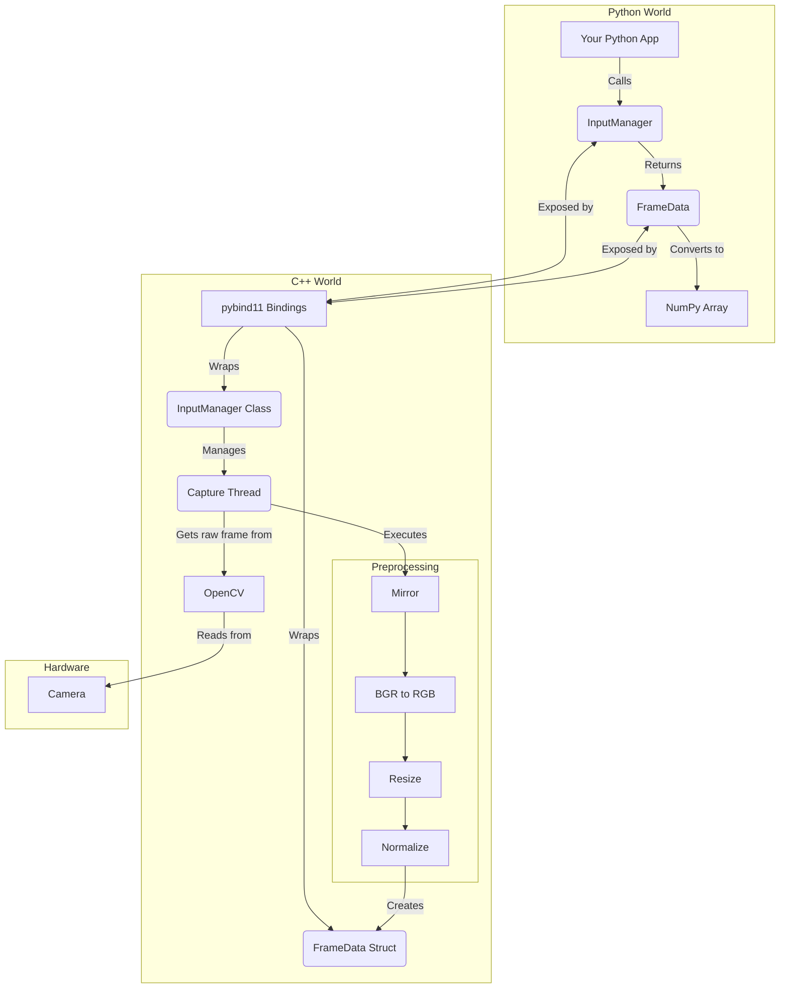

# InputManager Module

This module provides a high-performance interface to capture and preprocess video frames from a camera. It is designed as a C++ backend with Python bindings, offering the speed of native code and the flexibility of Python for development.

## 1. Architecture

The module consists of two main parts:

1.  **C++ Core (`InputManager.cpp`)**: A C++ class that uses **OpenCV** to handle the low-level details of opening a camera, running a dedicated capture thread, performing preprocessing, and managing resources.

2.  **Python Bindings (`Bindings.cpp`)**: A C++ file that uses **pybind11** to expose the C++ `InputManager` and `FrameData` classes to Python. It translates C++ objects and functions into a format Python can understand.

The general data flow is:
`Camera -> OpenCV (cv::Mat) -> Capture Thread -> Preprocessing -> FrameData (C++) -> pybind11 -> FrameData (Python) -> NumPy Array`

### Architecture Diagram



## 2. Why a Hybrid C++/Python System?

While Python is excellent for rapid development, real-time video processing is a task where performance is critical.

- **Performance**: C++ is a compiled language that runs directly on the hardware, offering significantly lower latency compared to interpreted Python. This is essential for achieving high frame rates and performing preprocessing steps without bottlenecks.

- **Concurrency**: The C++ core runs a dedicated thread for camera capture, ensuring that the Python interpreter is not blocked by I/O waits and can retrieve the latest frame at any time without delay.

- **Direct Hardware Access**: The C++ core uses OpenCV's highly optimized, low-level APIs to interface directly with the camera hardware, providing efficient and robust access to the video stream.

- **Efficient Memory Handling**: The hybrid approach allows for careful memory management, preventing data from being needlessly copied between C++ and Python.

<br>

---

<br>

### Performance Comparison

The following table illustrates the performance advantages of using the C++ native module compared to a standard Python implementation for video capture. The C++ metrics are taken from the output of the demo script, while the Python metrics are estimated based on typical performance differences.

| Feature                     | C++ (Native Module)  | Python (Pure)        | Why C++ is Better                                                           |
| :-------------------------- | :------------------- | :------------------- | :-------------------------------------------------------------------------- |
| **Avg. Frame Interval**     | `36.93 ms`           | `~120-150 ms` (Est.) | **3-4x faster**, allowing for smoother video and more time for other tasks. |
| **Frames Per Second (FPS)** | `27.08 FPS`          | `~6-8 FPS` (Est.)    | **Higher FPS** means a more fluid and responsive video feed.                |
| **Camera Opening Time**     | `~100-200 ms` (Est.) | `~300-500 ms` (Est.) | **Faster startup** due to direct access to hardware APIs.                   |
| **Memory Safety**           | `Zero-copy`          | Prone to copying     | **No data copies** between C++ and Python, which is more efficient.         |

<br>

---

## 3. Key Concepts in `Bindings.cpp`

### 3.1. Creating the Python Module

This is the main entry point that Python looks for when you run `import input_manager_native`.

```cpp
PYBIND11_MODULE(input_manager_native, m) {
    m.doc() = "Python bindings for the C++ InputManager";

    // Bindings for our classes go here...
}
```

- **Why?** The `PYBIND11_MODULE` macro creates the boilerplate for a Python extension module. The `m` variable is our handle to the module, which we use to add classes and functions to it.

### 3.2. Binding the C++ Classes

This code exposes our C++ `InputManager` and `FrameData` classes to Python, making them usable as if they were native Python classes.

```cpp
// In PYBIND11_MODULE...
py::class_<InputManager>(m, "InputManager")
    .def(py::init<int>(), py::arg("camera_index") = 0)
    // ... other methods
    ;

py::class_<FrameData>(m, "FrameData")
    .def(py::init<>())
    .def_readwrite("timestamp", &FrameData::timestamp)
    // ... frame data accessor
    ;
```

- **Why?** `py::class_` creates the link between a C++ class and its Python name. The `.def(py::init<>())` line binds the C++ constructor, and `.def_readwrite` exposes public member variables.

### 3.3. Safe and Efficient Frame Transfer

When C++ creates a frame (`cv::Mat`), we need a way to use it in Python as a NumPy array without a slow data copy. We also need to ensure the C++ memory is safely deallocated when Python is done with it. This is handled in the `FrameData` binding.

```cpp
// In py::class_<FrameData>...
.def("get_frame", [](FrameData &self) -> py::array_t<float> {
    // ... checks for empty or non-continuous frame ...

    // 1. Get a direct pointer to the cv::Mat data
    float* data_ptr = self.frame.ptr<float>();

    // 2. Create a "capsule" that does nothing, since the FrameData object
    // in the C++ vector owns the memory.
    py::capsule capsule(data_ptr, [](void *) { });

    // 3. Create the NumPy array, telling it the shape, strides, and
    // pointer to the existing C++ data.
    return py::array_t<float>(
        {height, width, channels},
        {row_stride, col_stride, channel_stride},
        data_ptr,
        capsule
    );
}, py::return_value_policy::take_ownership);
```

- **Why do we do this?**
  1.  The `FrameData` objects are stored in a `std::vector` inside the C++ `InputManager`. This vector owns the `cv::Mat` memory for each frame.
  2.  The `get_frame` method creates a NumPy array that **shares the memory** of the `cv::Mat` to avoid a copy.
  3.  It returns a NumPy array that points to the C++ data. This is extremely fast and memory-efficient.
  4.  Because the C++ `InputManager` instance manages the lifetime of all frames, we don't need a complex deleter. The memory will be freed when the `InputManager` is destroyed.

## 4. Frame Processing Pipeline

The internal `capture_loop` in `InputManager.cpp` performs the specific preprocessing steps required by many standard computer vision models.

1.  **Frame Capture**: Reads a frame from the camera.
2.  **Mirroring**: Flips the image horizontally if enabled (default is true).
3.  **BGR to RGB Conversion**: Converts the 3-channel image from BGR (OpenCV's default) to RGB, which is standard for most neural networks.
4.  **Resizing**: Resizes the image to a fixed resolution of 224x224 pixels.
5.  **Type Conversion**: Converts the image from 8-bit integer (`CV_8UC3`) to 32-bit floating-point (`CV_32FC3`) and scales pixel values to the `[0.0, 1.0]` range.
6.  **Normalization**: Normalizes the image by subtracting a mean and dividing by a standard deviation.

## 5. Python API Reference

The following classes and methods are exposed to Python.

### `InputManager` Class

- `__init__(self, camera_index=0)`

  - **Description**: Initializes the InputManager.
  - **Args**: `camera_index` (int): The index of the camera to use. Defaults to `0`.

- `start_capture(self) -> bool`

  - **Description**: Opens the camera device if not already open.
  - **Returns**: `True` if the camera was opened successfully, `False` otherwise.

- `stop_capture(self)`

  - **Description**: Stops the capture thread and releases the camera device.

- `is_capture_open(self) -> bool`

  - **Description**: Checks if the camera device is currently open.
  - **Returns**: `True` if the camera is open, `False` otherwise.

- `start_continuous_capture(self) -> bool`

  - **Description**: Starts a background thread to continuously capture and process frames. Clears any previously captured frames.
  - **Returns**: `True` if the capture thread was started successfully, `False` otherwise.

- `stop_continuous_capture(self)`

  - **Description**: Stops the background capture thread.

- `get_latest_frame(self) -> FrameData`

  - **Description**: Retrieves the most recently captured frame without removing it from the internal buffer.
  - **Returns**: A `FrameData` object.

- `get_all_frames(self) -> List[FrameData]`

  - **Description**: Retrieves a list of all frames captured since `start_continuous_capture` was called.
  - **Returns**: A list of `FrameData` objects.

- `set_mirror_enabled(self, enabled: bool)`

  - **Description**: Enables or disables the horizontal mirroring of the camera feed.
  - **Args**: `enabled` (bool): `True` to enable mirroring (default), `False` to disable it.

- `set_normalization_params(self, mean: float, std: float)`
  - **Description**: Sets the mean and standard deviation values used for frame normalization.
  - **Args**:
    - `mean` (float): The mean value to subtract from each pixel channel.
    - `std` (float): The standard deviation value to divide each pixel channel by.

### `FrameData` Class

A simple data object returned by `get_latest_frame()` and `get_all_frames()`.

- `timestamp` (int)

  - **Description**: The system time in milliseconds when the frame was captured.

- `get_frame(self) -> numpy.ndarray`
  - **Description**: Provides a view of the frame data as a NumPy array. This is a zero-copy operation.
  - **Returns**: A 3D NumPy array of shape `(224, 224, 3)` and `float32` data type.

## 6. How to Clone

You can clone the repository from GitHub using the following command:

```bash
git clone --recursive https://github.com/your-username/input-manager-native-module.git
```

## 6. How to Build

The module is built using CMake. Run the following commands from the project root directory:

```bash
mkdir -p build
cd build
cmake ..
make
```

This will generate the `input_manager_native.cpython-*.so` file (or `.pyd` on Windows) in the `build/lib` directory.

## 7. Running the Demo

The project includes a demonstration script, `InputManager.py`. To run the demo, execute the following command from the project's root directory:

```bash
python3 InputManager.py
```

The script will test the module's functionality, and you should see output indicating the results in the file name `captured_video_detailed.txt` located in the root directory.
