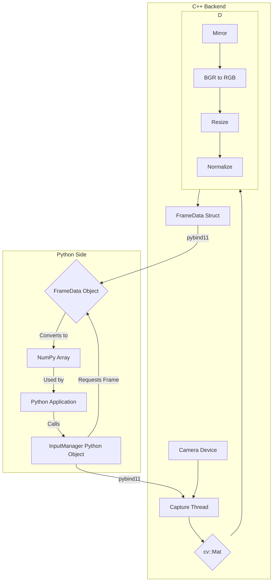

# InputManager Module

This module provides a high-performance interface to capture and preprocess video frames from a camera. It is designed as a C++ backend with Python bindings, offering the speed of native code and the flexibility of Python for development.

## 1. Architecture

The module consists of two main parts:

1.  **C++ Core (`InputManager.cpp`)**: A C++ class that uses the **OpenCV** library to handle the low-level details of opening a camera device, capturing frames in a separate thread, performing preprocessing, and managing resources.

2.  **Python Bindings (`Bindings.cpp`)**: A C++ file that uses the **pybind11** library to expose the C++ `InputManager` class and its related data structures to Python. It translates C++ objects and functions into a format Python can understand.

The general data flow is:
`Camera -> OpenCV (cv::Mat) -> Preprocessing (Resize, Normalize) -> C++ FrameData Struct -> pybind11 -> Python FrameData Object -> NumPy Array`

## 2. Workflow Diagram



## 3. Why a Hybrid C++/Python System?

While Python is excellent for rapid development, real-time video processing is a task where performance is critical.

- **Performance**: C++ is a compiled language that runs directly on the hardware, offering significantly lower latency compared to interpreted Python. This is essential for achieving high frame rates and performing preprocessing steps without bottlenecks.

- **Concurrency**: The C++ core uses a separate thread for video capture, ensuring the Python interpreter is not blocked while waiting for a new frame. This leads to a smoother and more responsive application.

- **Efficient Memory Handling**: The hybrid approach allows for careful memory management. Data is passed from C++ to Python using zero-copy techniques where possible, preventing slow and unnecessary data duplication.

## 4. Key Concepts in `Bindings.cpp`

### 4.1. Creating the Python Module

This is the main entry point that Python looks for when you run `import input_manager_native`.

```cpp
PYBIND11_MODULE(input_manager_native, m) {
    m.doc() = "Python bindings for the C++ InputManager";

    // Bindings for our classes and functions go here...
}
```

- **Why?** The `PYBIND11_MODULE` macro creates the boilerplate for a Python extension module. The `m` variable is our handle to the module, which we use to add classes and functions to it.

### 4.2. Binding the C++ Class and its Constructor

This code exposes our C++ `InputManager` class to Python, making it usable as if it were a native Python class.

```cpp
py::class_<InputManager>(m, "InputManager")
    .def(py::init<int>(), py::arg("camera_index") = 0);
```

- **Why?** `py::class_` creates the link between the C++ `InputManager` and the Python name `"InputManager"`. The `.def(py::init<>())` line specifically binds the C++ constructor, and `py::arg(...)` gives the Python argument a name and a default value, making the API more user-friendly.

### 4.3. Efficient Data Transfer with Zero-Copy

When C++ creates a frame, we want to share its memory with a NumPy array in Python without making a slow copy. The `FrameData` class binding achieves this using a `py::capsule` to safely manage the memory lifetime.

```cpp
py::class_<FrameData>(m, "FrameData")
    // ...
    .def("get_frame", [](FrameData &self) -> py::array_t<float> {
        // ... checks for empty or non-continuous frame ...

        // 1. Get a pointer to the raw C++ data
        float* data_ptr = self.frame.ptr<float>();

        // 2. Create a capsule to manage the memory lifetime
        py::capsule capsule(data_ptr, [](void *) { });

        // 3. Create a NumPy array that uses the C++ memory directly
        return py::array_t<float>(
            {height, width, channels},
            {row_stride, col_stride, channel_stride},
            data_ptr,
            capsule
        );
    }, py::return_value_policy::take_ownership);
```

- **Why do we do this?**
  1. We get a pointer to the `cv::Mat` data in C++.
  2. We want to create a NumPy array that **shares the memory** of that `cv::Mat`.
  3. The `py::capsule` tells Python's garbage collector how to handle this C++-allocated memory. In this case, since the `FrameData` object owns the memory, the capsule's destructor is empty, but it ensures the NumPy array doesn't try to deallocate the memory on its own.
  4. This is a standard, safe, and efficient way to expose C++ data to Python without performance penalties.

## 5. Frame Processing Pipeline

When continuous capture is running, the background thread performs the following preprocessing steps for each frame:

1.  **Frame Capture**: Reads a frame from the camera.
2.  **Mirroring**: Flips the image horizontally if enabled (default is true).
3.  **BGR to RGB Conversion**: Converts the 3-channel image from the BGR color space (OpenCV's default) to the RGB color space, which is standard for most neural networks.
4.  **Resizing**: Resizes the image to a fixed resolution of 224x224 pixels.
5.  **Type Conversion**: Converts the image from 8-bit integer (`CV_8UC3`) to 32-bit floating-point (`CV_32FC3`) and scales pixel values from the `[0, 255]` range to the `[0.0, 1.0]` range.
6.  **Normalization**: Normalizes the floating-point image by subtracting a mean and dividing by a standard deviation.

## 6. Python API Reference

### The `InputManager` Class

- `__init__(self, camera_index=0)`

  - **Description**: Initializes the InputManager.
  - **Args**: `camera_index` (int): The index of the camera to use. Defaults to `0`.

- `start_capture(self) -> bool`

  - **Description**: Opens the camera device. This is called automatically by `start_continuous_capture`.
  - **Returns**: `True` if the camera was opened successfully, `False` otherwise.

- `stop_capture(self)`

  - **Description**: Releases the camera device. This is called automatically by `stop_continuous_capture`.

- `is_capture_open(self) -> bool`

  - **Description**: Checks if the camera capture is currently open.
  - **Returns**: `True` if the camera is open, `False` otherwise.

- `start_continuous_capture(self) -> bool`

  - **Description**: Starts a background thread that continuously captures and processes frames.
  - **Returns**: `True` on success.

- `stop_continuous_capture(self)`

  - **Description**: Stops the background capture thread and releases the camera.

- `get_latest_frame(self) -> FrameData`

  - **Description**: Retrieves the most recently captured and processed frame.
  - **Returns**: A `FrameData` object.

- `get_all_frames(self) -> list[FrameData]`

  - **Description**: Retrieves a list of all frames captured since `start_continuous_capture` was called.
  - **Returns**: A list of `FrameData` objects.

- `set_mirror_enabled(self, enabled: bool)`

  - **Description**: Enables or disables the horizontal mirroring of the camera feed.
  - **Args**: `enabled` (bool): `True` to enable mirroring (default), `False` to disable it.

- `set_normalization_params(self, mean: float, std: float)`
  - **Description**: Sets the mean and standard deviation values used for frame normalization.
  - **Args**:
    - `mean` (float): The mean value to subtract from each pixel channel.
    - `std` (float): The standard deviation value to divide each pixel channel by.

### The `FrameData` Object

This object is returned by `get_latest_frame()` and `get_all_frames()`. It contains the processed frame data and associated metadata.

- `timestamp` (long)
  - The system timestamp (in milliseconds) when the frame was captured.
- `get_frame(self) -> numpy.ndarray`
  - **Returns**: The frame data as a 3D NumPy array of shape `(224, 224, 3)` and `float32` data type.

## 7. How to Build

The module is built using CMake. Run the following commands from the project root directory:

```bash
mkdir -p build
cd build
cmake ..
make
```

This will generate the `input_manager_native.cpython-*.so` file (or `.pyd` on Windows) in the `build/lib` directory.

## 8. Running the Demo

The project includes a demonstration script, `InputManager.py`. To run the demo, execute the following command from the project's root directory:

```bash
python3 InputManager.py
```

The script will test the module's functionality, and you should see output indicating the results in the file name `captured_video_detailed.txt` located in the root directory.

