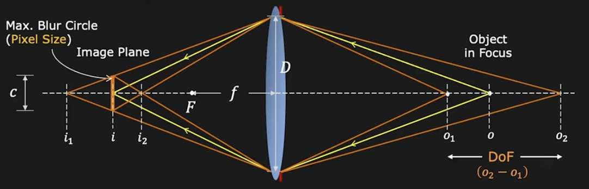
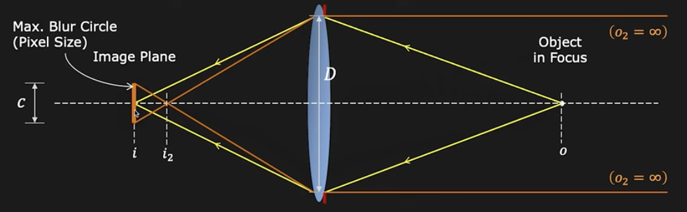

# Depth of Field | Image Formation

It is the range of object distances over which the image is **sufficiently well** focused, i.e, range over which blur _b_ is less than pixel size.

If $o_1$ and $o_2$ are the nearest and farthest distances respectively for which blur circle is maximum $c$, then:

$$
c = \frac{f^2 (o - o_{1})}{No_{1}(o - f)}
$$

$$
c = \frac{f^2 (o_{2} - o)}{No_{2}(o - f)}
$$

Thus we obtain the **Depth of Field**:

$$
o_2 = o_1 = \frac{2of^{2}cN(o - f)}{f^4 - c^2 N^2 (o - f)^2}
$$

> [!NOTE]
> The closer you get to the lens, the defocus is going to increase more rapidly.

## Hyperfocal Distance

The closest distance $o = h$ the lens must be focused to keep objects at infinity ($o_2 = \infty$) acceptably sharp (blur circle $\leq c$).

Thus we obtain the **Hyperfocal Distance**:

$$
h = \frac{f^2}{Nc} + f
$$

where:

- $f$: focal length
- $N$: f-Number
- $c$: size of the pixel

> [!NOTE]
> Using the hyperfocal distance allows all points beyond the _object in Focus_ to be in focus, only the points that are closer to the lens are going to be out of focus.

## Aperture Size: DOF vs. Brightness

- **Large** Aperture (**Small** f-Number)
  - **Bright** Image or **Short** Exposure time
  - **Shallow** Depth of Field
- **Small** Aperture (**Large** f-Number)
  - **Dark** Image or **Long** Exposure Time
  - **Large** Depth of Field

[Depth of Field | Image Formation](https://youtu.be/v5OE90eVIXo?si=LFgVbKNd8qt8fLtY)
