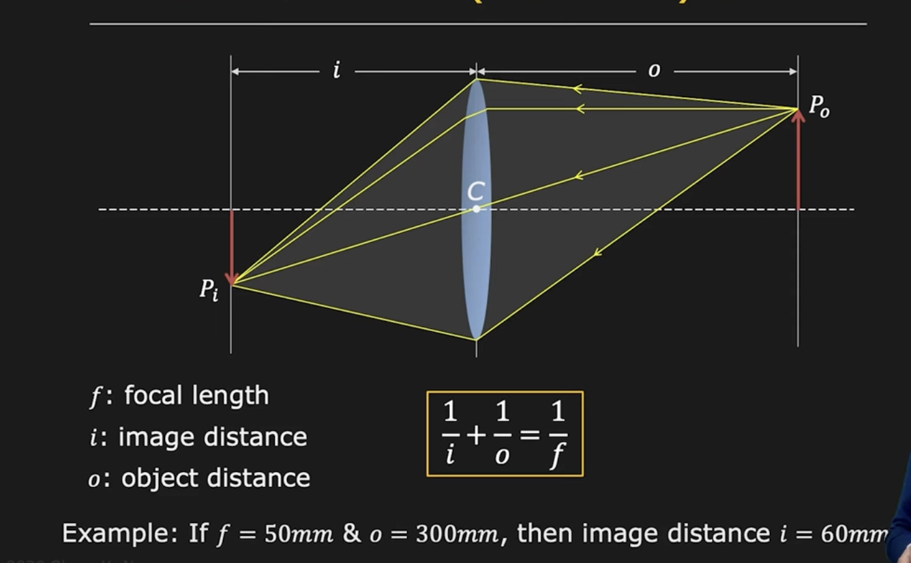
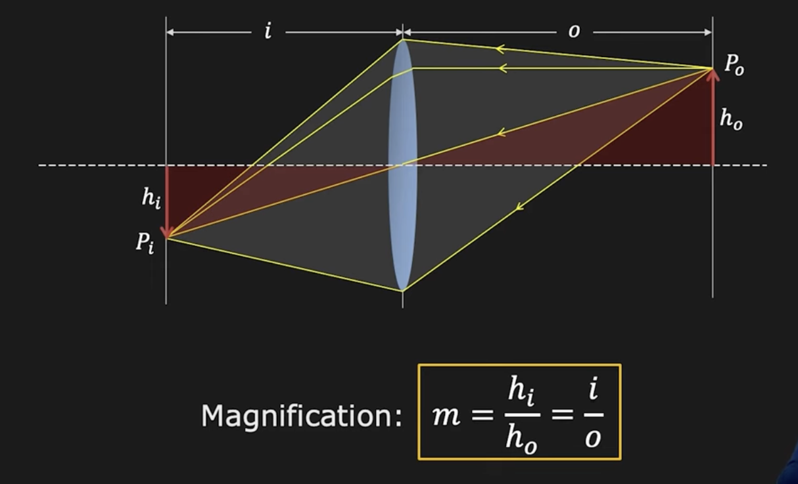
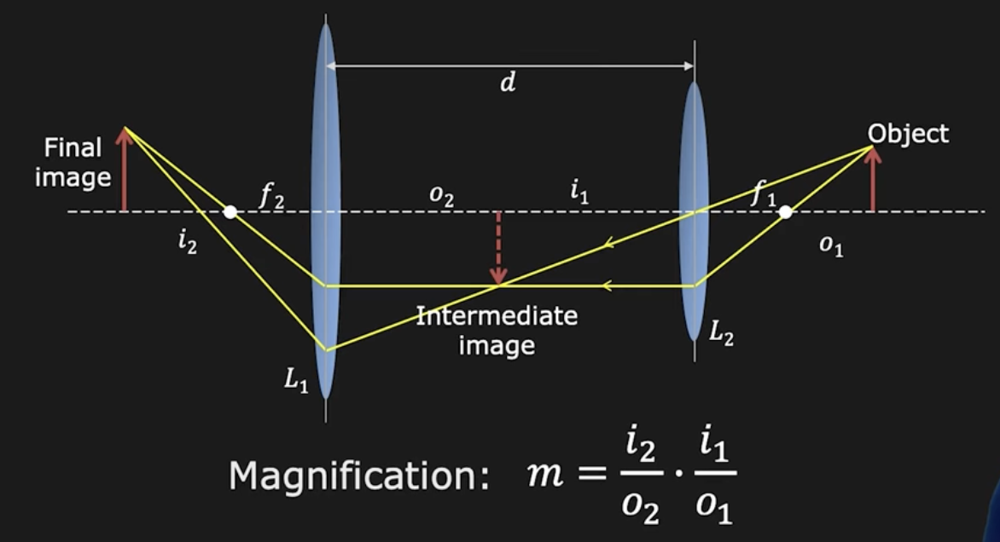
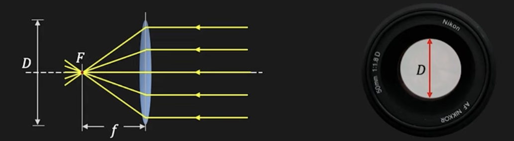
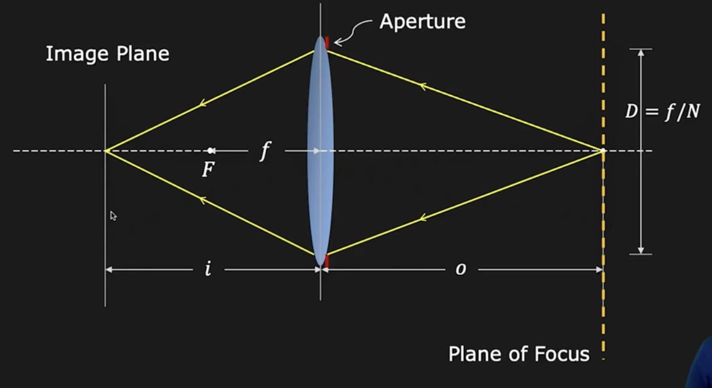
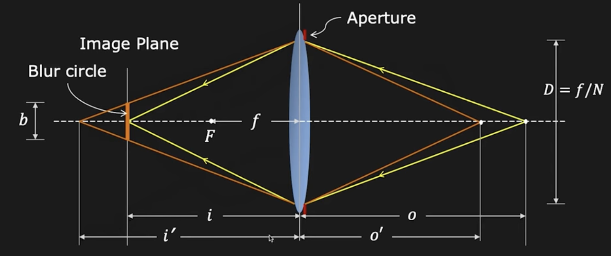
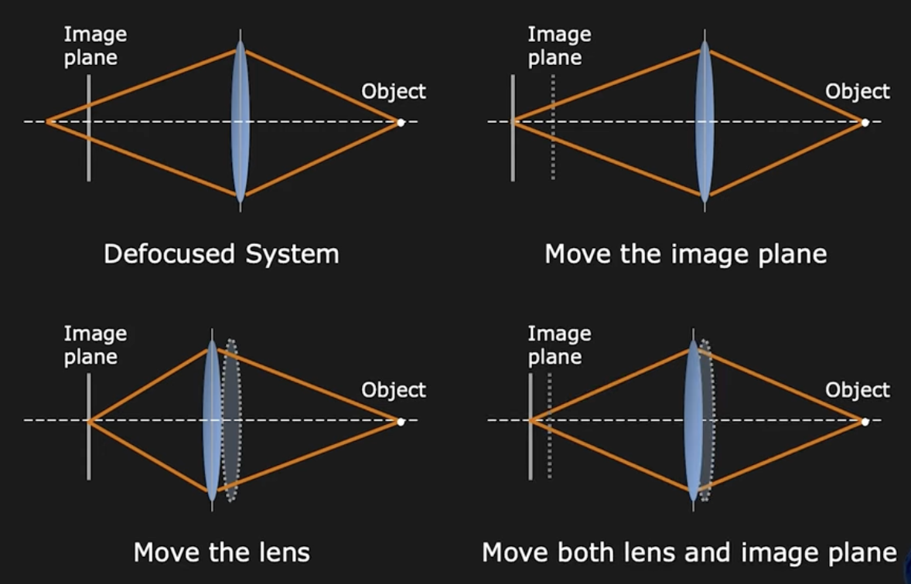

# Image Formation Using Lenses

Lenses provides the same kind of projection as _pinholes_, but they gather more light.

> [!NOTE]
> The lens' bending power is determined by the **Focal length ($f$)**.

## Gaussian Lens (Thin Lens) Law

> [!NOTE]
> When using a point that is far away in the scene such that $o$ tends to infinity, then the distance between the focused image and the lens is the **focal length**.

## Image Magnification

### Two Lens System

> [!NOTE]
> **Zooming** is the process of moving lenses to change the _magnification_.

### Aperture of Lens

The aperture is the light receiving area of lens, it is indicated by the lens diameter.

> [!NOTE]
> Aperture can be reduced/increased to control image brightness.

#### f-number (f-stop, f-ratio) of Lens

It is convenient to represent the _aperture_ as a fraction of _focal length_.

- Aperture: $D = \frac{f}{N}$
- f-Number: $N = \frac{f}{D}$
  where $N$ is called teh **f-Number** of lens.

### Lens Defocus

> [!WARNING]
> Even though the lens gathers more light, but there is only one point in the plane that is perfectly focused onto the image plane.

When a point lie outside of the _plane of focus_, the light that the lens receives from the point ends up being distributed over a circular disc rather than a single point. It is called the **blur circle**.

From similar triangles we obtain:

$$
\frac{b}{D} = \frac{|i' - i|}{i'}
$$

Blur circle diameter:

$$
b = \frac{D}{i'} |i' - i|
b \propto D \propto \frac{1}{M}
$$

### Focusing an Imaging System

We can accomplish this by 3 methods:

- Moving the image plane
- Moving the lens
- Moving both the image plane and the lens

