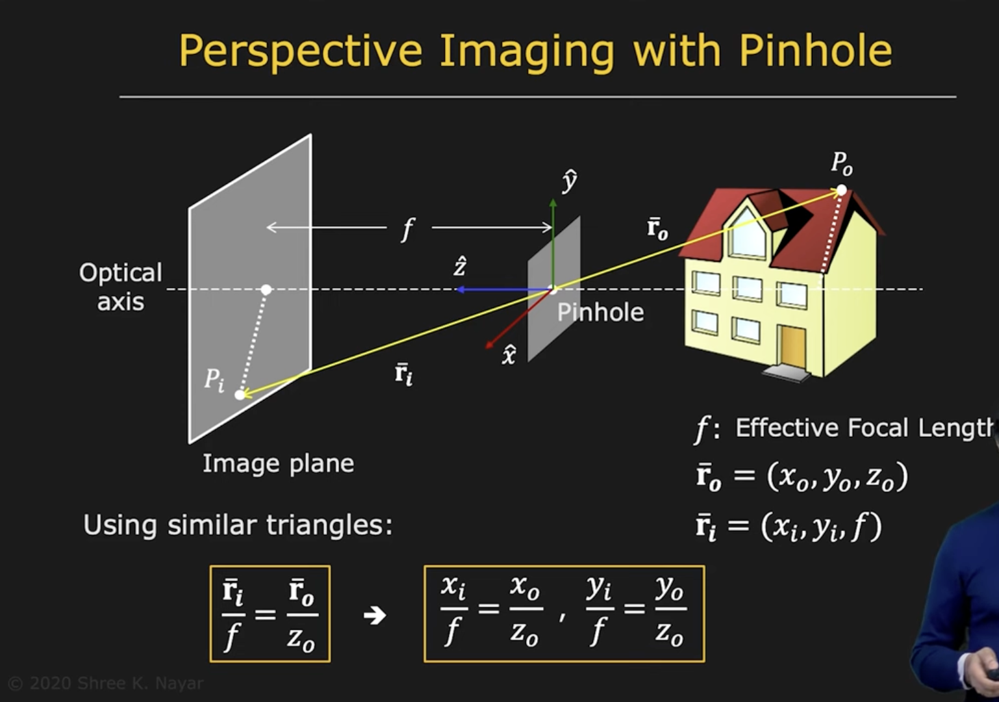
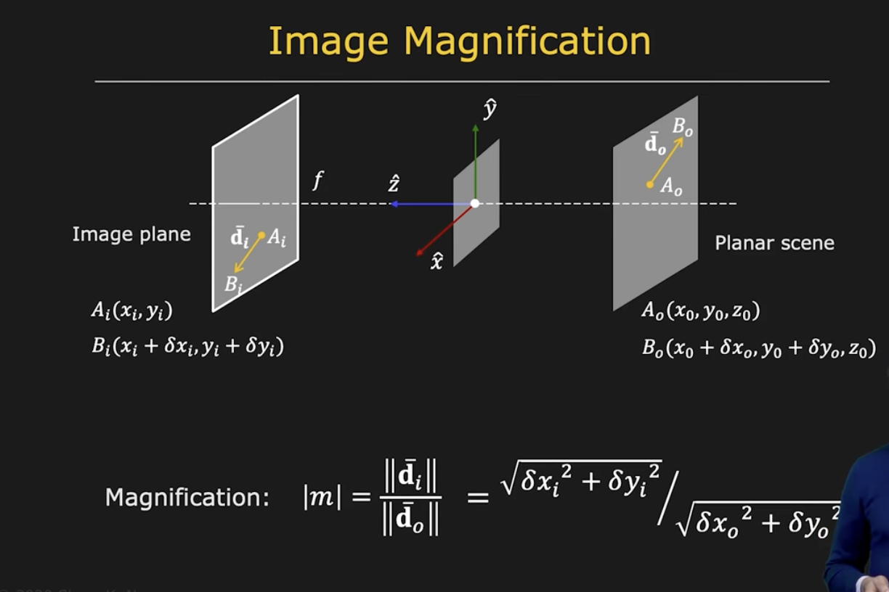
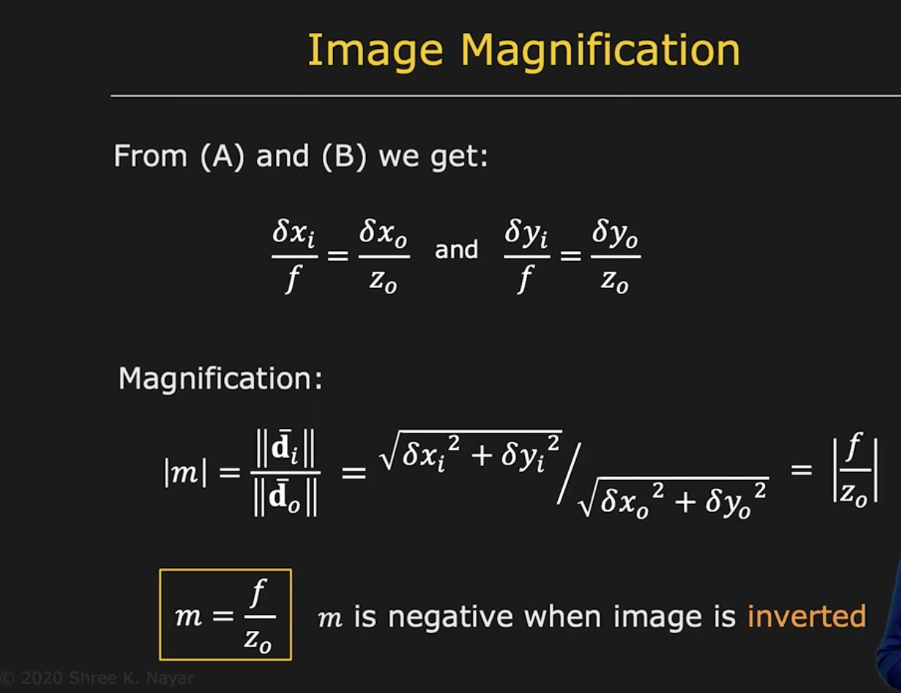

# Pinhole and Perspective Projection

## Image Formation

A clear image of an object can be created on a screen (two dimensional plane) using a **_pinhole_**.

> [!NOTE]
> The projection of a line in 3D must be a line in 2D.

## Image Magnification

> [!NOTE]
> $m$ can be assumed to be **constant** if the range of scene depth $\Delta z$ is much smaller than the average scene depth $z$. In other words, when the distance of an object is much smaller in comparison to its size, the magnification is constant.

## Vanishing Point

Phenomenon where parallel straight lines converge at a single image point.

The location of the _Vanishing Point_ depends on the **orientation** of the parallel straight lines.

### Finding the _Vanishing Point_

Since all parallel lines in 3D share the same vanishing point, in order to find the _Vanishing Point_ , we only need to construct a new parallel line that is parallel to any two lines in the considered space.

### Diffraction

A pinhole must be **tiny**, but if it's too tiny itll will cause **diffraction**.

Ideal pinhole diameter:
$$d \approx 2 \sqrt{f\lambda}$$
where:

- $f$: effective focal length
- $\lambda$: wavelength

## Exposure Time

Pinholes pass less light and hence require **long exposures** to capture bright images.

> [!IMPORTANT]
> For any real world computer vision application, waiting to capture a single frame will be problematic, that is the reason we use lenses.
