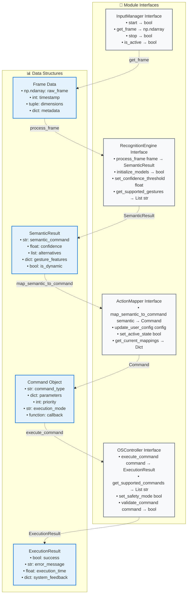
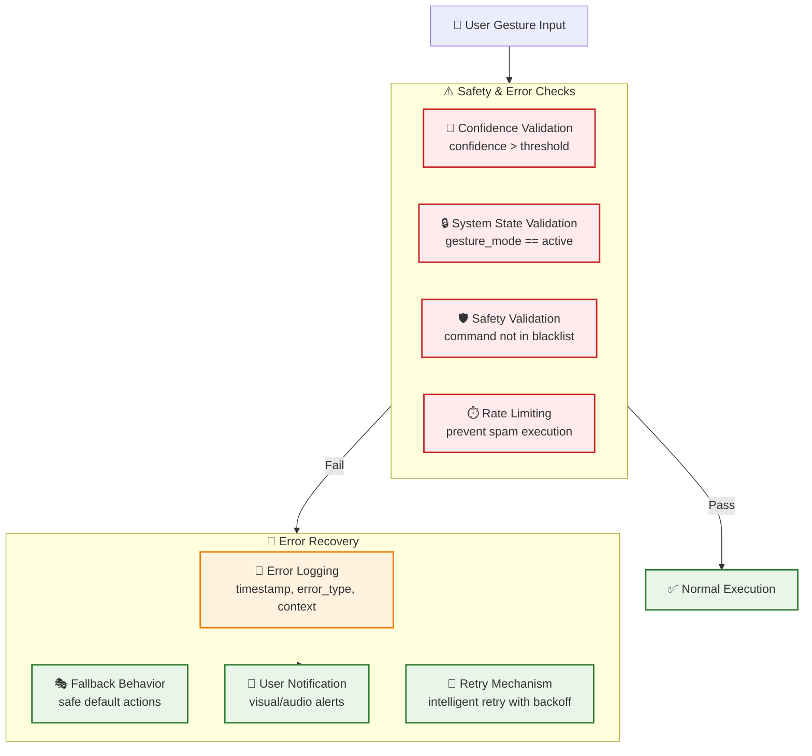
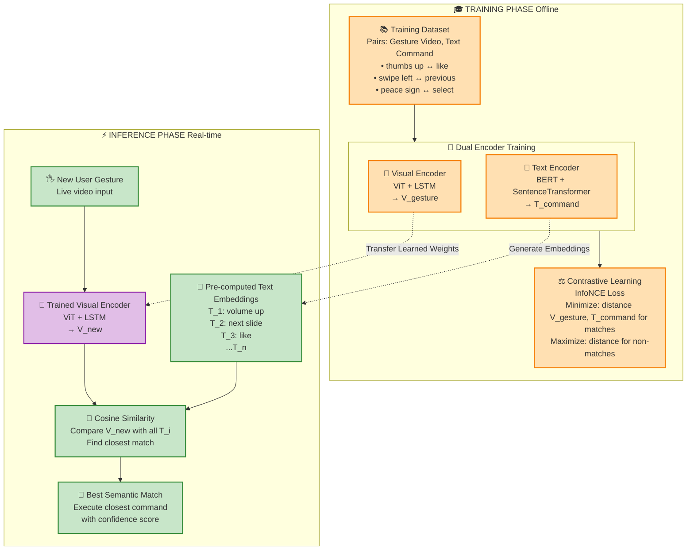

# Detailed System Architecture Diagram

This document provides a comprehensive visual representation of the Hand Gesture Recognition System, showing all components of the four core modules in detail. The diagram illustrates how each component works together to achieve semantic gesture understanding and OS control.

## Project Overview

This project implements a **Semantic Gesture Recognition Engine** that moves beyond traditional landmark-based approaches to achieve genuine understanding of user intent. The system uses state-of-the-art deep learning models (Vision Transformer, LSTM, BERT) within a hybrid framework inspired by HAVIT and ALBEF to create a shared semantic space for gestures and commands.

## System Overview Diagram

```mermaid
flowchart LR
    %% Styling
    classDef inputModule fill:#e1f5fe,stroke:#0277bd,stroke-width:3px
    classDef recognitionModule fill:#f3e5f5,stroke:#7b1fa2,stroke-width:3px
    classDef actionModule fill:#e8f5e8,stroke:#2e7d32,stroke-width:3px
    classDef osModule fill:#fff3e0,stroke:#ef6c00,stroke-width:3px
    classDef dataArrow fill:none,stroke:#424242,stroke-width:2px

    %% Main Modules
    INPUT["📹 INPUT MANAGER<br/>• Camera capture<br/>• Frame preprocessing<br/>• OpenCV integration"]:::inputModule

    RECOGNITION["🤖 RECOGNITION ENGINE<br/>• Hand detection MediaPipe<br/>• Feature extraction ViT<br/>• Semantic understanding ALBEF"]:::recognitionModule

    ACTION["🎛️ ACTION MAPPER<br/>• Command translation<br/>• State management<br/>• User configuration"]:::actionModule

    OS["💻 OS CONTROLLER<br/>• Cross-platform execution<br/>• Keyboard/mouse control<br/>• System integration"]:::osModule

    %% Data Flow
    INPUT -->|"Raw Video Frames"| RECOGNITION
    RECOGNITION -->|"Semantic Commands<br/>volume up, next slide"| ACTION
    ACTION -->|"Standardized Commands<br/>VOLUME_UP, NEXT_SLIDE"| OS
    OS -->|"System Actions"| OUTPUT["🎯 System Output<br/>User sees results"]

    %% User Interaction
    USER["👤 User<br/>Hand Gestures"] -->|"Video Stream"| INPUT
    OUTPUT -.->|"Visual/Audio Feedback"| USER
```

## Complete System Architecture

```mermaid
graph TB
    %% Styling
    classDef inputModule fill:#e1f5fe,stroke:#0277bd,stroke-width:3px
    classDef recognitionModule fill:#f3e5f5,stroke:#7b1fa2,stroke-width:3px
    classDef actionModule fill:#e8f5e8,stroke:#2e7d32,stroke-width:3px
    classDef osModule fill:#fff3e0,stroke:#ef6c00,stroke-width:3px
    classDef precompute fill:#fce4ec,stroke:#c2185b,stroke-width:2px
    classDef dataflow fill:#f5f5f5,stroke:#424242,stroke-width:1px
    classDef semantic fill:#e0f2f1,stroke:#00695c,stroke-width:2px

    %% Precomputation Phase (System Initialization)
    subgraph PRECOMP ["🚀 PRECOMPUTATION PHASE System Startup"]
        direction TB
        CMD_LIST["📝 Pre-defined Text Commands<br/>• volume up<br/>• next slide<br/>• like<br/>• scroll down<br/>• mouse click<br/>• etc."]:::precompute

        SENT_TRANS["🧠 SentenceTransformer<br/>Text Embedding Model<br/>BERT-based: all-MiniLM-L6-v2"]:::precompute

        TEXT_EMBEDDINGS["🎯 Precomputed Text Embeddings<br/>T_command1, T_command2, ..., T_n<br/>Semantic Vector Space"]:::precompute

        CMD_LIST --> SENT_TRANS
        SENT_TRANS --> TEXT_EMBEDDINGS
    end

    %% Real-time Processing Pipeline
    subgraph REALTIME ["⚡ REAL-TIME PROCESSING PIPELINE"]

        %% INPUT MANAGER MODULE
        subgraph INPUT_MGR ["📹 1. INPUT MANAGER MODULE"]
            direction TB
            CAMERA["🎥 Camera Hardware<br/>Webcam/Built-in Camera"]:::inputModule

            CV_CAPTURE["📡 OpenCV VideoCapture<br/>• cv2.VideoCapture device_id<br/>• Resolution config width/height<br/>• Frame rate optimization"]:::inputModule

            FRAME_PROC["🔄 Frame Processing<br/>• Continuous frame reading<br/>• Horizontal flip mirror effect<br/>• Thread-safe frame access<br/>• Frame buffering"]:::inputModule

            INPUT_API["🔌 Input Manager Interface<br/>• start - Initialize camera<br/>• get_frame - Latest frame<br/>• stop - Release resources"]:::inputModule

            CAMERA --> CV_CAPTURE
            CV_CAPTURE --> FRAME_PROC
            FRAME_PROC --> INPUT_API
        end

        %% RECOGNITION ENGINE MODULE
        subgraph REC_ENGINE ["🤖 2. RECOGNITION ENGINE MODULE"]
            direction TB

            %% Hand Detection Submodule
            subgraph HAND_DETECT ["🖐️ Hand Detection Submodule"]
                MEDIAPIPE["📋 MediaPipe Hands<br/>• Hand localization<br/>• Bounding box extraction<br/>• Multi-hand support<br/>• Confidence scoring"]:::recognitionModule

                HAND_CROP["✂️ Hand Region Cropping<br/>• Extract hand ROI<br/>• Normalize dimensions<br/>• Image preprocessing"]:::recognitionModule

                MEDIAPIPE --> HAND_CROP
            end

            %% Gesture Classification Submodule
            subgraph GESTURE_CLASS ["🎭 Gesture Classification Submodule"]
                STATIC_DYNAMIC["🔀 Static vs Dynamic<br/>Gesture Detection<br/>• Motion analysis<br/>• Temporal windowing"]:::recognitionModule

                %% Static Path
                subgraph STATIC_PATH ["📸 Static Gesture Path"]
                    STATIC_FRAME["🖼️ Single Frame<br/>Extraction"]:::recognitionModule

                    VIT_STATIC["🔍 Vision Transformer ViT<br/>• ViT-B/16 pre-trained<br/>• ImageNet-21k features<br/>• Patch-based processing<br/>• Global attention mechanism<br/>• 768-dim feature vector"]:::recognitionModule

                    STATIC_FEATURES["📊 Static Feature Vector<br/>768-dimensional"]:::recognitionModule

                    STATIC_FRAME --> VIT_STATIC
                    VIT_STATIC --> STATIC_FEATURES
                end

                %% Dynamic Path
                subgraph DYNAMIC_PATH ["🎬 Dynamic Gesture Path"]
                    FRAME_SEQ["🎞️ Frame Sequence<br/>Extraction<br/>T frames"]:::recognitionModule

                    VIT_DYNAMIC["🔍 ViT Feature Extraction<br/>Per Frame<br/>• Process each frame<br/>• Temporal consistency<br/>• Rich visual features"]:::recognitionModule

                    LSTM_PROC["🧠 LSTM Temporal Processing<br/>• Sequence modeling<br/>• Memory cells & gates<br/>• Long-range dependencies<br/>• Motion understanding"]:::recognitionModule

                    DYNAMIC_FEATURES["📊 Dynamic Feature Vector<br/>Context + Temporal info"]:::recognitionModule

                    FRAME_SEQ --> VIT_DYNAMIC
                    VIT_DYNAMIC --> LSTM_PROC
                    LSTM_PROC --> DYNAMIC_FEATURES
                end

                STATIC_DYNAMIC --> STATIC_PATH
                STATIC_DYNAMIC --> DYNAMIC_PATH
            end

            %% Semantic Understanding Submodule
            subgraph SEMANTIC_UNDERSTAND ["🧩 Semantic Understanding ALBEF-inspired"]
                VISUAL_EMBED["🎨 Visual Embedding Vector<br/>V_gesture<br/>Unified representation"]:::semantic

                COSINE_SIM["📐 Cosine Similarity Matching<br/>• Compare V_gesture with all T_commands<br/>• Find closest semantic match<br/>• Confidence scoring"]:::semantic

                SEMANTIC_RESULT["🎯 Semantic Match Result<br/>• Best matching command<br/>• Confidence score<br/>• Alternative candidates"]:::semantic

                STATIC_FEATURES --> VISUAL_EMBED
                DYNAMIC_FEATURES --> VISUAL_EMBED
                VISUAL_EMBED --> COSINE_SIM
                COSINE_SIM --> SEMANTIC_RESULT
            end

            HAND_CROP --> STATIC_DYNAMIC
        end

        %% ACTION MAPPER MODULE
        subgraph ACTION_MAP ["🎛️ 3. ACTION MAPPER MODULE"]
            direction TB

            CMD_MAPPING["🗺️ Command Mapping Logic<br/>• Semantic text → Command ID<br/>• Dictionary/lookup table<br/>• Custom user mappings<br/>• Priority handling"]:::actionModule

            STATE_MGR["🔄 State Management<br/>• Activation/deactivation control<br/>• Gesture mode switching<br/>• Context awareness<br/>• Timeout handling"]:::actionModule

            CONFIG_MGR["⚙️ Configuration Manager<br/>• User customization<br/>• Gesture-to-action mapping<br/>• Sensitivity settings<br/>• Profile management"]:::actionModule

            ACTION_CMD["📤 Action Command Output<br/>• Standardized command format<br/>• Parameters & metadata<br/>• Execution priority"]:::actionModule

            CMD_MAPPING --> STATE_MGR
            STATE_MGR --> CONFIG_MGR
            CONFIG_MGR --> ACTION_CMD
        end

        %% OS CONTROLLER MODULE
        subgraph OS_CTRL ["💻 4. OS CONTROLLER MODULE"]
            direction TB

            %% Platform Interface Submodule
            subgraph PLATFORM_INT ["🖥️ Platform Interface"]
                CROSS_PLATFORM["🌐 Cross-Platform Abstraction<br/>• Windows/macOS/Linux support<br/>• API standardization<br/>• Platform detection"]:::osModule

                LIB_MGR["📚 Library Manager<br/>• pyautogui for cross-platform<br/>• pynput for advanced input<br/>• Platform-specific optimizations"]:::osModule

                CROSS_PLATFORM --> LIB_MGR
            end

            %% Execution Engine Submodule
            subgraph EXEC_ENGINE ["⚡ Execution Engine"]
                KEYBOARD_CTRL["⌨️ Keyboard Control<br/>• Key press simulation<br/>• Modifier combinations<br/>• Hotkey sequences<br/>• Text input"]:::osModule

                MOUSE_CTRL["🖱️ Mouse Control<br/>• Cursor movement<br/>• Click simulation<br/>• Drag & drop<br/>• Scroll operations"]:::osModule

                MEDIA_CTRL["🎵 Media Control<br/>• Volume adjustment<br/>• Playback control<br/>• Track navigation<br/>• System sounds"]:::osModule

                SYS_CTRL["🔧 System Control<br/>• Application switching<br/>• Window management<br/>• Brightness control<br/>• Power management"]:::osModule
            end

            OS_INTERFACE["🔌 OS Interface<br/>• Command execution<br/>• Error handling<br/>• Feedback system<br/>• Safety mechanisms"]:::osModule

            LIB_MGR --> EXEC_ENGINE
            EXEC_ENGINE --> OS_INTERFACE
        end
    end

    %% Data Flow Connections
    INPUT_API -.->|"Raw Frame Data"| MEDIAPIPE
    TEXT_EMBEDDINGS -.->|"Precomputed Embeddings"| COSINE_SIM
    SEMANTIC_RESULT -->|"Semantic Command<br/>e.g., volume up"| CMD_MAPPING
    ACTION_CMD -->|"Standardized Command<br/>e.g., VOLUME_UP"| CROSS_PLATFORM
    OS_INTERFACE -->|"System Execution"| OS_OUTPUT["🎯 System Output<br/>• Volume changes<br/>• Mouse movements<br/>• Application control<br/>• Media playback"]:::dataflow

    %% External Connections
    CAMERA -.->|"Video Stream"| CV_CAPTURE
    OS_OUTPUT -.->|"User Feedback"| USER["👤 User"]:::dataflow
    USER -.->|"Hand Gestures"| CAMERA
```

## Component Interfaces and Data Flow

## Error Handling and Safety Mechanisms

## Module Breakdown

### 1. Input Manager Module 📹

**Purpose**: Capture and preprocess video frames from camera hardware

**Key Components**:

- **Camera Hardware Interface**: Direct connection to webcam/built-in camera
- **OpenCV VideoCapture**: Low-level video capture with configurable resolution and frame rate
- **Frame Processing**: Continuous frame reading with mirror effect and thread-safe access
- **API Interface**: Clean abstraction with start(), get_frame(), stop() methods

**Technical Details**:

- Uses `cv2.VideoCapture` for camera access
- Implements frame buffering for smooth operation
- Horizontal flip for intuitive mirror effect
- Thread-safe frame access for multi-module usage

### 2. Recognition Engine Module 🤖

**Purpose**: Core AI module performing semantic gesture recognition

**Key Components**:

#### Hand Detection Submodule 🖐️

- **MediaPipe Integration**: Efficient hand localization and bounding box extraction
- **Hand Region Cropping**: Precise ROI extraction with normalization

#### Gesture Classification Submodule 🎭

- **Static/Dynamic Detection**: Intelligent routing based on motion analysis
- **Vision Transformer (ViT)**: State-of-the-art visual feature extraction using ViT-B/16 pre-trained on ImageNet-21k
- **LSTM Processing**: Advanced temporal modeling for dynamic gestures

#### Semantic Understanding Submodule 🧩

- **Visual Embedding**: Unified representation of gesture features
- **Cosine Similarity Matching**: Semantic comparison with precomputed text embeddings
- **ALBEF-Inspired Architecture**: Cross-modal alignment between vision and language

**Technical Innovation**:

- Moves beyond landmark-based approaches to full image understanding
- Implements semantic grounding through contrastive learning
- Enables zero-shot gesture recognition through language understanding

### 3. Action Mapper Module 🎛️

**Purpose**: Bridge between semantic understanding and system commands

**Key Components**:

- **Command Mapping Logic**: Translates semantic text to standardized command IDs
- **State Management**: Controls gesture system activation/deactivation and context awareness
- **Configuration Manager**: Handles user customization and gesture-to-action mappings
- **Command Standardization**: Ensures consistent output format for OS Controller

**Features**:

- User-customizable gesture mappings
- Context-aware state management
- Priority handling for conflicting gestures
- Timeout mechanisms for gesture sessions

### 4. OS Controller Module 💻

**Purpose**: Execute commands on the host operating system

**Key Components**:

#### Platform Interface 🖥️

- **Cross-Platform Abstraction**: Unified interface for Windows/macOS/Linux
- **Library Management**: Optimized use of pyautogui, pynput, and platform-specific APIs

#### Execution Engine ⚡

- **Keyboard Control**: Key press simulation, modifier combinations, text input
- **Mouse Control**: Cursor movement, clicking, dragging, scrolling
- **Media Control**: Volume, playback, track navigation
- **System Control**: Application switching, window management, brightness

**Safety Features**:

- Error handling and recovery mechanisms
- User feedback systems
- Safety mechanisms to prevent unintended actions

## Data Flow Architecture

### Precomputation Phase 🚀

1. **Command Definition**: System loads predefined text commands
2. **Text Encoding**: SentenceTransformer processes commands into semantic vectors
3. **Embedding Storage**: Precomputed embeddings stored for real-time comparison

### Real-time Processing ⚡

1. **Frame Capture**: Input Manager captures and preprocesses video frames
2. **Hand Detection**: MediaPipe locates and crops hand regions
3. **Feature Extraction**: ViT processes hand images into rich feature vectors
4. **Temporal Analysis**: LSTM models dynamic gesture sequences
5. **Semantic Matching**: Cosine similarity finds closest command match
6. **Command Mapping**: Action Mapper translates semantic results to system commands
7. **OS Execution**: OS Controller executes commands through platform-specific APIs

## Key Innovations

### 1. Semantic Understanding 🧠

- **Problem Solved**: Traditional systems use rigid gesture-to-action mappings
- **Our Solution**: Learn semantic relationships between gestures and natural language commands
- **Benefit**: Flexible, extensible system that understands meaning, not just patterns

### 2. Vision Transformer Integration 🔍

- **Problem Solved**: Landmark-based methods lose visual context and are brittle
- **Our Solution**: Use entire hand image with global attention mechanisms
- **Benefit**: More robust recognition with better handling of variations

### 3. Cross-Modal Architecture 🌉

- **Problem Solved**: Gesture and command spaces are typically disconnected
- **Our Solution**: Shared semantic vector space using contrastive learning
- **Benefit**: Zero-shot learning potential and natural language extensibility

### 4. Modular Design 🧩

- **Problem Solved**: Monolithic gesture recognition systems are hard to maintain
- **Our Solution**: Clean separation of concerns with well-defined interfaces
- **Benefit**: Easy testing, debugging, and future enhancements

## Training vs Inference Pipeline

## System Benefits

1. **Higher Accuracy**: ViT-based approach captures nuanced visual features
2. **Improved Robustness**: Handles lighting variations, occlusions, and hand variations
3. **Semantic Flexibility**: Commands can be expressed in natural language variations
4. **Easy Extensibility**: Adding new gestures/commands requires minimal code changes
5. **Cross-Platform**: Works across different operating systems
6. **User Customization**: Configurable gesture-to-action mappings

## Technical Stack Summary

- **Visual Processing**: Vision Transformer (ViT-B/16), MediaPipe Hands
- **Temporal Modeling**: LSTM networks
- **Text Processing**: BERT-based SentenceTransformer (all-MiniLM-L6-v2)
- **Similarity Matching**: Cosine similarity, contrastive loss functions
- **System Control**: PyAutoGUI, pynput, platform-specific APIs
- **Framework**: OpenCV for video processing, PyTorch/TensorFlow for AI models

This architecture represents a significant advancement in gesture recognition technology, moving from simple pattern matching to true semantic understanding of user intent.
