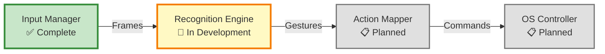
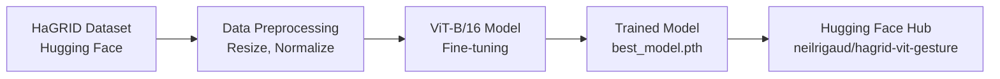
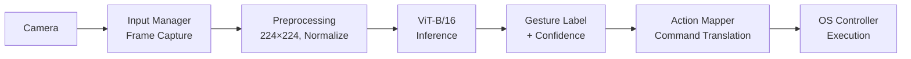

# System Architecture

This document describes the architecture of the Hand Gesture Recognition System.

## Overview

The system uses **Vision Transformer (ViT-B/16)** for gesture classification, trained on the HaGRID dataset with 18 gesture classes. The architecture consists of four planned modules, with Input Manager completed and Recognition Engine in active development.

## Module Overview



## 1. Input Manager (✅ Complete)

**Purpose**: Capture and preprocess video frames from camera.

**Implementation**: `src/input_manager/`

**Key Components**:
- `InputManager`: Camera capture with OpenCV
- `FrameData`: Frame container with metadata
- Thread-safe frame buffering
- Timestamp management

**Input**: Camera video stream  
**Output**: Preprocessed frames (numpy arrays)

**Status**: Production-ready, fully implemented

---

## 2. Recognition Engine (🔬 In Development)

**Purpose**: Classify hand gestures using ViT-B/16 model.

**Implementation**: `src/recognition_engine/`

**Architecture**:

```
Input Image (224×224×3)
    ↓
Patch Embedding (16×16 patches → 196 patches)
    ↓
Add Position Embeddings
    ↓
Transformer Encoder (12 layers)
    ├─ Multi-Head Self-Attention
    ├─ Layer Normalization
    └─ MLP
    ↓
Classification Head
    ↓
Gesture Prediction (18 classes)
```

**Model Details**:
- **Base Model**: ViT-B/16 (timm library)
- **Pre-training**: ImageNet-21k
- **Fine-tuning Dataset**: HaGRID subset (~30K images)
- **Input Size**: 224×224 RGB
- **Patch Size**: 16×16 (196 patches per image)
- **Hidden Dimensions**: 768
- **Attention Heads**: 12
- **Layers**: 12
- **Output Classes**: 18 gestures

**Gesture Classes**:
```
call, dislike, fist, four, like, mute, ok, one, palm,
peace, peace_inverted, rock, stop, stop_inverted, 
three, three2, two_up, two_up_inverted
```

**Training Performance**:
- Train Accuracy: ~90%
- Validation Accuracy: 85-90%
- Training Time: 30-60 min on GPU (10 epochs)
- Trained Model: [neilrigaud/hagrid-vit-gesture](https://huggingface.co/neilrigaud/hagrid-vit-gesture)

**Current Status**:
- ✅ Training pipeline complete
- ✅ Model trained and published to Hugging Face
- 🔬 Inference pipeline in development
- 📋 Real-time classification planned

**Input**: Preprocessed frame (224×224×3)  
**Output**: Gesture label + confidence score

---

## 3. Action Mapper (📋 Planned)

**Purpose**: Map recognized gestures to system commands.

**Planned Implementation**: `src/action_mapper/`

**Planned Features**:
- Gesture-to-command mapping configuration
- User-customizable command bindings
- State management (enable/disable gestures)
- Multi-gesture combination support
- Context-aware command selection

**Input**: Gesture label (e.g., "thumbs_up")  
**Output**: System command (e.g., "VOLUME_UP")

**Status**: Design phase, not yet implemented

---

## 4. OS Controller (📋 Planned)

**Purpose**: Execute system commands across different platforms.

**Planned Implementation**: `src/os_controller/`

**Planned Features**:
- Cross-platform support (macOS, Windows, Linux)
- Keyboard simulation (pyautogui/pynput)
- Mouse control
- Application-specific commands
- Safety mechanisms (command throttling, confirmation)

**Input**: System command (e.g., "VOLUME_UP")  
**Output**: OS action execution

**Status**: Design phase, not yet implemented

---

## Data Flow

### Training Pipeline



### Inference Pipeline (Planned)



---

## Technical Stack

### Core Libraries

**Computer Vision & Input**:
- OpenCV: Camera capture and image processing
- PIL/Pillow: Image manipulation
- NumPy: Array operations

**Deep Learning**:
- PyTorch: Deep learning framework
- timm: Pre-trained ViT models
- transformers (Hugging Face): Model deployment
- datasets (Hugging Face): Dataset loading

**Training**:
- torchvision: Image transforms
- tqdm: Progress tracking
- matplotlib: Visualization

**System Control (Planned)**:
- pyautogui: Cross-platform automation
- pynput: Keyboard/mouse control

### Model Specification

```python
# ViT-B/16 Configuration
{
    "model_name": "vit_base_patch16_224",
    "pretrain_source": "ImageNet-21k",
    "input_size": 224,
    "patch_size": 16,
    "embed_dim": 768,
    "depth": 12,
    "num_heads": 12,
    "num_classes": 18,
    "drop_rate": 0.1,
}
```

---

## Future Enhancements

### Short-term
1. Complete Recognition Engine inference pipeline
2. Implement Action Mapper module
3. Implement OS Controller module
4. Create end-to-end demo application

### Long-term (Research)
1. **Temporal Modeling**: Add LSTM for dynamic gesture recognition
2. **Semantic Understanding**: Vision-language alignment (ALBEF-inspired)
3. **Zero-shot Learning**: Recognize new gestures without retraining
4. **Multi-hand Support**: Simultaneous gesture recognition
5. **Robustness**: Handle occlusion, lighting variations, backgrounds

---

## Research Inspiration

This project draws inspiration from state-of-the-art research:

**HAVIT** (Hierarchical Attention-based Vision Transformer):
- Vision Transformer application to video understanding
- Hierarchical attention mechanisms
- Vision-language alignment

**ALBEF** (Align Before Fuse):
- Vision-language pre-training
- Contrastive learning for alignment
- Multi-modal understanding

**Note**: Current implementation focuses on robust gesture classification using ViT. Semantic understanding and vision-language alignment are future research directions.

---

## Implementation Status Summary

| Module | Status | Completion |
|--------|--------|-----------|
| Input Manager | ✅ Complete | 100% |
| Recognition Engine - Training | ✅ Complete | 100% |
| Recognition Engine - Inference | 🔬 In Development | 30% |
| Action Mapper | 📋 Planned | 0% |
| OS Controller | 📋 Planned | 0% |

**Overall Progress**: ~40% complete

---

## References

- [Vision Transformer (ViT) Paper](https://arxiv.org/abs/2010.11929)
- [HaGRID Dataset](https://github.com/hukenovs/hagrid)
- [timm Documentation](https://huggingface.co/docs/timm)
- [Hugging Face Model Hub](https://huggingface.co/neilrigaud/hagrid-vit-gesture)
