# Project Architecture

This document outlines the software architecture for the Hand Gesture Recognition project. The system is designed as a modular pipeline, with each component responsible for a specific part of the gesture recognition and control process.

## System Overview

The system consists of four main modules:

1.  **Input Manager:** Captures video from the camera.
2.  **Recognition Engine:** Performs hand gesture recognition.
3.  **Action Mapper:** Translates gestures into commands.
4.  **OS Controller:** Executes commands on the host OS.

```mermaid
flowchart LR
    %% Styling with better contrast and readability
    classDef inputModule fill:#e3f2fd,stroke:#1976d2,stroke-width:3px,color:#000000
    classDef recognitionModule fill:#f3e5f5,stroke:#7b1fa2,stroke-width:3px,color:#000000
    classDef actionModule fill:#e8f5e8,stroke:#388e3c,stroke-width:3px,color:#000000
    classDef osModule fill:#fff3e0,stroke:#f57c00,stroke-width:3px,color:#000000
    classDef dataArrow fill:none,stroke:#424242,stroke-width:2px

    %% Main Modules
    INPUT["INPUT MANAGER<br/>• Camera capture<br/>• Frame preprocessing<br/>• OpenCV integration"]:::inputModule

    RECOGNITION["RECOGNITION ENGINE<br/>• Hand detection MediaPipe<br/>• Feature extraction ViT<br/>• Semantic understanding ALBEF"]:::recognitionModule

    ACTION["ACTION MAPPER<br/>• Command translation<br/>• State management<br/>• User configuration"]:::actionModule

    OS["OS CONTROLLER<br/>• Cross-platform execution<br/>• Keyboard/mouse control<br/>• System integration"]:::osModule

    %% Data Flow
    INPUT -->|"Raw Video Frames"| RECOGNITION
    RECOGNITION -->|"Semantic Commands<br/>volume up, next slide"| ACTION
    ACTION -->|"Standardized Commands<br/>VOLUME_UP, NEXT_SLIDE"| OS
    OS -->|"System Actions"| OUTPUT["System Output<br/>User sees results"]

    %% User Interaction
    USER["User<br/>Hand Gestures"] -->|"Video Stream"| INPUT
    OUTPUT -.->|"Visual/Audio Feedback"| USER
```

## Technical Direction

The core of this project is the **Recognition Engine**, which will be developed using a state-of-the-art deep learning approach. Our research has shown that traditional methods relying solely on hand landmark coordinates can be limited. Therefore, we will be leveraging a **Vision Transformer (ViT)** based architecture for more robust and accurate gesture recognition.

Furthermore, to create a truly intuitive and extensible system, we will be implementing a semantic understanding layer inspired by the **ALBEF (Align Before Fuse)** framework. This will allow the system to learn the _meaning_ of gestures by associating them with natural language descriptions of commands, moving beyond hardcoded gesture-to-action mappings.

This approach offers several key benefits:

- **Higher Accuracy and Robustness:** By analyzing the entire hand image, the ViT can capture more nuanced features than landmark-based methods alone.
- **Semantic Understanding:** The system will be able to understand what gestures _mean_, making it more flexible and easier to customize.
- **Extensibility:** Adding new gestures and commands will be a matter of providing new training data, not rewriting code.

## Detailed Architecture Diagram

For a comprehensive visual representation of all system components and their interactions, see the [**Detailed System Architecture Diagram**](./DETAILED_SYSTEM_ARCHITECTURE.md). This document provides:

- Complete component breakdown for all four modules
- Data flow visualization with technical specifications
- Implementation details for each submodule
- Technical stack and innovation explanations
- Visual representation of the semantic understanding pipeline

## Module Documentation

For more detailed information on the technical design and implementation plan for each module, please refer to the `README.md` file within each module's directory.
