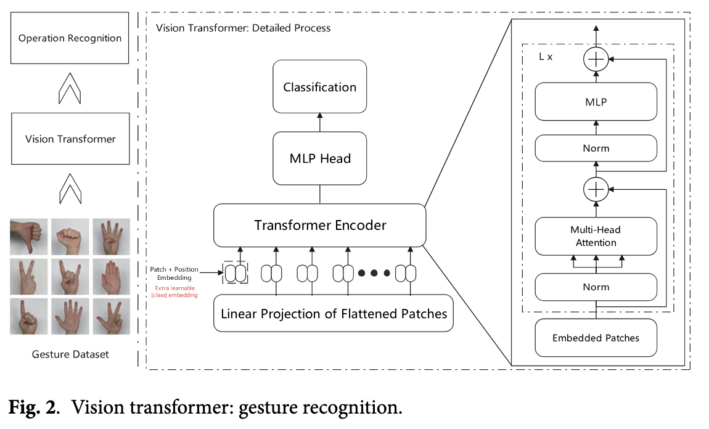

# HAVIT: Research on vision-language gesture interaction mechanism for smart furniture

> [!NOTE]
> HAVIT: Hybrid Deep Learning model based on Vision Transformer and ALBEF.

- Natural and intuitive interaction method
- Effectiveness of gesture recognition technology is constrained by:
  - **Limited data resources**
  - **Insufficient semantic understanding**
- HAVIT:
  - Enhances the **performance** of gesture recognition systems under **data-scarce conditions**
  - Achieves:
    - efficient **feature extraction**
    - accurate **recognition of gesture characteristics**

    through the organic integration of:
    - [Vision Tranformer](https://huggingface.co/docs/transformers/model_doc/vit)'s feature extraction capabilities
    - and [ALBEF](https://arxiv.org/abs/2107.07651)

- New solution for the development of **smart furniture interaction technology**
- Significant implications for advancing practical applications in this field

> [!NOTE]
> **Vision Transformer** (ViT) is a transformer adapted for computer vision tasks. An image is split into smaller fixed-sized patches which are treated as a sequence of tokens, similar to words for NLP tasks. ViT requires less resources to pretrain compared to convolutional architectures and its performance on large datasets can be transferred to smaller downstream tasks.

## Research Background

- Transformation of human lifestyles and production modes by the rapid development of information technologies
- Global smart furniture market reached $146.6 million in 2020
- Human quality of life improvement
- Key challenge in interaction methods
- Struggle in the adaptation of human-computer interaction to diverse usage scenarios
- Traditional control methods no longer meet user demands
- **Gesture recognition** demonstrates significant **application potential**
- Demand for _contactless_ interaction in the post-pandemic era
- Significant challenge faced in actual application environments due to:
  - **limited data resources**
  - **scene complexity**

## Literature Review

- [Alyami et al.](https://www.sciencedirect.com/science/article/abs/pii/S0306457324001341?via%3Dihub) pointed out that existing research overly focuses on _sign language recognition_, with insufficient application research in **_universal interaction scenarios_**
- Han et al. in their proposed method fails to consider **environmental interference issues** in practical scenarios.
- [Ma et al.](https://www.frontiersin.org/journals/psychology/articles/10.3389/fpsyg.2021.769509/full) designed a multimodal network based on motion energy, that improved recognition performance, but their method heavily relies on [Kinect camera](https://manual.notch.one/0.9.23/en/docs/nodes/video-processing/input-output/depth-camera-kinect-source/) depth information, which:
  - Increases deployment cost
  - Lacks gesture semantic understanding
- [Zhou et al.](https://www.sciencedirect.com/science/article/abs/pii/S1071581924000867?via%3Dihub) proposed the DigCode encoding method, converting continuous actions into _discrete string encodings_ to improve the **standardization** of gesture expression, but:
  - failed to solve the problem of **_insufficient data volume_**
  - ignored the **_personalized needs_** of different users
- [Ji et al.](https://www.tandfonline.com/doi/full/10.1080/10447318.2023.2212232) conducted a review of _flexible strain sensor gloves_, which:
  - showed advantages in **cost** and **portability**,
  - but the contact-based solution **_limited user experience_**.
- [Wang et al.](https://doi.org/10.1080/10447318.2024.2352226) found that **_gesture simplicity_** and **_directionality_** are key factors, but the research was **limited** to specific user groups and lacked **_universal verification_**.
- [Yu et al.](https://www.nature.com/articles/s41598-022-08133-z) proposed a **_dynamic gesture recognition_** method based on **_2D CNNs_** and **_[feature fusion](https://arxiv.org/abs/1712.00960)_** which achieved **improved recognition accuracy** but their method:
  - faces challenges in real-time applications with **_varying lighting conditions_**
- [Marzouk et al.](https://www.mdpi.com/2227-9032/10/9/1606) proposed the **ASODCAE-SLR** model combining:
  - atomic search optimization
  - deep convolutional autoencoders

  but the model:
  - requires **_large amounts of training data_**
  - has **_limited feature extraction capabilities_**

> [!NOTE]
> **ASODCAE-SLR**: Atom Search Optimization with Deep Learning Enabled Arabic Sign Language Recognition

- [Liu et al.](https://doi.org/10.3390/healthcare10091779) achieved **high-accuracy gesture recognition** using the **YOLOv5 algorithm**, but:
  - it _only_ applies to **predefined simple gestures sets**
  - lacks the ability to **understand complex interaction intentions**
- [Zhou et al.](https://www.tandfonline.com/doi/full/10.1080/15230406.2023.2183900) while studying **user-defined gestures** for multi-scale GIS interfaces:
  - found that **gesture features** vary with **_spatial scale_**
  - did not _deeply_ explore **_semantic-level adaptability issues_**
- [Dey et al.](https://www.sciencedirect.com/science/article/pii/S1877050924009554) developed an **attention-driven** C3D-biLSTM network which:
  - recognizes question sign gestures in video streams
  - demonstrates the effectiveness of **attention mechanism** in capturing **_temporal dynamic gestures_**

  however their approach:
  - primarily focuses on **specific sign language gestures**
  - rather than **_general interaction gestures_**

- [Joksimoski et al.](https://ieeexplore.ieee.org/document/9739689) review emphasized the importance of:
  - data collection
  - feature extraction
  - recognition technologies

  but pointed out that:
  - current research still shows **insufficient robustness in complex environments**.

- [Jeong et al.](https://www.tandfonline.com/doi/full/10.1080/10447318.2024.2348837) explored **non-verbal sound interaction** based on tapping and touching, and:
  - achieved good recognition results

  but:
  - this **_single-modal solution_** struggles to meet the **_diverse interaction needs_**

### Key Challenges and Solutions

#### Challenges

- Data scarcity
- Semantic understanding
- Substantial annotated data support

#### Solutions

- Exploration of more effective methods
- Combination of:
  - Vision Transformer (ViT)
  - Aligned Language Image BERT for Enhanced Vision-language Understanding (ALBEF)

> [!NOTE]
> The Vision Transformer architecture offers **powerful feature extraction capabilities** through **self-attention mechanisms** that capture _long-range dependencies_ in visual data.

> [!NOTE]
> The **self-attention mechanism** in Transformers allows each word in a sentence to dynamically weigh the importance of every other word in the same sentence to understand context and relationships.

> [!NOTE]
> ALBEF provides advantages in [cross-modal alignment](https://arxiv.org/abs/2208.01744) learning, enabling better semantic understanding of gestures with **_limited annotated samples_**.

## Current HAVIT model contribution results

- 86.89% accuracy with 80% annotated data
- AUC value of 0.92
  - Significant improvement compared to using ALBEF (0.71) or ViT alone (0.76)
- Ability to achieve **high true positive rates in low false positive rate regions**
- Addresses key limitation in existing methods that focuses on:
  - visual features
  - semantic context

  but rarely both simultaneously.

> [!NOTE]
> AUC: Area Under the Curve

> [!NOTE]
> ViT has the ability to capture **global spatial relationships**.

## Methods

### Problem description

- Three-dimensional space
- Accurate mapping of the captured gesture sequences to control commands
- Definition of gesture image sequence at a time $t$:
  $$I_t = \{i_1, i_2, \dots, i_n\} \in \mathbb{R}^{H \times W \times C}$$
- Gesture image represented as three-dimensional tensor $i_k \in \mathbb{R}^{H \times W \times C}$ where:
  - H: height of the image
  - W: width of the image
  - C: **_number of image channels_**
- Each frame contains:
  - rich spatial information
  - visual features for gestures
- Introduction of a **transformation matrix** on the **[special Euclidean group SE(3)](https://lavalle.pl/planning/node147.html)** to precisely characterize:
  - the position
  - and posture information of gestures
    $$T=\begin{bmatrix}R&p\cr0&1\end{bmatrix} \in SE(3)$$
    where:
  - $R \in SO(3)$ describes the **spatial orientation** of the gesture
  - $SO(3)$ represents the **three-dimensional [special orthogonal group](https://mathworld.wolfram.com/SpecialOrthogonalGroup.html)**
  - $p \in \mathbb{R}^3$ is the **translation vector** which characterizes the **spatial position of the gesture**.
- Definition of all executable control commands as a finite set:
  $$\mathcal{C} = \{c_1, c_2, \dots, c_m\}, \quad c_i \in \mathcal{A}$$
  where:
  - $\mathcal{A}$ is the **_action space_** of the control commands
  - Each command $c_i$ corresponds to a **specific operation**
- Construction of a mapping from **image space** to **control command space**:
  $$\mathcal{f} : \mathbb{R}^{H \times W \times C} \to \mathcal{C}, \quad \mathcal{f}(I_t) = c_i$$
- Definition of the **environment state space** to handle the **complexity** of practical application scenarios:
  $$
  \mathcal{E} = \{e_1, e_2, \dots, e_k\}, \quad e_i \in \mathcal{S}
  $$
  where:
  - $\mathcal{S}$ is the set of **environmental states** including various factors affecting **_recognition effectiveness_** such as:
    - lighting changes $e_1 \in \mathbb{R}^{+}$
    - occlusion degree $e_2 \in [0,1]$
- Expression of the **_optimization objective_** of gesture recognition as a **[conditional probability maximization problem](https://arxiv.org/pdf/1708.02406)**:

  $$
  \min_{\theta} \mathcal{L}(f_{\theta}(I_t \mid \mathcal{E}), y), \quad \theta \in \Theta
  $$

  where:
  - $\Theta$: **parameter space** which contains all possible parameter configurations
  - $y$: true label
  - $\mathcal{L}$: [loss function](https://www.datarobot.com/blog/introduction-to-loss-functions/) which measures the **difference** between the predicted and true values

- Design of an _objective function_ containing **regularization terms** to enhance the robustness and generalization ability of the model:
  $$
  \mathcal{L_{total}} = \mathcal{L_{rec}} + \lambda \mathcal{L_{reg}}, \quad \lambda \gt 0
  $$
  where:
  - $\mathcal{L_{rec}}$: **recognition loss** which measures the accuracy of model predictions
  - $\mathcal{L_{reg}}$: **regularization term** which controls the model complexity
  - $\lambda$: **balance factor** weighing the importance of both terms
- Output of the control command with **maximum posterior probability**:
  $$
  \mathcal{c^*} = arg \max_{c \in \mathcal{C}}{P(c \mid I_t, \mathcal{E})}
  $$

> [!NOTE]
> An **image channel** refers to the category of color types (RGB, CMYK, HSV) in an image.

> [!NOTE]
> The separation of the channels is used for component analysis of colors in an image.

> [!NOTE]
> A **transformation matrix** is a square matrix used in linear algebra to perform geometric operations such as rotation, scaling, and translation on vectors or geometric objects by mapping their coordinates from an original system to a new one.

> [!NOTE]
> A **translation vector** is a mathematical representation of a shift in position, indicating both the direction and distance an object or figure is moved without rotation or change in size.

- Consideration of uncertain factors such as:
  - lighting changes
  - occlusion in the environment
  - data acquisition

  to formally represent the problem as:

  $$
  arg_{\theta} \min{\mathbb{E}_{I_t \sim D} [\mathcal{L}_{rec} (f_{\theta}(I_t \mid \mathcal{E}), y) + \lambda \mathcal{L}_{reg}(\theta)]}, \quad \text{s.t.} \quad |D| \ll N
  $$

  where $\mathcal{E}$ is the interference factor brought by the environment.
  - In other words, _find the parameters $\theta$ that minimizes the expectation of the loss subject to $|D| \ll N$_
  - Describes how to achieve **accurate understanding** of user gesture intentions under the constraint of limited annotated data ($|D| \ll N$)

### Vision Transformer: Gesture Recognition

#### Advantages of ViT

- Reliance of traditional methods on CNNs with obvious limitations
- Superiority of [ViT through its _self-attention_ mechanism](https://arxiv.org/abs/1706.03762)
  - Directly model feature correlations at any position in the sequence
    - Solving the **[long-range dependency problem](https://www.wikiwand.com/en/articles/Long-range_dependence)**
  - Learn features from different representation subspaces through **multi-head attention mechanism**
    - Enhance recognition ability of subtle differences in gesture actions
    - Improvement of model performance in complex scenarios

#### ViT Processing Steps:

1. Division of of the input gesture image into **patches**
2. Performs _linear projection_
3. Adds positional encoding information
4. Processing of the features through mutliple layers of Transformer encoders containing:
   - Multi-head attention mechanism
   - MLP structure
5. Complete **classification prediction** through the MLP head

> [!NOTE]
> **Multilayer Perceptron (MLP)** has three or more layers of nodes: an _input layer_ for data entry, one or more _hidden layer_ for processing and an _output layer_ for the final result.
