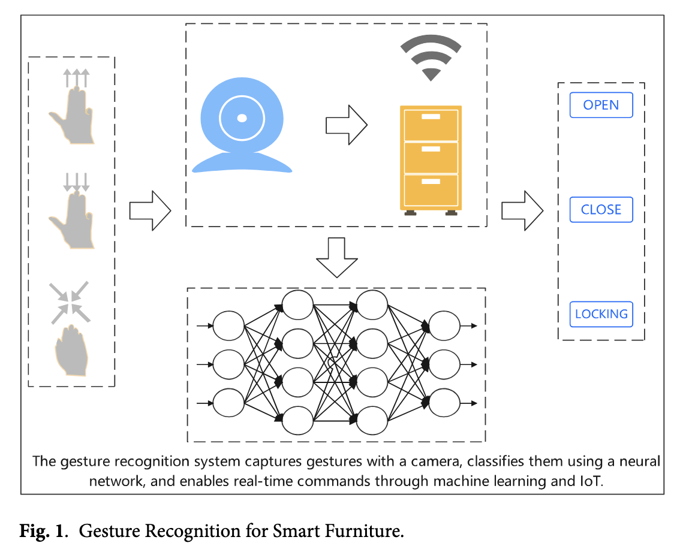

# HAVIT: Research on vision-language gesture interaction mechanism for smart furniture

> [!NOTE]
> HAVIT: Hybrid Deep Learning model based on Vision Transformer and ALBEF.

- Natural and intuitive interaction method
- Effectiveness of gesture recognition technology is constrained by:
  - **Limited data ressources**
  - **Insufficient semantic understanding**
- HAVIT:
  - Enhances the **performance** of gesture recognition systems under **data-scarce conditions**
  - Achieves:
    - efficient **feature extraction**
    - and accurate **recognition of gesture characteristics**

  through the organic integration of:
  - [Vision Tranformer](https://huggingface.co/docs/transformers/model_doc/vit)'s feature extraction capabilities
  - and [ALBEF](https://arxiv.org/abs/2107.07651)

- New solution for the development of **smart furniture interaction technology**
- Significant implications for advancing practical applications in this field

> [!NOTE]
> **Vision Transformer** (ViT) is a transformer adapted for computer vision tasks. An image is split into smaller fixed-sized patches which are treated as a sequence of tokens, similar to words for NLP tasks. ViT requires less resources to pretrain compared to convolutional architectures and its performance on large datasets can be transferred to smaller downstream tasks.

## Research Background

- Transformation of human lifestyles and production modes by the rapid development of information technologies
- Global smart furniture market reached $146.6 million in 2020
- Human quality of life improvement
- Key challenge in interaction methods
- Struggle in the adaptation of human-computer interaction to diverse usage scenarios
- Traditional control methods no longer meet user demands
- **Gesture recognition** demonstrates significant **application potential**
- Demand for _contactless_ interaction in the post-pandemic era
- Significant challenge faced in actual application environments due to:
  - **limited data resources**
  - **scence complexity**

## Literature Review

- [Alyami et al.](https://www.sciencedirect.com/science/article/abs/pii/S0306457324001341?via%3Dihub) pointed out that existing research overly focuses on _sign language recognition_, with insufficient application research in **_universal interaction scenarios_**
- Han et al. in their proposed method fails to consider **environmental interference issues** in practical scenarios.
- [Ma et al.](https://www.frontiersin.org/journals/psychology/articles/10.3389/fpsyg.2021.769509/full) designed a multimodal network based on motion energy, that improved recognition performance, but their method heavily relies on [Kinect camera](https://manual.notch.one/0.9.23/en/docs/nodes/video-processing/input-output/depth-camera-kinect-source/) depth information, which:
  - Increases deployment cost
  - Lacks gesture semantic understanding
- [Zhou et al.](https://www.sciencedirect.com/science/article/abs/pii/S1071581924000867?via%3Dihub) proposed the DigCode encoding method, converting continuous actions into _discrete string encodings_ to improve the **standardization** of gesture expression, but:
  - failed to solve the problem of **_insufficient data volume_**
  - ignored the **_personalized needs_** of different users
- [Ji et al.](https://www.tandfonline.com/doi/full/10.1080/10447318.2023.2212232) conducted a review of _flexible strain sensor gloves_, which:
  - showed advantages in **cost** and **portability**,
  - but the contact-based solution **_limited user experience_**.
