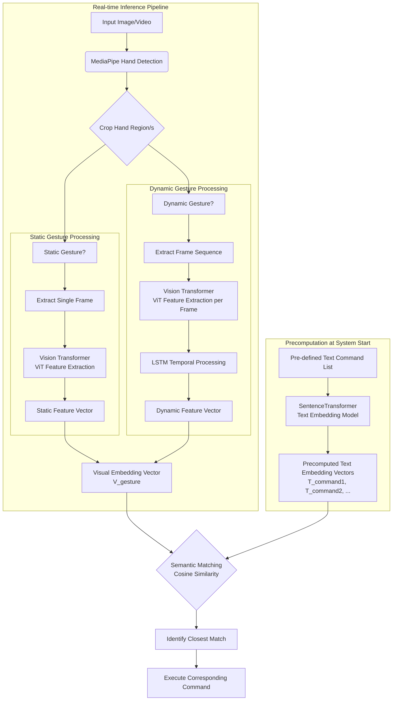

# CONTRIBUTION: Semantic Gesture Recognition Engine: A HAVIT & ALBEF-Inspired Approach

## Project Overview

This project presents a novel architecture for vision-based gesture recognition that moves beyond simple pose classification to achieve genuine **semantic understanding** of user intent. By integrating state-of-the-art models from computer vision (Vision Transformer) and natural language processing (BERT/SentenceTransformer) within a hybrid framework inspired by HAVIT and ALBEF, we create a system that learns a shared semantic space for gestures and commands. This approach results in a gesture interface that is significantly more robust, flexible, and intelligent than current landmark-based solutions.

## The Problem with Current Paradigms

Most existing gesture recognition systems, particularly those built on libraries like MediaPipe, follow a simplistic pipeline:

1.  **Landmark Extraction:** A hand model detects 21 (or 42) 3D coordinate points representing hand joints.
2.  **Simple Classification:** These coordinate vectors are fed into a lightweight classifier (e.g., a Multi-Layer Perceptron for static poses or a simple RNN for motions).
3.  **Hard-Coded Mapping:** A rigid "if-else" logic maps a classified gesture label (e.g., `gesture_12`) to a predefined action (e.g., `volume_up()`).

**This approach has critical limitations:**

- **Brittleness:** It discards all texture, context, and visual details from the image, relying solely on the precise detection of skeletal points. This makes it highly sensitive to lighting, occlusion, and rapid movements.
- **Limited Expressiveness:** Classifying entire complex motions into a single label (e.g., "circle" or "swipe") fails to capture their nuanced meaning and variations.
- **Inflexibility:** Adding new gestures or commands requires collecting new data, retraining the classifier, and writing new hard-coded mapping rules—a cumbersome and non-scalable process.
- **No Semantic Understanding:** The system learns to classify shapes, not meanings. It knows a "thumbs up" is `gesture_7`, but it does not understand that `gesture_7` signifies "approval" or "like."

## Our Proposed Architecture: A Semantic Revolution

Our design directly addresses these shortcomings by introducing a deep learning pipeline that focuses on learning the **semantic meaning** behind a gesture.

### Understanding the Architecture: Why Text Processing Has No Parent

A key insight into our architecture is that the text processing branch operates independently from the visual pipeline. This is a deliberate design choice that reflects a fundamental aspect of how the system works:

- **Precomputation vs. Real-time Processing**: The text command processing occurs during system initialization, not during real-time inference. When the application starts, it processes all possible text commands (e.g., "volume up," "next slide," "like") through the text encoder exactly once, generating their semantic embeddings ahead of time.

- **Static Nature of Commands**: The set of available commands is typically fixed and known in advance. There is no need to recompute these text embeddings for each frame or gesture recognition event, as they remain constant unless the command set changes.

- **Efficiency Optimization**: This separation ensures maximum efficiency during real-time operation. The computationally intensive text processing happens once at startup, while the real-time path only handles the visual processing and the efficient cosine similarity comparison between the gesture embedding and precomputed text embeddings.

- **Asynchronous Design**: The text and visual pipelines are conceptually parallel components that meet only at the semantic matching stage. The text branch provides a static set of possible semantic targets, while the visual branch generates a single semantic vector for the observed gesture that is compared against these precomputed targets.

### Stage 1: Robust Visual Feature Extraction with Vision Transformer (ViT)

Instead of discarding the image for a handful of points, we leverage the entire visual context of the hand.

- **Process:** The hand region, identified by an initial detector (e.g., MediaPipe), is cropped and fed into a **pre-trained Vision Transformer (ViT)**.
- **Why ViT?** Unlike Convolutional Neural Networks (CNNs) that process images locally, ViTs break an image into patches and use a self-attention mechanism to understand the **global context** and relationships between all parts of the image. This allows it to capture nuanced features like subtle finger angles, palm orientation, and texture, which are completely lost in landmark data.
- **Output:** For each frame, the ViT outputs a rich, high-dimensional **feature vector** that is a dense numerical representation of the hand's pose and shape. This is far more informative and robust than a list of coordinates.

### Stage 2: Advanced Temporal Modeling with LSTM

For dynamic gestures (e.g., "swipe left", "circle clockwise"), understanding the sequence of motion is essential.

- **Process:** A sequence of feature vectors from the ViT (one for each frame in a short video clip) is fed into a **Long Short-Term Memory (LSTM)** network.
- **Why LSTM?** LSTMs are a type of Recurrent Neural Network (RNN) designed to learn long-range dependencies in sequential data. They contain a "memory cell" regulated by input, forget, and output gates. This allows them to selectively remember important information from earlier in the sequence and forget irrelevant noise, making them perfect for modeling complex motions over time.
- **Superiority:** The LSTM is not just tracking the path of a single point; it is processing the evolution of the _entire hand's rich visual representation_. This enables it to distinguish between superficially similar motions (e.g., a shaky "swipe" vs. a smooth "swipe") with much higher accuracy.

### Stage 3: The Core Innovation: Semantic Alignment (ALBEF-Inspired)

This is the pivotal contribution of our work. We bridge the visual and textual domains to understand what a gesture _means_, not just what it _looks like_.

- **Objective:** To create a **shared vector space** where the representation of a visual gesture is close to the representation of its corresponding textual command.

#### Training Phase: Contrastive Learning

We train a dual-encoder model using a dataset of pairs: `(Gesture Video, Text Command)`.

1.  **Visual Encoder:** Our fine-tuned ViT (for static gestures) or ViT+LSTM (for dynamic gestures) processes a gesture and produces a **gesture embedding vector** (`V_gesture`).
2.  **Text Encoder:** A pre-trained language model—**BERT** fine-tuned with the **SentenceTransformer** framework—processes a text command (e.g., "like this post", "next slide") and produces a **command embedding vector** (`T_command`).
3.  **Alignment:** Using a **contrastive loss function** (e.g., InfoNCE), we train the entire system to minimize the distance between `V_gesture` and `T_command` for matching pairs, while maximizing the distance for non-matching pairs. This forces the model to learn that a "thumbs up" gesture is semantically "closer" to the text "like" than to the text "mute."

#### Inference Phase: Semantic Retrieval

When a user performs a new gesture:

1.  The visual encoder processes it into a vector (`V_new`).
2.  The text encoder pre-computes vectors for all possible commands (`T_1`, `T_2`, `T_3`, ... `T_n`).
3.  The system calculates the **cosine similarity** between `V_new` and every `T_n`.
4.  The system executes the command whose text vector is **most similar** to the gesture vector. It doesn't choose a label; it finds the closest _meaning_.

## Our Key Contributions to the Field

This project makes several significant contributions that advance the state-of-the-art in gesture recognition:

### 1. Novel Application of SOTA Architectures

We are among the first to **repurpose the HAVIT (video-text) and ALBEF (vision-language) frameworks**, giants in the field of multimodal learning, for the specific and practical challenge of semantic gesture-based control. This cross-pollination of ideas from different AI sub-fields is a genuine architectural contribution.

### 2. Paradigm Shift: From Classification to Semantic Grounding

Our primary contribution is the **shift from a hard-coded "lookup table" to a learned, semantic embedding space**. We introduce a formal methodology for creating "gesture embeddings" and "command embeddings" that are aligned based on meaning. This is a more cognitively plausible model, mirroring how humans associate symbols (gestures) with concepts (commands).

### 3. Unprecedented Extensibility and Zero-Shot Potential

This architecture is fundamentally more scalable and flexible.

- **Easy Addition:** Adding a new command no longer requires retraining the entire visual model. In many cases, one can simply add the new text label (e.g., "contrast up") to the list. The pre-trained text encoder, by understanding language, will place its vector near similar commands (e.g., "volume up", "brightness up").
- **Zero-Shot Learning:** This enables **zero-shot gesture recognition**. If the system knows a "swipe up" gesture means "increase," the same gesture could be immediately understood to mean "increase contrast" for a new application, without any new gesture data, because the text embeddings for "increase" and "increase contrast" are semantically close. This is a groundbreaking step towards generic gesture interfaces.

### 4. Enhanced Robustness and Natural Interaction

- By using the whole image (ViT) instead of just landmarks, our system is inherently more robust to visual noise, partial occlusions, and varying hand appearances.
- By understanding semantics, the system becomes robust to paraphrasing. A command can be phrased as "next slide," "go forward," or "advance," and the system will correctly map the intended gesture to all of them, as their text vectors reside in the same semantic neighborhood.

## Technical Stack & Components

- **Visual Feature Extraction:** Vision Transformer (ViT-B/16 pre-trained on ImageNet-21k)
- **Temporal Modeling:** Long Short-Term Memory (LSTM) network
- **Text Encoding:** SentenceTransformer framework leveraging a pre-trained BERT model (e.g., `all-MiniLM-L6-v2`)
- **Alignment Framework:** Contrastive Loss (e.g., InfoNCE, Cosine Similarity)
- **Initial Detection:** MediaPipe Hands (for efficient hand localization and cropping only)

## Conclusion

This project proposes a comprehensive and innovative framework that elevates gesture recognition from a simple classification task to a problem of cross-modal semantic understanding. By integrating cutting-edge vision and language models within a contrastive learning paradigm, we deliver a system that is not only more accurate and robust but also fundamentally more intelligent and adaptable. Our work paves the way for a future where gesture interfaces can be extended and customized through natural language, ultimately leading to more natural and powerful human-computer interaction.
