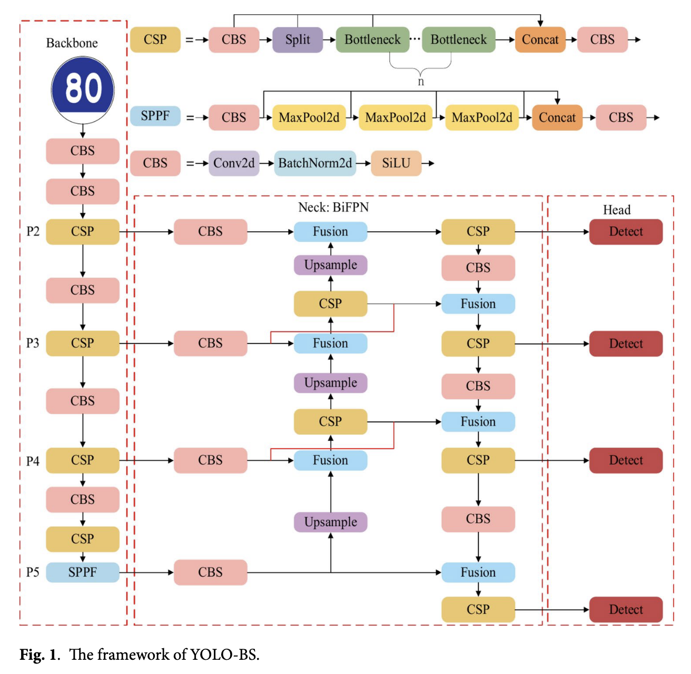
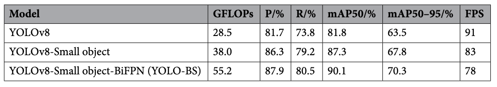

# Traffic Sign Detection

Traffic signs are pivotal components of traffic management, ensuring the regulation and safety of road traffic. However, existing detection methods suffer from **poor accuracy** and **poor real-time performance** in dynamic road environments.
Traffic sign detection utilizes _computer vision_ and _artificial intelligence_ technologies to recognize and interpret traffic signs on the road automatically. This technology is critical for enhancing:

- driving safety
- guiding traffic behavior
- aiding in the decision-making processes of autonomous vehicles

## Importance of Effective Traffic Sign Detection

- Helps drivers adhere to traffic regulations
- Reduces traffic accidents
- Improves traffic flow management
- Ensures road safety

## Challenges faced in Traffic Sign Detection

- Growing variety and complexity of urban traffic signs
- Dynamic and complex traffic conditions
- Lighting variations
- Occlusions
- Similarities among different types of signs

> [!NOTE]
> Deep-learning based traffic sign recognition algorithms have prominence in helping overcoming those challenges.

## Related Concepts

- Principles of small object detection layers
- YOLOv12
- BiFPN network

## Essential Key Benefits

- Vehicle-mounted traffic sign recognition systems:
  - Effectively guide and regulate driver behavior
  - Ensure safe driving
  - Reduce traffic accidents
- Detecting and recognizing traffic signs:
  - Further enhances autonomous driving technology
  - Improves road commuting efficiency

### Main Steps of Traffic Sign Detection

- Localization
  - Identification of the **presence** and **exact location** of traffic signs within complex road environments.
- Recognition and classification of signs
  - Interprets the detected signs to determine their **types**, such as _stops signs_ and _speed limits_.

## Traditional Methods and Related Works

- Image processing and machine learning
- Detection algorithms:
  - Histogram of Orientation Gradients (HOG)
  - Scale-Invariant Feature Transformations (SIFT)
- Classification algorithms:
  - Support Vector Machines (SVM)
  - Random Forest (RF)

### Traditional Approach

- Relies on _distinctive features_ of traffic signs
  - Specific colors
  - Prominent shapes
- Extraction of those features for detection
- Classification with a **_trained classifier_**

#### Related Researches

- ["Road traffic sign detection and classification" De La Escalera et al.](https://ieeexplore.ieee.org/document/649946)
  - Traffic signs extraction from their environment using the color and shape of the sign's corners along with classification of identified signs using neural networks.
- ["Goal evaluation of segmentation algorithm for traffic sign recognition" by Gomez-Moreno et al.](https://ieeexplore.ieee.org/document/4220659)
  - Color segmentation method using SVM and speed increase using Look-Up Table (LUT)
- ["Robust traffic sign recognition based on color global and Local Oriented Edge Magnitude Patterns (LOEMP)" by Yuan et al.](https://ieeexplore.ieee.org/document/6810168)
  - Integrates:
    - color
    - global spatial structure
    - local shape information

  which significantly increasing the efficiency of sign detection.

- ["On circular traffic sign detection and recognition" by Berkaya et al.](https://www.sciencedirect.com/science/article/abs/pii/S0957417415007848)
  - EDCircles circle detection algorithm combined with an RGB-based color thresholding technique to detect traffic signs
  - Integrates GABOR, LBP, and HOG techniques
  - Classification was performed with an SVM
  - Enhanced traffic sign detection process

> [!IMPORTANT]
> Color features and shape features are prone to interference from external objects of similar color and shape in _complex road conditions_, resulting in **poor generalization**.

- ["Application of BW-ELM model on traffic sign recognition" by Sun et al.](https://www.sciencedirect.com/science/article/abs/pii/S0925231213009934)
  - Combination of HOG for feature extraction with an Extreme Learning Machine (ELM) classifier for rapid classification
  - High recognition accuracy in the [GTSRB dataset](https://www.kaggle.com/datasets/meowmeowmeowmeowmeow/gtsrb-german-traffic-sign)
  - Exhibits significant advantages in _computational efficiency_
- ["An efficient method for traffic sign recognition based on extreme machine learning (ELM)" by Huang et al.](https://pubmed.ncbi.nlm.nih.gov/26992185/)
  - Balance between computational efficiency and recognition accuracy
  - Enhanced version of the HOG for feature extraction with the ELM classifier
  - High recognition accuracy both on the [GTSRB dataset](https://www.kaggle.com/datasets/meowmeowmeowmeowmeow/gtsrb-german-traffic-sign) and the [Belgium traffic sign classification dataset (BTSC)](https://btsd.ethz.ch/shareddata/) while maintaining very high computational efficiency
- ["Traffic sign detection and recognition based on random forests" by Ellahyani et al.](url)
  - Employ the HSI color space for threshold segmentation to pinpoint potential traffic sign regions
  - Augmented with the use of _SVM_ and _Random Forest classifiers_ for enhanced accuracy
  - Utilized HOG features to recognize the traffic signs effectively

## Improvements due to Deep Learning Algorithms

Deep learning algorithms utilize neural networks to model _intricate relationships_ between inputs and outputs.

- Ability to autonomously learn high-level features directly from raw data
- Diminish the necessity for manual feature extraction
- Streamline the feature extraction process
- Enhance the effectiveness of recognition systems

### Related Researches

- ["Speed Limit": high-accuracy US traffic sign recognition with convolutional neural networks (CNN) by Li et al.](https://ieeexplore.ieee.org/document/7585032)
  - Utilized CNN to specifically target the detection and recognition of traffic signs in the USA, concentrating particularly on speed limit signs.
  - Impressive detection performance on the [LISA-TS dataset](https://git-disl.github.io/GTDLBench/datasets/lisa_traffic_sign_dataset/)
  - Effective in identifying critical signs
- ["Real-time traffic sign recognition based on efficient CNNs in the wild" by Li & Wang](https://ieeexplore.ieee.org/document/8392744)
  - Combination of **Faster R-CNN** with **MobileNets** to precisely locate and classify small traffic signs.
  - Leverage the strengths of:
    - **Faster R-CNN** for its efficient and accurate detection capabilities
    - **MobileNets** for its lightweight, mobile-friendly architecture
  - Resulted in enhanced performance in recognizing small traffic signs

- ["Deep learning for large-scale traffic-sign detection and recognition" by Tabernik & Skocaj](https://arxiv.org/pdf/1904.00649)
  - Enhanced **Mask R-CNN** framework to better recognize small traffic signs
  - Introduced a novel _data augmentation technique_ to improve the model's generalization capabilities
  - Evaluations on both the [DFG](https://service.tib.eu/ldmservice/dataset/dfg-traf-c-sign-dataset) and the [Swedish traffic sign datasets](https://www.cvl.isy.liu.se/research/datasets/traffic-signs-dataset/) demonstrated significant performance gains, with the refined **Mask R-CNN** model achieving metrics such as **_mAP50 up to 95.5%_**

- ["A cascaded R-CNN with multiscale attention and imbalanced samples from traffic sign detection" by Zhang et al.](https://ieeexplore.ieee.org/document/8986614)
  - Cascaded R-CNN model with **multiscale attention**
    - Improves detection accuracy by focusing on **multiscale feature extraction** and **balancing imbalanced datasets**
    - Enhance the model's performance in detecting _small-sized_ traffic signs

- ["An improved light-weight traffic sign recognition based on YOLOv4-Tiny" by Wang et al.](https://ieeexplore.ieee.org/abstract/document/9527223)
  - Enhanced lightweight traffic sign recognition algorithm based on **YOLOv4-Tiny**
  - Refines the **_K-means clustering method_** to generate anchor frames tailored to the traffic sign dataset.
  - Significant improvement of **detection recall** and **target localization precision**
  - Achieved a mean Average Precision (mAP) at **_0.5 of 52.07%_** on the [TT100K dataset](https://www.kaggle.com/datasets/braunge/tt100k)
  - Demonstrated enhanced real-time performance

- ["Robust detection method for improving small traffic sign recognition based on spatial pyramid pooling (SPP)" by Dewi et al.](https://www.researchgate.net/publication/356401539_Robust_detection_method_for_improving_small_traffic_sign_recognition_based_on_spatial_pyramid_pooling)
  - Combination of **YOLOv3** and **_[Densenets models](https://arxiv.org/abs/1608.06993)_**
  - Incorporate [Spatial Pyramid Pooling (SPP)](https://arxiv.org/abs/1406.4729) to optimize feature extraction
  - Significant boost the _recognition accuracy_ of small traffic signs

> [!NOTE]
> Machine learning techniques can automate feature extraction from images, but their detection performance is generally inferior. In contrast, deep learning approaches achieve high accuracy rates; however, they struggle with detecting small targets effectively.

Deep learning can be used to:

- Enhance the accuracy of traffic sign detection
- Improve the robustness and real-time performance of detection algorithms

## **_YOLO-BS_** Traffic Sign Detection Algorithm

Three main parts:

- Backbone
- Neck
- Head

### Procedure Steps

- Preprocessing of images through input part **data augmentation**
- Feed the images into the _backbone network_
- Feature extraction from images in the _backbone network_
- Production of **feature maps** by the _backbone network_
- Processing of the **feature maps** by the _neck network_ for prediction, which outputs:
  - the position
  - confidence
  - and classification information

  of the detection boxes at each scale.

### Small Object Detection Layer

> [!NOTE]
> This algorithm adds a _small object detection layer_ to the YOLO architecture to enhance its ability to detect small targets.

- Traffic signs are categorized in three (3) groups in datasets:
  - Large
  - Medium
  - Small

  based on their apparent sizes from varying distances.

- Introduced mainly by adding **_higher-resolution feature maps_**
  - Allow the retention of more spatial detail information, thus _increasing the network's sensitivity to small targets_
- Simultaneously engage _multiple-scale feature maps_ for detection
- Obtention of _scale feature rich_ in small target fusion
- Detection of _fused multiscale features_ by the detection head

> [!NOTE]
> **YOLOv8** introduces **_mesoscale_** and **_small-scale feature maps_** in addition to the original scale, enabling multilevel detection across these varying scales.

### **_Bidirectional Feature Pyramid Network (BiFPN)_**

- Aimed at bolstering the multi-scale feature fusion capabilities of CNN for target detection tasks
- Key component in detection frameworks such as **_[EfficientDet](https://arxiv.org/abs/1911.09070)_** and **_[YOLO](https://arxiv.org/html/2304.00501v6)_**
- Introduce a bidirectional information flow
  - Significant optimization of feature utilization and representation through a _weighted feature fusion mechanism_
  - Improves the overall efficacy of target detection
- Helps realize a top-down and bottom-up bidirectional information flow
  - Enhance the _information transfer_ between different layers of features
  - Enables _fuller fusion of features_ from different scales
  - Improves the network's ability to detect multi-scale targets
- Employs a **_fast normalized fusion method_** that improves upon the traditional feature fusion methods used in **_[FPN](https://www.sciencedirect.com/science/article/abs/pii/S0168169924000036)_**

### YOLO Algorithm Evaluation Indicators

|                  |       | Prediction   |              |
| ---------------- | ----- | ------------ | ------------ |
|                  |       | **Positive** | **Negative** |
| **Ground truth** | True  | TP           | TN           |
|                  | False | FP           | FN           |

- Precision (P)
  - Ratio of correctly predicted positive samples (TP) to all predicted positive samples (TP + FP)
  - Depends on whether the prediction results are accurate or not; Its fromula: $$P = \frac{TP}{TP + FP}$$
- Recall (R)
  - Ratio of correctly predicted as positive samples (TP) to all true cases as positive samples (TP + FN)
  - Depends on whether the prediction results are comprehensive or not; Its formula: $$R = \frac{TP}{TP + FN}$$
- mean Average Precision (mAP)
  - AP refers to the _area of the region below the PR curve plotted with recall_ as the horizontal coordinate and _precision_ as the vertical coordinate.
  - Used to measure the _performance of the algorithm_ in recognizing each category.
  - Its formula: $$AP = \int_0^1 PdR$$
  - mAP is taken equal to the average value of Ap over all categories such as:
    - YOLOv8
    - YOLOv8-Small object
    - YOLOv8-Small object-BiFPN (YOLO-BS)

#### Results of ablation experiments

> [!NOTE]
> _YOLOv8_ and _YOLOv8 with small object detection layer_ were used as **_baselines_** in this experiment.

> [!IMPORTANT]
> Future works on the **_YOLO-BS_** algorithm will focus on further optimizing the balance between speed and accuracy, potentially through **_hardware acceleration techniques_** or more **_efficient network architectures_**.

## Research Paper References

- [YOLO-BS: A traffic sign detection algorithm based on YOLOv8](https://www.nature.com/articles/s41598-025-88184-0)
- [Datasets](https://cg.cs.tsinghua.edu.cn/traffic-sign/)
