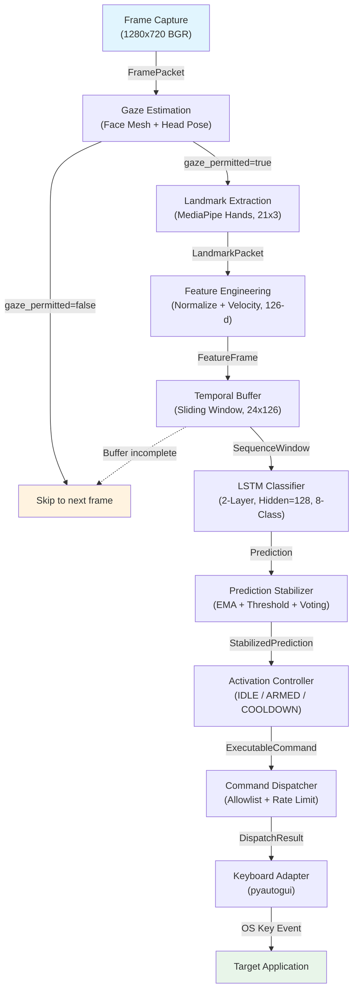

# Data Flow

## 1. Overview

This document describes the complete data flow through the real-time inference pipeline, from camera frame acquisition to keyboard command execution. Each stage is documented with its input type, transformation logic, and output type.

## 2. Pipeline Data Flow Diagram



## 3. Stage-by-Stage Description

### Stage 1: Frame Capture

**Component**: `OpenCVFrameSource`  
**Input**: Webcam hardware stream  
**Output**: `FramePacket`

| Field          | Type                           | Description                            |
| -------------- | ------------------------------ | -------------------------------------- |
| `frame`        | `numpy.ndarray` (H×W×3, uint8) | BGR color image                        |
| `timestamp_ms` | `float`                        | Capture timestamp in milliseconds      |
| `frame_id`     | `int`                          | Monotonically increasing frame counter |

The frame source reads from `cv2.VideoCapture` with a buffer size of 1 to minimize latency. Frame timing is enforced to match the configured target FPS (default 30). Each frame is assigned a monotonic timestamp for pipeline synchronization.

### Stage 2: Landmark Extraction

**Component**: `MediaPipeHandsExtractor`  
**Input**: `FramePacket`  
**Output**: `LandmarkPacket`

| Field          | Type                            | Description                                        |
| -------------- | ------------------------------- | -------------------------------------------------- |
| `landmarks`    | `numpy.ndarray` (21×3, float32) | Hand landmark coordinates (x, y, z)                |
| `handedness`   | `str`                           | `"Left"` or `"Right"`                              |
| `detect_conf`  | `float`                         | Detection confidence [0, 1]                        |
| `track_conf`   | `float`                         | Tracking confidence [0, 1]                         |
| `timestamp_ms` | `float`                         | Inherited from input frame                         |
| `valid`        | `bool`                          | `True` if hand detected with sufficient confidence |

The BGR frame is converted to RGB and processed by MediaPipe Hands. The model extracts 21 hand landmarks representing the wrist, palm, and finger joints. If detection confidence falls below the configured threshold (default 0.7) or no hand is detected, the packet is marked `valid=False`.

**Landmark indices (MediaPipe convention)**:

- 0: Wrist
- 1–4: Thumb (CMC, MCP, IP, TIP)
- 5–8: Index finger
- 9–12: Middle finger
- 13–16: Ring finger
- 17–20: Pinky finger

### Stage 3: Feature Engineering

**Component**: `LandmarkFeatureTransformer`  
**Input**: `LandmarkPacket`  
**Output**: `FeatureFrame`

| Field          | Type                       | Description                                        |
| -------------- | -------------------------- | -------------------------------------------------- |
| `vector`       | `list[float]` (length 126) | Normalized position + velocity features            |
| `timestamp_ms` | `float`                    | Inherited from input                               |
| `valid`        | `bool`                     | `False` if input was invalid (zero vector emitted) |

The transformation pipeline applies four sequential operations:

1. **Wrist-relative centering**: All 21 landmarks are translated so that the wrist (landmark 0) is at the origin: `l_i' = l_i - l_0`.

2. **Scale normalization**: Landmarks are divided by the Euclidean distance from the origin to landmark 9 (middle finger MCP joint), which approximates hand scale: `l_i'' = l_i' / ||l_9'||`.

3. **Orientation normalization** (optional, disabled by default): Landmarks are rotated to a canonical orientation based on the wrist-to-middle-finger axis.

4. **Velocity computation**: Per-landmark velocity is computed as the difference between current and previous frame landmarks divided by the time delta: `v_i = (l_i_current - l_i_previous) / Δt`.

The output vector is the concatenation of all position coordinates followed by all velocity coordinates:

```
[x₀, y₀, z₀, x₁, y₁, z₁, ..., x₂₀, y₂₀, z₂₀,     ← 63 position dims
 vx₀, vy₀, vz₀, vx₁, vy₁, vz₁, ..., vx₂₀, vy₂₀, vz₂₀]  ← 63 velocity dims
```

If the input `LandmarkPacket` is invalid, a zero vector with `valid=False` is emitted to maintain buffer alignment.

### Stage 4: Temporal Buffering

**Component**: `SlidingWindowSequenceBuffer`  
**Input**: `FeatureFrame`  
**Output**: `SequenceWindow` (when ready) or no output (buffer accumulating)

| Field                | Type                              | Description                                 |
| -------------------- | --------------------------------- | ------------------------------------------- |
| `features`           | `numpy.ndarray` (24×126, float32) | Stacked feature vectors                     |
| `start_timestamp_ms` | `float`                           | Timestamp of the oldest frame in the window |
| `end_timestamp_ms`   | `float`                           | Timestamp of the newest frame in the window |
| `valid_ratio`        | `float`                           | Fraction of frames with `valid=True`        |

The buffer is a fixed-length deque (default length 24). Feature frames are pushed on every iteration. A window is emitted when three conditions are met:

1. The deque is full (24 frames accumulated).
2. At least `window_step` frames (default 3) have been pushed since the last emission.
3. The valid-frame ratio meets or exceeds `min_valid_ratio` (default 0.8).

At 30 FPS with step=3, the buffer emits a window approximately every 100 ms. The 24-frame window spans approximately 800 ms of hand motion, capturing sufficient temporal context for dynamic gesture recognition.

### Stage 5: LSTM Inference

**Component**: `GestureLSTMClassifier`  
**Input**: `SequenceWindow`  
**Output**: `Prediction`

| Field         | Type               | Description                          |
| ------------- | ------------------ | ------------------------------------ |
| `class_probs` | `dict[str, float]` | Per-class softmax probabilities      |
| `top_class`   | `str`              | Class label with highest probability |
| `confidence`  | `float`            | Probability of the top class         |

The LSTM model architecture:

```
Input tensor: (1, 24, 126)  — batch=1, sequence=24 frames, features=126
    ↓
LSTM: input_size=126, hidden_size=128, num_layers=2, dropout=0.3
    ↓
Final hidden state: (1, 128)
    ↓
Fully connected: Linear(128, 8)
    ↓
Softmax: 8-class probability distribution
```

The model runs in `torch.no_grad()` evaluation mode. The output dictionary maps each of the 8 gesture labels to its softmax probability.

### Stage 6: Prediction Stabilization

**Component**: `PredictionStabilizer`  
**Input**: `Prediction`  
**Output**: `StabilizedPrediction`

| Field        | Type          | Description                               |
| ------------ | ------------- | ----------------------------------------- |
| `label`      | `str`         | Stabilized gesture label                  |
| `confidence` | `float`       | Smoothed confidence value                 |
| `accepted`   | `bool`        | Whether the prediction passed all filters |
| `reason`     | `str \| None` | Rejection reason if not accepted          |

Three sequential filtering stages:

**EMA Smoothing** (α = 0.4):

```
smoothed[c] = 0.4 × current[c] + 0.6 × previous[c]  for each class c
```

**Confidence Thresholding** (per-class from `production_ipn.yaml`):

```
if smoothed[top_class] < class_thresholds[top_class]:
    label ← "unknown", reason ← "below_threshold_or_unknown"
```

**Temporal Voting** (per-class window from `production_ipn.yaml`):

```
if not all(recent_N == candidate):
    accepted ← False, reason ← "temporal_inconsistency"
```

Dynamic gestures use vote_window=1 (immediate response). Static holds use vote_window=3 (require 3 consecutive agreements).

### Stage 7: Activation Control

**Component**: `GestureActivationController`  
**Input**: `StabilizedPrediction`  
**Output**: `ExecutableCommand | None`

| Field            | Type    | Description                                      |
| ---------------- | ------- | ------------------------------------------------ |
| `command_id`     | `str`   | Mapped command identifier (e.g., `"next_slide"`) |
| `source_gesture` | `str`   | Original gesture label (e.g., `"swipe_right"`)   |
| `issued_at_ms`   | `float` | Timestamp of command issuance                    |

The activation controller state machine (IDLE → ARMED → COOLDOWN) determines whether a stabilized prediction results in a command. See the Process View for detailed state machine behavior.

A command is emitted only when:

- The system is in ARMED mode.
- The prediction is accepted (temporal voting passed).
- The gesture label differs from the last dispatched label (edge trigger).
- The gesture exists in the command map.

Most iterations produce `None` (no command). Commands are emitted approximately once per intentional gesture, typically separated by several seconds.

### Stage 8: Command Dispatch

**Component**: `CommandDispatcher` → `ApplicationAdapter` → `KeyboardAdapter`  
**Input**: `ExecutableCommand`  
**Output**: `DispatchResult`

| Field        | Type   | Description                      |
| ------------ | ------ | -------------------------------- |
| `success`    | `bool` | Whether the command was executed |
| `command_id` | `str`  | The dispatched command ID        |
| `target_app` | `str`  | Target application name          |
| `detail`     | `str`  | Diagnostic message               |

The dispatch chain applies three validation stages before OS interaction:

1. **Allowlist validation**: Command ID checked against `allowed_commands` frozenset.
2. **Rate limiting**: Sliding-window deque enforces maximum dispatch frequency.
3. **Key name validation**: Each key in the shortcut tuple is validated against `_SAFE_KEY_NAMES`.

### Stage 9: Keyboard Execution

**Component**: `KeyboardAdapter`  
**Input**: Validated key tuple from application adapter  
**Output**: OS keyboard event

The keyboard adapter invokes `pyautogui.hotkey(*keys)` with the validated key names. Example command-to-key mappings:

| Command               | PowerPoint Keys | Zoom Keys      |
| --------------------- | --------------- | -------------- |
| `next_slide`          | `("right",)`    | `("right",)`   |
| `previous_slide`      | `("left",)`     | `("left",)`    |
| `raise_hand`          | —               | `("alt", "y")` |
| `start_presentation`  | `("f5",)`       | —              |
| `toggle_pointer_mode` | `("ctrl", "l")` | —              |
| `exit_presentation`   | `("escape",)`   | —              |

## 4. Data Volume Summary

| Pipeline Point  | Data Size                      | Frequency             |
| --------------- | ------------------------------ | --------------------- |
| Raw frame       | ~2.7 MB (1280×720×3)           | 30 Hz                 |
| Landmark packet | 252 bytes (21×3×4)             | 30 Hz                 |
| Feature vector  | 504 bytes (126×4)              | 30 Hz                 |
| Sequence window | 12,096 bytes (24×126×4)        | ~10 Hz                |
| Prediction      | ~200 bytes (8 floats + labels) | ~10 Hz                |
| Command         | ~100 bytes                     | ~0.1 Hz (per gesture) |

The pipeline progressively reduces data volume by approximately four orders of magnitude, from ~2.7 MB raw frames to ~100-byte commands.

## 5. Training Data Flow

The offline training pipeline transforms raw labeled data into a trained model artifact:

```mermaid
graph LR
    subgraph Collection ["Data Collection"]
        Video["IPN Videos<br/>(200 AVI files)"]
        Webcam["Webcam Recording<br/>(interactive)"]
    end

    subgraph Processing ["Dataset Processing"]
        Extract["Landmark Extraction<br/>(MediaPipe)"]
        JSONL["JSONL Output<br/>(labeled landmarks)"]
        Feature["Feature Transform<br/>(126-dim vectors)"]
        Window["Sliding Window<br/>(24×126 sequences)"]
        NPZ["NPZ Dataset<br/>(N × 24 × 126)"]
    end

    subgraph Training ["Model Training"]
        Split["Stratified Split<br/>(70/15/15)"]
        Aug["Augmentation<br/>(temporal + spatial)"]
        LSTM2["LSTM Training<br/>(Adam + class weights)"]
        Eval["Evaluation<br/>(precision, recall, F1)"]
        Export["Export Artifact<br/>(.pt + metadata)"]
    end

    Video --> Extract
    Webcam --> Extract
    Extract --> JSONL
    JSONL --> Feature
    Feature --> Window
    Window --> NPZ
    NPZ --> Split
    Split --> Aug
    Aug --> LSTM2
    LSTM2 --> Eval
    Eval --> Export
```



The training pipeline reuses `LandmarkFeatureTransformer` and `SlidingWindowSequenceBuffer` from the inference pipeline, ensuring identical feature computation between training and deployment.

---

**Document**: Data Flow  
**Suite**: Architecture Documentation (`docs/architecture/`)  
**Last Updated**: March 2026
