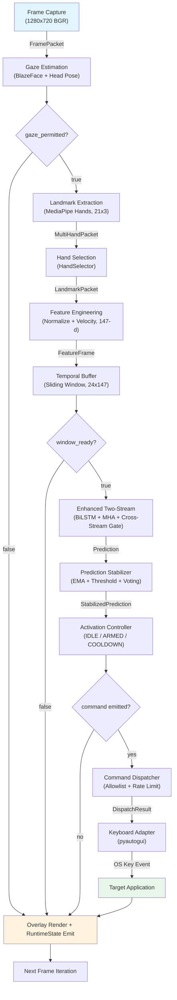

# Data Flow

## 1. Overview

This document describes the complete data flow through the real-time inference pipeline, from camera frame acquisition to keyboard command execution. Each stage is documented with its input type, transformation logic, and output type.

## 2. Pipeline Data Flow Diagram



## 3. Stage-by-Stage Description

### Stage 1: Frame Capture

**Component**: `OpenCVFrameSource`  
**Input**: Webcam hardware stream  
**Output**: `FramePacket`

| Field          | Type                           | Description                            |
| -------------- | ------------------------------ | -------------------------------------- |
| `frame`        | `numpy.ndarray` (H×W×3, uint8) | BGR color image                        |
| `timestamp_ms` | `float`                        | Capture timestamp in milliseconds      |
| `frame_id`     | `int`                          | Monotonically increasing frame counter |

The frame source reads from `cv2.VideoCapture` with a buffer size of 1 to minimize latency. Frame timing is enforced to match the configured target FPS (default 30). Each frame is assigned a monotonic timestamp for pipeline synchronization.

### Stage 2: Gaze Estimation

**Component**: `HeadPoseGazeDetector` (or `NullGazeDetector` when `gaze.enabled: false`)
**Input**: `FramePacket`
**Output**: `gaze_permitted: bool`

| Output Value | Condition                                                                                           | Pipeline Effect                              |
| ------------ | --------------------------------------------------------------------------------------------------- | -------------------------------------------- |
| `True`       | User head pose within ±30° yaw and ±25° pitch; gaze state is ACTIVE or LOSING (within grace period) | Downstream stages proceed normally           |
| `False`      | No face detected, head pose outside thresholds, or gaze state is ABSENT or ACQUIRING                | All downstream stages skipped for this frame |

The detector maintains a four-state machine (ABSENT → ACQUIRING → ACTIVE → LOSING). BlazeFace is sampled every `sample_interval_frames` frames (default 3) at approximately 10 Hz; the cached result is returned on intervening frames at negligible cost. When the LOSING→ABSENT transition fires, `GestureActivationController.force_idle()` is invoked to reset any in-progress gesture hold, preventing an armed system from persisting unattended.

The BGR frame is converted to RGB and processed by MediaPipe BlazeFace face detection (`mediapipe.solutions.face_detection.FaceDetection`). BlazeFace provides 6 face keypoints directly — right eye, left eye, nose tip, mouth center, and ear tragions — eliminating the 468 unused landmarks computed by the previous Face Mesh model. Head orientation is computed by fitting a Perspective-n-Point (PnP) pose from these 6 keypoints and resolving Euler angles from the resulting rotation matrix.

This stage does not produce a domain entity. `gaze_permitted` flows directly into the runtime loop control path and is stored in `RuntimeState` for overlay rendering.

### Stage 3: Landmark Extraction

**Component**: `MediaPipeHandsExtractor`  
**Input**: `FramePacket`  
**Output**: `MultiHandPacket`

The extractor is preference-agnostic: it always configures MediaPipe with `max_num_hands=2` and returns every detected hand without filtering.

| Field          | Type                  | Description                                           |
| -------------- | --------------------- | ----------------------------------------------------- |
| `hands`        | `list[HandLandmarks]` | 0–2 entries ordered by MediaPipe detection confidence |
| `timestamp_ms` | `int`                 | Inherited from input frame                            |

Each `HandLandmarks` entry contains:

| Field         | Type                | Description                                        |
| ------------- | ------------------- | -------------------------------------------------- |
| `label`       | `str`               | MediaPipe selfie-view label: `"Left"` or `"Right"` |
| `landmarks`   | `list[list[float]]` | 21 × [x, y, z] hand landmark coordinates           |
| `detect_conf` | `float`             | MediaPipe handedness classification score [0, 1]   |
| `track_conf`  | `float`             | Ratio of finite (non-NaN) landmark points [0, 1]   |

The BGR frame is converted to RGB using `cv2.cvtColor` (producing a C-contiguous array required by MediaPipe's C extensions) and processed by `mediapipe.solutions.hands.Hands`. If no hands are detected, `hands` is an empty list.

> **Note on handedness labels**: MediaPipe assumes a mirrored (selfie-view) frame. In a standard non-mirrored webcam feed the user's physical right hand is labelled `"Left"` and vice versa. Hand-preference resolution is delegated to `HandSelector` in Stage 4.

**Landmark indices (MediaPipe convention)**:

- 0: Wrist
- 1–4: Thumb (CMC, MCP, IP, TIP)
- 5–8: Index finger
- 9–12: Middle finger
- 13–16: Ring finger
- 17–20: Pinky finger

### Stage 4: Hand Selection

**Component**: `HandSelector`  
**Input**: `MultiHandPacket`  
**Output**: `LandmarkPacket`

| Field          | Type                | Description                                                     |
| -------------- | ------------------- | --------------------------------------------------------------- |
| `landmarks`    | `list[list[float]]` | 21 × [x, y, z] coordinates of the selected hand                 |
| `handedness`   | `str \| None`       | MediaPipe label of the selected hand (`"Left"` / `"Right"`)     |
| `detect_conf`  | `float`             | Detection confidence of the selected hand [0, 1]                |
| `track_conf`   | `float`             | Track confidence of the selected hand [0, 1]                    |
| `timestamp_ms` | `int`               | Inherited from input                                            |
| `valid`        | `bool`              | `True` only if a qualifying hand was found above all thresholds |

`HandSelector` applies the user's `hand_preference` configuration to choose one hand from the `MultiHandPacket`:

- **`hand_preference: "right"` / `"left"`**: Selects the hand whose MediaPipe label matches the inverted mapping (`"right"` → MP `"Left"`, `"left"` → MP `"Right"`). If the preferred hand is absent, the first detected hand is returned with `valid=False`.
- **`hand_preference: "both"`**: Selects the hand with the highest `detect_conf`.

A packet is marked `valid=True` only if the selected hand's `detect_conf ≥ min_handedness_conf` (default 0.7) and `track_conf ≥ min_track_conf` (default 0.5).

### Stage 5: Feature Engineering

**Component**: `LandmarkFeatureTransformer`  
**Input**: `LandmarkPacket`  
**Output**: `FeatureFrame`

| Field          | Type                       | Description                                        |
| -------------- | -------------------------- | -------------------------------------------------- |
| `vector`       | `list[float]` (length 147) | Normalized position + velocity features            |
| `timestamp_ms` | `float`                    | Inherited from input                               |
| `valid`        | `bool`                     | `False` if input was invalid (zero vector emitted) |

The transformation pipeline applies four sequential operations:

1. **Wrist-relative centering**: All 21 landmarks are translated so that the wrist (landmark 0) is at the origin: `l_i' = l_i - l_0`.

2. **Scale normalization**: Landmarks are divided by the Euclidean distance from the origin to landmark 9 (middle finger MCP joint), which approximates hand scale: `l_i'' = l_i' / ||l_9'||`.

3. **Orientation normalization** (optional, disabled by default): Landmarks are rotated to a canonical orientation based on the wrist-to-middle-finger axis.

4. **Velocity computation**: Per-landmark velocity is computed as the difference between current and previous frame landmarks divided by the time delta: `v_i = (l_i_current - l_i_previous) / Δt`.

The output vector is the concatenation of six feature blocks (feature-schema-v5):

```
[x₀…z₂₀]                        ← 63 dims  (positions)
[d₀₁, d₀₂, d₀₃, d₀₄, d₀₅]      ←  5 dims  (fingertip spread)
[Δwx, Δwy, Δwz]                 ←  3 dims  (wrist trajectory in window)
[vx₀…vz₂₀]                      ← 63 dims  (velocity)
[θ₀…θ₉]                         ← 10 dims  (MCP + PIP joint angles)
[vwx, vwy, vwz]                 ←  3 dims  (wrist velocity, camera-normalised)
                                 ─────────
                                   147 dims total (feature-schema-v5)
```

If the input `LandmarkPacket` is invalid, a zero vector with `valid=False` is emitted to maintain buffer alignment.

### Stage 6: Temporal Buffering

**Component**: `SlidingWindowSequenceBuffer`  
**Input**: `FeatureFrame`  
**Output**: `SequenceWindow` (when ready) or no output (buffer accumulating)

| Field                | Type                              | Description                                 |
| -------------------- | --------------------------------- | ------------------------------------------- |
| `features`           | `numpy.ndarray` (24×147, float32) | Stacked feature vectors                     |
| `start_timestamp_ms` | `float`                           | Timestamp of the oldest frame in the window |
| `end_timestamp_ms`   | `float`                           | Timestamp of the newest frame in the window |
| `valid_ratio`        | `float`                           | Fraction of frames with `valid=True`        |

The buffer is a fixed-length deque (default length 24). Feature frames are pushed on every iteration. A window is emitted when three conditions are met:

1. The deque is full (24 frames accumulated).
2. At least `window_step` frames (default 3) have been pushed since the last emission.
3. The valid-frame ratio meets or exceeds `min_valid_ratio` (default 0.8).

At 30 FPS with step=3, the buffer emits a window approximately every 100 ms. The 24-frame window spans approximately 800 ms of hand motion, capturing sufficient temporal context for dynamic gesture recognition.

### Stage 7: Enhanced Two-Stream Inference

**Component**: `EnhancedTwoStreamLSTM`  
**Input**: `SequenceWindow`  
**Output**: `Prediction`

| Field         | Type               | Description                          |
| ------------- | ------------------ | ------------------------------------ |
| `class_probs` | `dict[str, float]` | Per-class softmax probabilities      |
| `top_class`   | `str`              | Class label with highest probability |
| `confidence`  | `float`            | Probability of the top class         |

The runtime uses `two_stream_attn_v1` as the authoritative architecture:

- Feature partition remains deterministic: pose stream (73 dims) + motion stream (74 dims).
- Each stream is projected, encoded with BiLSTM, then refined by multi-head self-attention.
- Mean+max pooled stream contexts are recalibrated through cross-stream MLP gates.
- A LayerNorm/GELU MLP head produces final class logits.

See also: `enhanced-two-stream-lstm-architecture.md` for the full component-level model design.

The two-stream architecture addresses the directional signal dilution identified in the model improvement plan (Tier 4-A): the 6 critical directional dims (`wrist_traj` + `wrist_vel_raw`) previously competed for gradient weight with 141 pose and velocity dims in a single LSTM. Stream B gives motion features a fully independent representational pathway, eliminating within-timestep feature competition that Bahdanau attention alone cannot resolve (attention operates over time, not over feature dimensions).

The model runs in `torch.no_grad()` evaluation mode. `checkpoint_loader.py` validates that `artifact_type` equals `two_stream_attn_inference` before reconstructing the model; any other artifact type raises `ValueError` to prevent silent failure.

### Stage 8: Prediction Stabilization

**Component**: `PredictionStabilizer`  
**Input**: `Prediction`  
**Output**: `StabilizedPrediction`

| Field        | Type          | Description                               |
| ------------ | ------------- | ----------------------------------------- |
| `label`      | `str`         | Stabilized gesture label                  |
| `confidence` | `float`       | Smoothed confidence value                 |
| `accepted`   | `bool`        | Whether the prediction passed all filters |
| `reason`     | `str \| None` | Rejection reason if not accepted          |

Three sequential filtering stages:

**EMA Smoothing** (α = 0.4):

```
smoothed[c] = 0.4 × current[c] + 0.6 × previous[c]  for each class c
```

**Confidence Thresholding** (per-class from `production_ipn.yaml`):

```
if smoothed[top_class] < class_thresholds[top_class]:
    label ← "unknown", reason ← "below_threshold_or_unknown"
```

**Temporal Voting** (per-class window from `production_ipn.yaml`):

```
if not all(recent_N == candidate):
    accepted ← False, reason ← "temporal_inconsistency"
```

Dynamic gestures use vote_window=1 (immediate response). Static holds use vote_window=3 (require 3 consecutive agreements).

### Stage 9: Activation Control

**Component**: `GestureActivationController`  
**Input**: `StabilizedPrediction`  
**Output**: `ExecutableCommand | None`

| Field            | Type    | Description                                      |
| ---------------- | ------- | ------------------------------------------------ |
| `command_id`     | `str`   | Mapped command identifier (e.g., `"next_slide"`) |
| `source_gesture` | `str`   | Original gesture label (e.g., `"swipe_right"`)   |
| `issued_at_ms`   | `float` | Timestamp of command issuance                    |

The activation controller state machine (IDLE → ARMED → COOLDOWN) determines whether a stabilized prediction results in a command. See the Process View for detailed state machine behavior.

A command is emitted only when:

- The system is in ARMED mode.
- The prediction is accepted (temporal voting passed).
- The gesture label differs from the last dispatched label (edge trigger).
- The gesture exists in the command map.

Most iterations produce `None` (no command). Commands are emitted approximately once per intentional gesture, typically separated by several seconds.

### Stage 10: Command Dispatch

**Component**: `CommandDispatcher` → `ApplicationAdapter` → `KeyboardAdapter`  
**Input**: `ExecutableCommand`  
**Output**: `DispatchResult`

| Field        | Type   | Description                      |
| ------------ | ------ | -------------------------------- |
| `success`    | `bool` | Whether the command was executed |
| `command_id` | `str`  | The dispatched command ID        |
| `target_app` | `str`  | Target application name          |
| `detail`     | `str`  | Diagnostic message               |

The dispatch chain applies three validation stages before OS interaction:

1. **Allowlist validation**: Command ID checked against `allowed_commands` frozenset.
2. **Rate limiting**: Sliding-window deque enforces maximum dispatch frequency.
3. **Key name validation**: Each key in the shortcut tuple is validated against `_SAFE_KEY_NAMES`.

### Stage 11: Keyboard Execution

**Component**: `KeyboardAdapter`  
**Input**: Validated key tuple from application adapter  
**Output**: OS keyboard event

The keyboard adapter invokes `pyautogui.hotkey(*keys)` with the validated key names. `PresentationAdapter` command-to-key mappings:

| Command                   | Key(s)                                                       |
| ------------------------- | ------------------------------------------------------------ |
| `next_slide`              | `("right",)`                                                 |
| `previous_slide`          | `("left",)`                                                  |
| `scroll_forward`          | `("down",)`                                                  |
| `scroll_back`             | `("up",)`                                                    |
| `zoom_in_view`            | `("command", "equal")` macOS / `("ctrl", "equal")` Win/Linux |
| `zoom_out_view`           | `("command", "minus")` macOS / `("ctrl", "minus")` Win/Linux |
| `start_stop_presentation` | `("command", "enter")` macOS / `("f5",)` Win/Linux           |
| `no_action`               | _(no keystroke; returns `success=False`)_                    |

## 4. UI State Delivery

`RuntimeState` is produced at the end of every frame iteration and is the exclusive data
contract between the inference loop and the UI layer. It is not a pipeline stage — it is
assembled from existing pipeline state variables and passed to an optional callback.

### Production

After every frame (whether or not a command was dispatched), `Runtime.run()` assembles a
`RuntimeState` and calls `self._on_state(state)` if the callback is not `None`. The callback is
provided by `_RuntimeThread._handle_state()` in the UI path.

### Throttling

`_RuntimeThread._handle_state()` increments a private frame counter and emits the
`state_ready` Qt signal only every `emit_every` frames (default 3). At 30 FPS, this caps UI
signal traffic at approximately 10 Hz. The counter is private to the worker thread; no
synchronization is required.

### Cross-Thread Delivery

Qt's queued signal connection delivers each emitted `RuntimeState` from the worker thread to
the main (Qt event loop) thread via Qt's event queue. The `RuntimeState` frozen dataclass is
safe to pass across thread boundaries without copying or locking.

### Consumers

| Consumer            | Connected Signal                  | Fields Read                                                 |
| ------------------- | --------------------------------- | ----------------------------------------------------------- |
| `StatusMonitor`     | `RuntimeController.state_updated` | All fields                                                  |
| `MainWindow` (tray) | `RuntimeController.state_updated` | `gaze_permitted`, `info["accepted"]`, `last_label`          |
| `MainWindow` (log)  | `RuntimeController.state_updated` | `mode`, `info["accepted"]`, `last_label`, `last_confidence` |

### CLI Path

When the system is launched via `scripts/run_realtime.py`, `on_state` is `None`. No
`RuntimeState` objects are emitted to any callback; the inference loop is completely unmodified
from its pre-UI implementation.

## 5. Data Volume Summary

| Pipeline Point    | Data Size                      | Frequency             |
| ----------------- | ------------------------------ | --------------------- |
| Raw frame         | ~2.7 MB (1280×720×3)           | 30 Hz                 |
| Multi-hand packet | 0–504 bytes (0–2 × 21×3×4)     | 30 Hz                 |
| Landmark packet   | 252 bytes (21×3×4)             | 30 Hz                 |
| Feature vector    | 588 bytes (147×4)              | 30 Hz                 |
| Sequence window   | 14,112 bytes (24×147×4)        | ~10 Hz                |
| Prediction        | ~200 bytes (8 floats + labels) | ~10 Hz                |
| Command           | ~100 bytes                     | ~0.1 Hz (per gesture) |

The pipeline progressively reduces data volume by approximately four orders of magnitude, from ~2.7 MB raw frames to ~100-byte commands.

## 5. Training Data Flow

The offline training pipeline transforms raw labeled data into a trained model artifact:

```mermaid
graph LR
    subgraph Collection ["Data Collection"]
        Video["IPN Videos<br/>(200 AVI files)"]
        Webcam["Webcam Recording<br/>(interactive)"]
    end

    subgraph Processing ["Dataset Processing"]
        Extract["Landmark Extraction<br/>(MediaPipe)"]
        JSONL["JSONL Output<br/>(labeled landmarks)"]
        Feature["Feature Transform<br/>(126-dim vectors)"]
        Window["Sliding Window<br/>(24×126 sequences)"]
        NPZ["NPZ Dataset<br/>(N × 24 × 126)"]
    end

    subgraph Training ["Model Training"]
        Split["Stratified Split<br/>(70/15/15)"]
        Aug["Augmentation<br/>(temporal + spatial)"]
        LSTM2["LSTM Training<br/>(Adam + class weights)"]
        Eval["Evaluation<br/>(precision, recall, F1)"]
        Export["Export Artifact<br/>(.pt + metadata)"]
    end

    Video --> Extract
    Webcam --> Extract
    Extract --> JSONL
    JSONL --> Feature
    Feature --> Window
    Window --> NPZ
    NPZ --> Split
    Split --> Aug
    Aug --> LSTM2
    LSTM2 --> Eval
    Eval --> Export
```



The training pipeline reuses `LandmarkFeatureTransformer` and `SlidingWindowSequenceBuffer` from the inference pipeline, ensuring identical feature computation between training and deployment.

---

**Document**: Data Flow  
**Suite**: Architecture Documentation (`docs/architecture/`)  
**Last Updated**: April 2026
