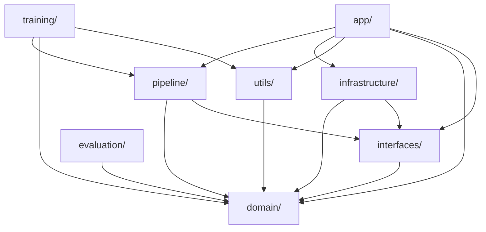

# Development View

## 1. Overview

The development view describes the system's source code organization, module decomposition, and dependency structure from a developer's perspective. The codebase follows a layered package architecture with dependency inversion enforced through Protocol interfaces.

## 2. Repository Structure

```
Semantic-HGR-System/
├── configs/                          # Runtime and model configuration (YAML)
│   ├── app.yaml                      # Camera, FPS, active application
│   ├── inference.yaml                # Window geometry, activation timing, thresholds
│   ├── logging.yaml                  # Logging configuration
│   ├── gestures/
│   │   ├── vocabulary_ipn.yaml       # Gesture class vocabulary (8 classes)
│   │   └── command_map_ipn.yaml      # Gesture-to-command mapping
│   ├── model/
│   │   ├── lstm_default.yaml         # LSTM architecture and training hyperparameters
│   │   └── feature_pipeline.yaml     # Feature normalization toggles
│   └── thresholds/
│       └── production_ipn.yaml       # Per-class confidence thresholds and vote windows
├── src/gesture_control/              # Main application package
│   ├── app/                          # Application layer
│   ├── domain/                       # Domain entities and interfaces
│   ├── interfaces/                   # Protocol definitions
│   ├── infrastructure/               # External library adapters
│   ├── pipeline/                     # Inference pipeline components
│   ├── training/                     # Offline training pipeline
│   ├── evaluation/                   # Benchmarking utilities
│   └── utils/                        # Shared utilities
├── scripts/                          # CLI entry points
├── tests/                            # Test suite
│   ├── unit/                         # Isolated component tests
│   ├── integration/                  # Multi-component pipeline tests
│   ├── system/                       # End-to-end system tests
│   └── fixtures/                     # Test data and configurations
├── models/                           # Trained model artifacts
│   ├── checkpoints/                  # Training checkpoints
│   ├── exported/                     # Inference-ready artifacts
│   └── registry.json                 # Model version registry
├── data/                             # Dataset files
│   ├── raw/                          # JSONL landmark recordings
│   └── processed/                    # NPZ sequence datasets
├── experiments/
│   └── runs/                         # Training run logs
├── docs/                             # Project documentation
│   ├── architecture/                 # Architecture documentation suite
│   └── work-logs/                    # Development session logs
├── tools/                            # Development scripts (lint, test, profile)
├── requirements/                     # Dependency specifications
├── pyproject.toml                    # Project metadata and build configuration
└── ARCHITECTURE_SPECIFICATION.md     # System architecture specification
```

## 3. Package Decomposition

### 3.1 `src/gesture_control/domain/`

**Purpose**: Pure business concepts with no external dependencies.

| Module         | Contents                                                                                                                                                       | Responsibility                                                            |
| -------------- | -------------------------------------------------------------------------------------------------------------------------------------------------------------- | ------------------------------------------------------------------------- |
| `entities.py`  | `FramePacket`, `LandmarkPacket`, `FeatureFrame`, `SequenceWindow`, `Prediction`, `StabilizedPrediction`, `ExecutableCommand`, `DispatchResult`, `RuntimeState` | Immutable data transfer objects representing pipeline state at each stage |
| `enums.py`     | `RuntimeMode`, `CommandID`                                                                                                                                     | Finite state and command vocabularies as `StrEnum` types                  |
| `events.py`    | `DomainEvent`                                                                                                                                                  | Structured event type for telemetry and logging                           |
| `contracts.py` | `IRunnable`, `IClosable`                                                                                                                                       | Minimal lifecycle protocols                                               |

**Dependency rule**: This package imports only from the Python standard library. No other package in the system may be imported here.

### 3.2 `src/gesture_control/interfaces/`

**Purpose**: Protocol definitions for all pipeline services.

| Interface                | Method Signature                                                    | Consumed By                   |
| ------------------------ | ------------------------------------------------------------------- | ----------------------------- |
| `IFrameSource`           | `read() → FramePacket`                                              | Runtime loop                  |
| `IHandLandmarkExtractor` | `extract(FramePacket) → LandmarkPacket`                             | Runtime loop                  |
| `IFeatureTransformer`    | `transform(LandmarkPacket) → FeatureFrame`                          | Runtime loop, dataset builder |
| `ISequenceBuffer`        | `push(FeatureFrame)`, `ready() → bool`, `window() → SequenceWindow` | Runtime loop, dataset builder |
| `IGestureModel`          | `predict(SequenceWindow) → Prediction`                              | Runtime loop                  |
| `IPredictionStabilizer`  | `update(Prediction) → StabilizedPrediction`                         | Runtime loop                  |
| `IActivationController`  | `route(StabilizedPrediction) → ExecutableCommand \| None`           | Runtime loop                  |
| `ICommandDispatcher`     | `dispatch(ExecutableCommand) → DispatchResult`                      | Runtime loop                  |
| `IFeedbackRenderer`      | `render(FramePacket, RuntimeState) → FramePacket`                   | Runtime loop                  |
| `IGazeIntentDetector`    | `update(FramePacket) → bool`, `close() → None`                      | Runtime loop, bootstrap       |

**Dependency rule**: Imports only domain entities. Uses `typing.Protocol` for structural subtyping.

### 3.3 `src/gesture_control/infrastructure/`

**Purpose**: Concrete implementations wrapping external libraries.

| Subpackage               | Module                  | Class                                 | External Dependency |
| ------------------------ | ----------------------- | ------------------------------------- | ------------------- |
| `camera/`                | `opencv_source.py`      | `OpenCVFrameSource`                   | OpenCV              |
| `mediapipe/`             | `hands_extractor.py`    | `MediaPipeHandsExtractor`             | MediaPipe           |
| `model/`                 | `checkpoint_loader.py`  | `InferenceArtifact`, loader functions | PyTorch             |
| `dispatch/`              | `command_dispatcher.py` | `CommandDispatcher`                   | —                   |
| `dispatch/app_adapters/` | `keyboard_adapter.py`   | `KeyboardAdapter`                     | pyautogui           |
| `dispatch/app_adapters/` | `powerpoint_adapter.py` | `PowerPointAdapter`                   | —                   |
| `dispatch/app_adapters/` | `zoom_adapter.py`       | `ZoomAdapter`                         | —                   |
| `feedback/`              | `overlay_renderer.py`   | `OverlayRenderer`                     | OpenCV              |
| `gaze/`                  | `head_pose_detector.py` | `HeadPoseGazeDetector`                | MediaPipe, OpenCV   |
| `gaze/`                  | `null_detector.py`      | `NullGazeDetector`                    | —                   |

**Dependency rule**: May import domain entities, interfaces, and external libraries. Must not import from pipeline, training, or app packages.

### 3.4 `src/gesture_control/pipeline/`

**Purpose**: Stateful inference pipeline components.

| Module                   | Class                         | State                                                        |
| ------------------------ | ----------------------------- | ------------------------------------------------------------ |
| `feature_engineering.py` | `LandmarkFeatureTransformer`  | Previous frame landmarks (for velocity)                      |
| `buffering.py`           | `SlidingWindowSequenceBuffer` | Deque of recent feature frames, step counter                 |
| `stabilization.py`       | `PredictionStabilizer`        | EMA-smoothed probabilities, vote history deque               |
| `activation.py`          | `GestureActivationController` | Current `RuntimeMode`, activation timer, dispatch edge state |

**Dependency rule**: May import domain entities and interfaces. Must not import from infrastructure or app packages. The `LandmarkFeatureTransformer` and `SlidingWindowSequenceBuffer` are shared with the training package to enforce feature parity.

### 3.5 `src/gesture_control/training/`

**Purpose**: Offline dataset construction, model training, evaluation, and export.

| Module                 | Key Classes                                              | Responsibility                                                                  |
| ---------------------- | -------------------------------------------------------- | ------------------------------------------------------------------------------- |
| `dataset_builder.py`   | `SequenceDatasetBuilder`, `LabeledLandmarkFrame`         | Converts JSONL landmark recordings to NPZ sequence datasets                     |
| `datamodule.py`        | `GestureDataModule`, `SequenceTensorDataset`             | PyTorch dataset wrappers with stratified/group splits and optional augmentation |
| `augmentation.py`      | `GestureAugmenter`, `AugmentationConfig`                 | Temporal scaling and spatial jitter for training regularization                 |
| `train_lstm.py`        | `GestureLSTMClassifier`, `train_lstm()`                  | LSTM model definition and training loop with early stopping                     |
| `evaluate.py`          | `evaluate_model()`, `EvaluationReport`                   | Per-class precision, recall, F1; confusion matrix                               |
| `export_checkpoint.py` | `export_inference_artifact()`, `update_model_registry()` | Checkpoint serialization and registry update                                    |

**Dependency rule**: Imports pipeline components (`LandmarkFeatureTransformer`, `SlidingWindowSequenceBuffer`) for training–inference parity. Imports PyTorch and scikit-learn. Not imported by the runtime inference path.

### 3.6 `src/gesture_control/app/`

**Purpose**: Application entry points and dependency wiring.

| Module         | Key Components                      | Responsibility                                                            |
| -------------- | ----------------------------------- | ------------------------------------------------------------------------- |
| `bootstrap.py` | `AppContainer`, `build_container()` | Composition root; reads configs, loads model, instantiates all components |
| `runtime.py`   | `Runtime`                           | Main event loop; sequential frame processing and display                  |
| `main.py`      | `main()`, `parse_args()`            | CLI argument parsing and runtime launch                                   |

**Dependency rule**: May import from all other packages. This is the only package that performs concrete instantiation.

### 3.7 `src/gesture_control/utils/`

**Purpose**: Shared utilities used across training and inference.

| Module                  | Responsibility                                                                             |
| ----------------------- | ------------------------------------------------------------------------------------------ |
| `config_loader.py`      | Reads and validates YAML configuration files                                               |
| `schema_validation.py`  | Pydantic models (`AppConfig`, `InferenceConfig`, `FeaturePipelineConfig`, `RuntimeConfig`) |
| `feature_validation.py` | Dataset–runtime feature schema compatibility checking                                      |
| `time_utils.py`         | Timestamp utilities                                                                        |
| `reproducibility.py`    | Random seed management for NumPy, PyTorch, and Python `random`                             |

### 3.8 `src/gesture_control/evaluation/`

**Purpose**: Runtime performance measurement.

| Module                 | Responsibility                                                                     |
| ---------------------- | ---------------------------------------------------------------------------------- |
| `benchmark_latency.py` | Per-stage latency recording with percentile aggregation and JSON report generation |

## 4. Module Dependency Graph



**Key constraint**: All arrows point downward or laterally. No circular dependencies exist. The domain layer is at the bottom of the dependency hierarchy.

## 5. Configuration Organization

Configuration files are organized by concern:

| Category        | Files                            | Schema                                                              |
| --------------- | -------------------------------- | ------------------------------------------------------------------- |
| **Application** | `app.yaml`                       | `AppConfig` — camera index, resolution, FPS, active application     |
| **Inference**   | `inference.yaml`                 | `InferenceConfig` — window length/step, activation timing, cooldown |
| **Model**       | `model/lstm_default.yaml`        | Training hyperparameters, model architecture, augmentation settings |
| **Features**    | `model/feature_pipeline.yaml`    | `FeaturePipelineConfig` — normalization and velocity toggles        |
| **Vocabulary**  | `gestures/vocabulary_ipn.yaml`   | Gesture class list and activation gesture designation               |
| **Commands**    | `gestures/command_map_ipn.yaml`  | Gesture-to-`CommandID` mapping                                      |
| **Thresholds**  | `thresholds/production_ipn.yaml` | Per-class confidence thresholds and temporal vote window sizes      |

All configuration is validated at startup via Pydantic schemas. Invalid configurations cause immediate failure with descriptive error messages.

## 6. Script Entry Points

| Script                         | Purpose                              | Primary Dependencies                                  |
| ------------------------------ | ------------------------------------ | ----------------------------------------------------- |
| `scripts/run_realtime.py`      | Launch real-time gesture recognition | `app/`, `pipeline/`, `infrastructure/`                |
| `scripts/train_model.py`       | Train LSTM from NPZ dataset          | `training/`, `utils/`                                 |
| `scripts/build_dataset.py`     | Build NPZ from JSONL landmarks       | `training/`, `pipeline/`                              |
| `scripts/build_ipn_dataset.py` | Convert IPN Hand dataset to NPZ      | `training/`, `pipeline/`                              |
| `scripts/collect_data.py`      | Interactive webcam data recording    | `infrastructure/camera/`, `infrastructure/mediapipe/` |
| `scripts/benchmark_system.py`  | Latency profiling                    | `evaluation/`                                         |

## 7. Testing Organization

```
tests/
├── conftest.py                              # Shared fixtures
├── unit/                                    # 17 test modules
│   ├── test_opencv_source.py
│   ├── test_mediapipe_extractor.py
│   ├── test_feature_engineering.py
│   ├── test_sequence_buffer.py
│   ├── test_prediction_stabilization.py
│   ├── test_activation_controller.py
│   ├── test_adapters.py
│   ├── test_dataset_builder.py
│   ├── test_augmentation.py
│   ├── test_training_datamodule.py
│   ├── test_training_export.py
│   ├── test_checkpoint_loader.py
│   ├── test_config_loader.py
│   ├── test_feature_validation.py
│   ├── test_latency_benchmark.py
│   ├── test_overlay_renderer.py
│   ├── test_runtime.py
│   └── test_head_pose_gaze_detector.py
├── integration/                             # 5 test modules
│   ├── test_phase2_pipeline.py
│   ├── test_phase3_feature_pipeline.py
│   ├── test_dataset_generation_pipeline.py
│   ├── test_training_pipeline_smoke.py
│   └── test_gesture_dispatch_pipeline.py
├── system/                                  # End-to-end tests
└── fixtures/                                # Test data and configs
```

**Testing strategy**: Unit tests mock external dependencies (OpenCV, MediaPipe, pyautogui). Integration tests exercise multi-component pipelines with synthetic data. All tests run without GPU, camera hardware, or display server.

---

**Document**: Development View  
**Suite**: Architecture Documentation (`docs/architecture/`)  
**Last Updated**: March 2026
