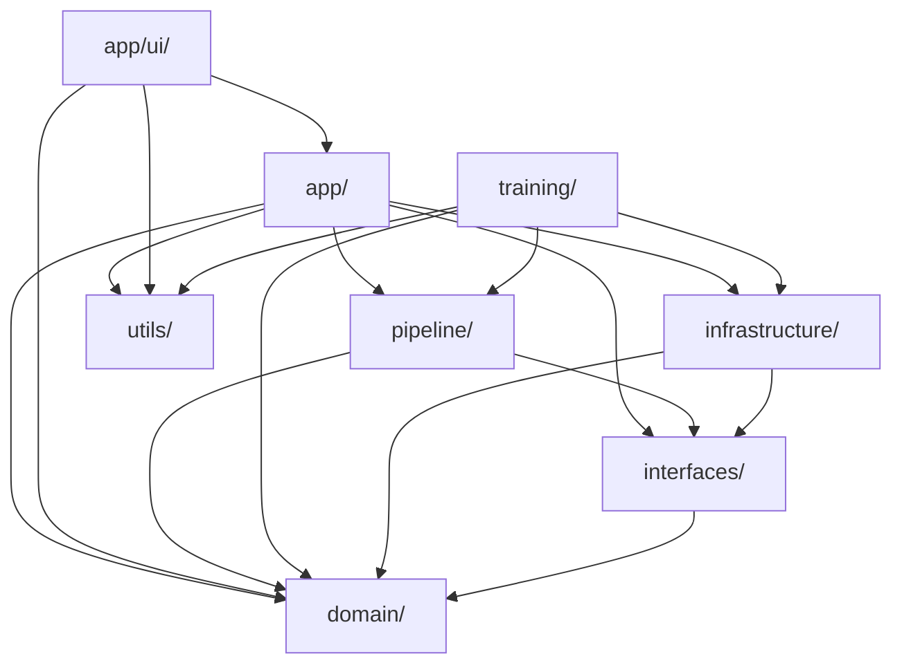

# Development View

## 1. Overview

This development view describes the current source layout after STGCN/legacy cleanup.
The system uses a layered package design with Protocol interfaces and a runtime/training split.

## 2. Repository Structure

```text
Maestro/
├── configs/
│   ├── app.yaml
│   ├── inference.yaml
│   ├── model_source.yaml
│   ├── gestures/
│   │   ├── command_map_presentation.yaml
│   │   ├── vocabulary_ld_cong_hybrid.yaml
│   │   ├── vocabulary_jester.yaml
│   │   └── vocabulary_ipn_10class.yaml
│   ├── model/
│   │   ├── two_stream_attn_ld_cong_10class_2layer_experiment.yaml
│   │   ├── two_stream_attn_jester_2layer_experiment.yaml
│   │   ├── feature_pipeline.yaml
│   │   └── archive/
│   └── thresholds/
│       └── production_hybrid.yaml
├── src/maestro/
│   ├── app/
│   ├── domain/
│   ├── interfaces/
│   ├── infrastructure/
│   ├── pipeline/
│   ├── training/
│   ├── evaluation/
│   └── utils/
├── scripts/
├── tests/
├── docs/
└── notebooks/
```

## 3. Package Decomposition

### 3.1 Domain (`src/maestro/domain/`)

Core dataclasses and enums used by pipeline and runtime:
- `entities.py`: frame/landmark/feature/prediction/runtime state contracts
- `enums.py`: runtime mode vocabulary
- `events.py`: telemetry events
- `contracts.py`: lifecycle contracts

### 3.2 Interfaces (`src/maestro/interfaces/`)

Protocol-based abstractions for frame source, feature extraction, model inference, stabilization,
activation, dispatch, and feedback rendering.

### 3.3 Infrastructure (`src/maestro/infrastructure/`)

Concrete adapters for OpenCV, MediaPipe, model artifact loading, dispatch targets,
overlay rendering, and gaze detectors.

### 3.4 Pipeline (`src/maestro/pipeline/`)

Active runtime pipeline modules:
- `hand_selection.py` (`HandSelector`)
- `feature_engineering.py` (`LandmarkFeatureTransformer`)
- `buffering.py` (`SlidingWindowSequenceBuffer`)
- `stabilization.py` (`PredictionStabilizer`)
- `activation.py` (`GestureActivationController`)
- `laser_pointer.py`, `annotation_pen.py`

### 3.5 Training (`src/maestro/training/`)

Current production training stack is feature-sequence based (no graph/STGCN modules):
- `dataset_builder.py`: `SequenceDatasetBuilder`, `LabeledLandmarkFrame`
- `datamodule.py`: `GestureDataModule`, tensor datasets, split logic
- `augmentation.py`: data augmentation config + augmenter
- `train_lstm.py`: training loop and config parsing for `EnhancedTwoStreamLSTM`
- `evaluate.py`: evaluation metrics and reporting
- `export_checkpoint.py`: inference artifact export and registry update
- `hf_publish.py`: Hugging Face publishing and model card generation

### 3.6 Application (`src/maestro/app/`)

- `bootstrap.py`: dependency container wiring
- `runtime.py`: frame-by-frame runtime loop
- `main.py`: CLI entrypoint
- `ui/`: PySide6 UI modules

### 3.7 App UI (`src/maestro/app/ui/`)

The UI package currently contains:
- `app_ui.py`: Qt app bootstrap
- `controller.py`: runtime worker-thread orchestration
- `main_window.py`: primary control window
- `floating_preview.py`: detached preview window
- `preview_widget.py`: frame rendering widget
- `cli_preview.py`: lightweight preview for CLI mode

## 4. Dependency Direction



## 5. Active Configuration Set

- `configs/model_source.yaml`: production model source (`ntsrigaud/maestro-lstm-hybrid`)
- `configs/gestures/vocabulary_ld_cong_hybrid.yaml`: production vocabulary
- `configs/gestures/command_map_presentation.yaml`: command/mode mapping
- `configs/thresholds/production_hybrid.yaml`: production thresholds
- `configs/model/two_stream_attn_ld_cong_10class_2layer_experiment.yaml`: production training config
- `configs/model/two_stream_attn_jester_2layer_experiment.yaml`: backbone pretraining config

## 6. Script Entry Points

- `scripts/run_ui.py`: launch PySide6 UI
- `scripts/run_realtime.py`: launch runtime without full UI
- `scripts/train_model.py`: training
- `scripts/build_ld_cong_dataset.py`: LD-CONG dataset builder
- `scripts/build_jester_dataset.py`, `scripts/build_ipn_dataset.py`: dataset prep utilities
- `scripts/benchmark_system.py`: runtime benchmark
