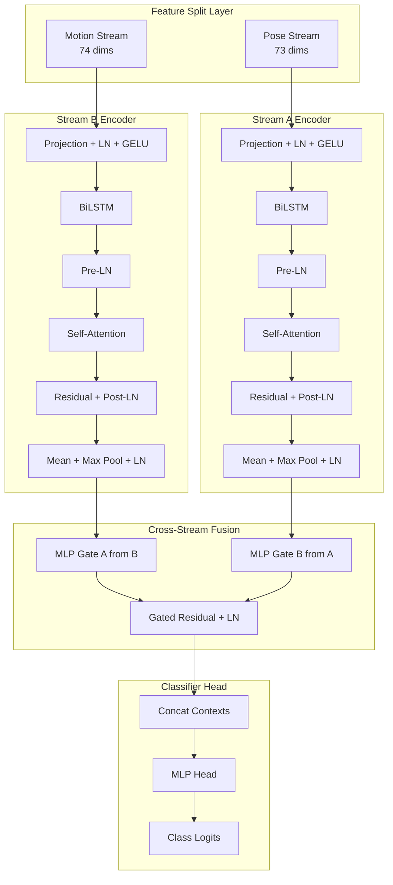

# EnhancedTwoStreamLSTM Architecture

## 1. Purpose

This document is the authoritative architecture reference for the runtime model used by Maestro:

- Model class: `EnhancedTwoStreamLSTM`
- Implementation: `src/maestro/infrastructure/model/two_stream_attn_lstm.py`
- Runtime artifact type: `two_stream_attn_inference`
- Runtime checkpoint loading path: `src/maestro/infrastructure/model/checkpoint_loader.py`

It explains what each component does, why it was added, and how data moves through the model.

---

## 2. Input/Output Contract

- Input tensor shape: `(B, T, 147)`
- Feature schema: `feature-schema-v5`
- Stream split:
  - Stream A (pose/shape): 73 dims = positions `[0:63]` + joint angles `[134:144]`
  - Stream B (motion/dynamics): 74 dims = spread `[63:68]` + trajectory `[68:71]` + velocity `[71:134]` + wrist velocity `[144:147]`
- Output tensor shape: `(B, C)` logits

---

## 3. End-to-End Forward Path

```mermaid
flowchart LR
    X["Input Sequence<br/>B x T x 147"] --> S["Deterministic Split<br/>Pose 73 + Motion 74"]

    S --> PA["Stream A Projection<br/>Linear 73 to proj_dim<br/>LayerNorm + GELU"]
    S --> PB["Stream B Projection<br/>Linear 74 to proj_dim<br/>LayerNorm + GELU"]

    PA --> LA["BiLSTM A<br/>num_layers, dropout"]
    PB --> LB["BiLSTM B<br/>num_layers, dropout"]

    LA --> NA["Pre-LN A"]
    LB --> NB["Pre-LN B"]

    NA --> MHA["Self-Attention A<br/>Q = K = V"]
    NB --> MHB["Self-Attention B<br/>Q = K = V"]

    MHA --> RA["Residual + Post-LN A"]
    MHB --> RB["Residual + Post-LN B"]

    RA --> POOLA["Temporal Pool A<br/>mean + max + LN"]
    RB --> POOLB["Temporal Pool B<br/>mean + max + LN"]

    POOLA --> GA["Cross-Stream Gate A<br/>MLP gate from B<br/>gated residual + LN"]
    POOLB --> GB["Cross-Stream Gate B<br/>MLP gate from A<br/>gated residual + LN"]

    GA --> FUSE["Concatenate<br/>B x (4H)"]
    GB --> FUSE

    FUSE --> HEAD["Head MLP<br/>LN to Linear to GELU to Dropout to Linear"]
    HEAD --> OUT["Logits<br/>B x C"]
```

---

## 4. Component Decomposition

---

## 5. Why Each Component Exists

| Component                 | Why it was added                                                                                 | How it works in this model                                                                 |
| ------------------------- | ------------------------------------------------------------------------------------------------ | ------------------------------------------------------------------------------------------ |
| Feature split (73/74)     | Separate pose/shape from motion cues so directional dynamics do not compete with static geometry | Deterministic index gather before any learned processing                                   |
| Stream projection         | Normalize representational width across streams and decouple raw feature width from model width  | `Linear -> LayerNorm -> GELU` per stream                                                   |
| BiLSTM encoders           | Capture forward and backward temporal context for fixed windows                                  | Independent BiLSTM for each stream, output width `2 * hidden_size`                         |
| Self-attention per stream | Refine temporal saliency after recurrent encoding                                                | `nn.MultiheadAttention` with `Q=K=V` on each stream, residual + normalization              |
| Mean + max pooling        | Preserve both sustained gesture evidence and transient peaks                                     | Element-wise temporal mean plus temporal max, then LayerNorm                               |
| Cross-stream MLP gates    | Lightweight cross-modal recalibration without full cross-attention overhead                      | Two bottleneck MLP gates produce element-wise sigmoid gates used in gated residual updates |
| Deeper MLP head           | Improve non-linear fusion capacity before classification                                         | `LayerNorm -> Linear -> GELU -> Dropout -> Linear`                                         |

---

## 6. Runtime Compatibility Rules

Runtime loading enforces these rules:

1. Artifact type must be `two_stream_attn_inference`.
2. `model_config` must include core fields (`input_size`, `hidden_size`, `num_layers`, `dropout`, `num_classes`).
3. Optional attention fields (`num_heads`, `proj_dim`) are read with defaults when absent.
4. `validate_runtime_compatibility()` checks runtime window and feature schema compatibility before loop start.

---

## 7. Practical Configuration Notes

- Default training config path: `configs/model/two_stream_attn.yaml`
- Typical production profile in repo: `hidden_size=96`, `proj_dim=96`, `num_heads=8`, `num_classes=8`
- Divisibility guard: `2 * hidden_size` must be divisible by `num_heads`

---

## 8. Related References

- `docs/architecture/data-flow.md`
- `docs/architecture/process-view.md`
- `docs/architecture/system-overview.md`
- `docs/ml-system/feature-schema.md`
