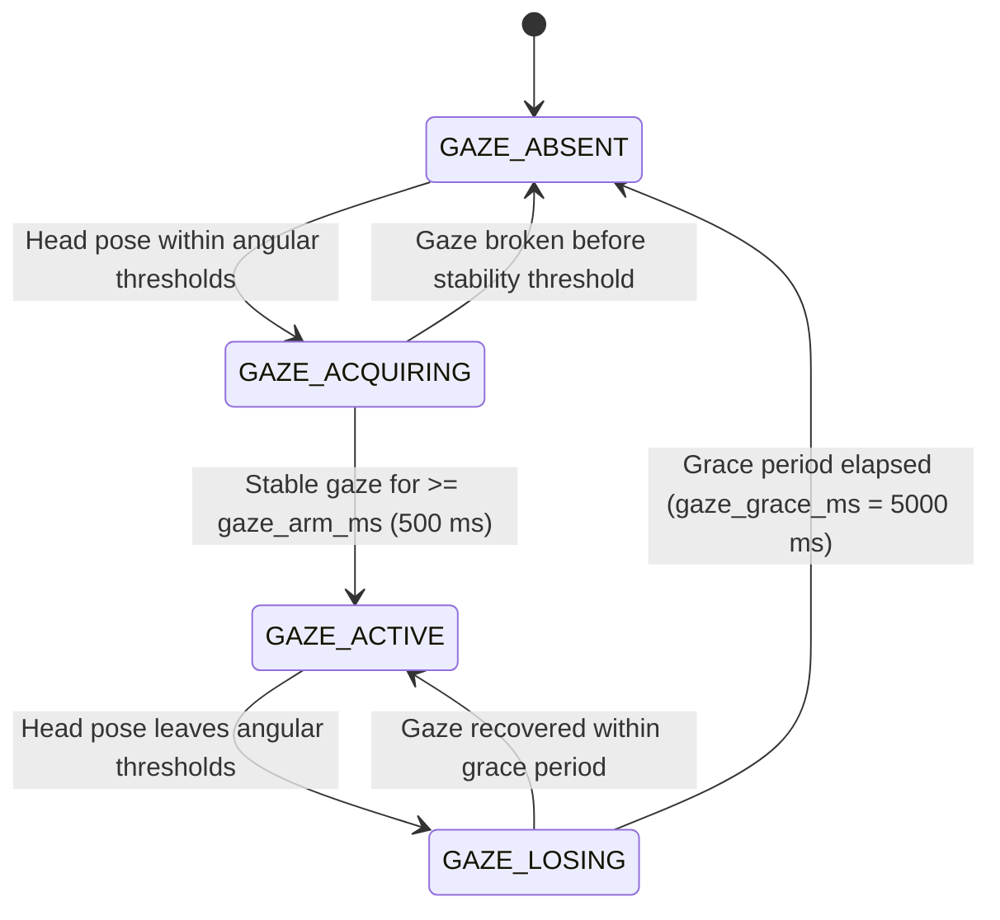
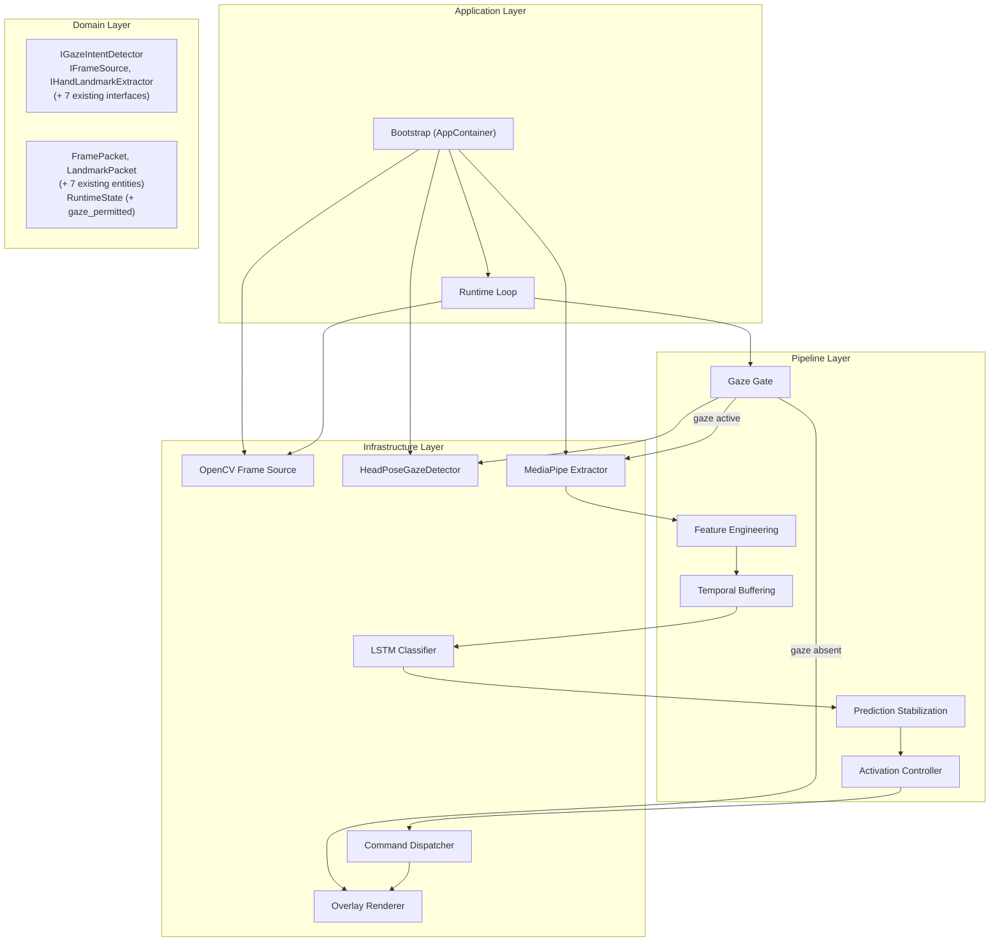

# Gaze-Aware Activation Design

## 0. Executive Summary

This document defines the architecture and implementation plan for extending the Gesture Control System with a gaze-based intent detection mechanism. The proposed mechanism acts as an outermost safety gate: the gesture recognition pipeline is only active when the user is directing their gaze toward the camera. When gaze is absent, the entire downstream pipeline is bypassed.

The design reuses MediaPipe Face Mesh (already a transitive dependency via MediaPipe 0.10.14) combined with OpenCV `solvePnP` head-pose estimation to infer gaze direction from facial landmark geometry. No new runtime dependencies are introduced. The amortized per-frame cost of the mechanism is 1–2 ms when Face Mesh is sampled every third frame.

Design goals:

- Eliminate accidental gesture activation when the user is not attending to the camera
- Provide a second, ambient signal for the system's armed/idle state
- Preserve single-threaded determinism and existing pipeline latency budget
- Introduce no new runtime dependencies
- Degrade gracefully (null implementation available when gaze detection is disabled)

---

## 1. Current Architecture Audit

### 1.1 Pipeline Topology

The system implements a strictly sequential single-threaded event loop in `Runtime.run()`. Prior to the gaze extension, the pipeline executes nine stages per iteration:

| Stage | Component                                | Output Entity               |
| ----- | ---------------------------------------- | --------------------------- |
| 1     | `OpenCVFrameSource.read()`               | `FramePacket`               |
| 2     | `MediaPipeHandsExtractor.extract()`      | `LandmarkPacket`            |
| 3     | `LandmarkFeatureTransformer.transform()` | `FeatureFrame`              |
| 4     | `SlidingWindowSequenceBuffer.push()`     | `SequenceWindow` (periodic) |
| 5     | `GestureLSTMClassifier.predict()`        | `Prediction`                |
| 6     | `PredictionStabilizer.update()`          | `StabilizedPrediction`      |
| 7     | `GestureActivationController.route()`    | `ExecutableCommand \| None` |
| 8     | `CommandDispatcher.dispatch()`           | `DispatchResult`            |
| 9     | `OverlayRenderer.render()`               | Display frame               |

### 1.2 Activation State Machine

`GestureActivationController` implements a three-state machine (IDLE → ARMED → COOLDOWN). It is the sole command gate: no `ExecutableCommand` is emitted unless the controller is in ARMED state with a passing edge-trigger check.

### 1.3 Component Wiring

All components are injected as fields of `AppContainer` (an `@dataclass(slots=True)`) assembled by `src/gesture_control/app/bootstrap.py`. Every component is accessed via a Protocol interface, enabling substitution of any implementation without changes to the runtime loop.

### 1.4 Integration Point Analysis

Three positions in the pipeline are viable insertion points for gaze estimation:

| Position                                                       | Pros                                                                                                                         | Cons                                                                                                |
| -------------------------------------------------------------- | ---------------------------------------------------------------------------------------------------------------------------- | --------------------------------------------------------------------------------------------------- |
| **After frame capture, before landmark extraction** (selected) | Bypasses the entire 35–55 ms downstream cost when gaze is absent; minimal coupling; frame already available as `FramePacket` | Requires one new container field and a two-line addition to the runtime loop                        |
| After MediaPipe Face Mesh (reusing a shared face pipeline)     | No separate Face Mesh instantiation                                                                                          | System has no face pipeline today; introduces ordering dependency between Hands and Face Mesh calls |
| Inside `GestureActivationController.route()`                   | No runtime loop changes                                                                                                      | Violates single responsibility; gaze state is opaque to the overlay renderer                        |

**Decision**: insert gaze estimation as the second stage, immediately after frame capture and before hand landmark extraction.

---

## 2. Gaze Estimation Method Research

### 2.1 Methods Evaluated

**MediaPipe Face Mesh + `solvePnP` head pose** (selected)
: Extracts 468 facial landmarks; head orientation is derived from six canonical 3D reference points via OpenCV `cv2.solvePnP`. CPU latency: 5–15 ms per full call; amortized to ~2 ms at one-in-three frame sampling. Zero new dependencies against the locked project dependency set.

**L2CS-Net / GazeML (CNN appearance-based regression)**
: Achieves ~4° MAE on MPIIFaceGaze and ETH-XGaze benchmarks. CPU latency: 40–80 ms — disqualified on latency alone given the existing 60–80 ms end-to-end pipeline budget.

**Pupil-based tracking (PyGaze, OpenPupil)**
: Requires near-infrared illumination hardware. Not applicable to standard webcam deployments.

**dlib 68-point landmark head pose**
: Functionally equivalent to the selected method, but adds dlib as a heavy new dependency and runs 20–30% slower than MediaPipe for comparable landmark count.

**MediaPipe FaceLandmarker (Tasks API)**
: Newer API over the same underlying model. Incompatible with the Solutions API (`mediapipe.solutions.face_mesh`) used by the existing `MediaPipeHandsExtractor`. Mixing APIs in a single process is unsupported by MediaPipe 0.10.14.

### 2.2 Selected Method: MediaPipe Face Mesh + Head-Pose Proxy

The selected approach uses `mediapipe.solutions.face_mesh.FaceMesh` to extract 468 landmarks, then fits a Perspective-n-Point (PnP) pose using six anatomical reference points:

| Landmark index | Anatomy                |
| -------------- | ---------------------- |
| 1              | Nose tip               |
| 152            | Chin                   |
| 226            | Left eye outer corner  |
| 446            | Right eye outer corner |
| 57             | Left mouth corner      |
| 287            | Right mouth corner     |

The rotation vector from `cv2.solvePnP` is converted to a rotation matrix via `cv2.Rodrigues`, from which Euler angles (yaw, pitch, roll) are extracted. A face is considered "directed toward the camera" when:

```
abs(yaw_deg)   <= gaze_yaw_threshold_deg    (default 30°)
abs(pitch_deg) <= gaze_pitch_threshold_deg  (default 25°)
```

### 2.3 Justification

For a desk-mounted webcam in a presentation room, the camera is positioned at or near the screen. "Gaze toward camera" is a reliable proxy for "screen-directed attention" under these environmental constraints. This proxy is preferred over iris-based estimation (`refine_landmarks=True`) because:

- Iris landmarks add ~5 ms per Face Mesh call
- Head pose is more stable under glasses, partial occlusion, and variable room lighting — all common in presentation environments
- The ±30°/±25° acceptance cone corresponds to well-established thresholds from webcam-based attention detection literature (Stiefelhagen et al., 2002; Murphy-Chutorian & Trivedi, 2009)

---

## 3. Gaze Intent Detector Design

### 3.1 State Machine

`HeadPoseGazeDetector` maintains a four-state machine independent of the gesture activation controller:



**GAZE_ABSENT**: No face detected or head pose exceeds angular thresholds. Returns `gaze_permitted = False`. All pipeline stages after frame capture are bypassed. Any ongoing gesture hold timer in the activation controller is reset via `force_idle()`.

**GAZE_ACQUIRING**: A qualifying head pose has been observed. A stability timer starts. The gesture pipeline remains inactive, preventing instantaneous arming on a brief camera glance. Returns `gaze_permitted = False`.

**GAZE_ACTIVE**: Head pose has remained within thresholds for `gaze_arm_ms` continuously. Returns `gaze_permitted = True`. The downstream gesture pipeline is fully operational.

**GAZE_LOSING**: Head pose has left the acceptance window. A grace timer starts. If the user re-qualifies before the grace period elapses, no state change occurs in the gesture controller, preventing disarming during natural head movements (checking notes, glancing at slides). Returns `gaze_permitted = True` during the grace period.

### 3.2 Configuration Parameters

All thresholds are externalized to `configs/inference.yaml` under a `gaze:` key:

| Parameter                     | Default | Description                                                |
| ----------------------------- | ------- | ---------------------------------------------------------- |
| `gaze.enabled`                | `true`  | Master enable; `false` substitutes `NullGazeDetector`      |
| `gaze.yaw_threshold_deg`      | `30`    | Maximum absolute yaw deviation (degrees)                   |
| `gaze.pitch_threshold_deg`    | `25`    | Maximum absolute pitch deviation (degrees)                 |
| `gaze.arm_ms`                 | `500`   | Continuous gaze duration required to reach GAZE_ACTIVE     |
| `gaze.grace_ms`               | `5000`  | Grace period before GAZE_ACTIVE transitions to GAZE_ABSENT |
| `gaze.sample_interval_frames` | `3`     | Face Mesh call frequency; result cached between calls      |

### 3.3 Combined Two-Tier Gate

The gaze detector and gesture activation controller together form a two-tier command gate:

```
Gaze ABSENT / ACQUIRING   →  gesture pipeline bypassed entirely
Gaze ACTIVE               →  GestureActivationController operates normally
Gaze LOSING → ABSENT      →  GestureActivationController.force_idle() called
```

---

## 4. Architectural Integration

### 4.1 New Modules

**`src/gesture_control/interfaces/gaze_detector.py`** — Protocol interface:

```python
class IGazeIntentDetector(Protocol):
    def update(self, frame: FramePacket) -> bool: ...
    def close(self) -> None: ...
```

**`src/gesture_control/infrastructure/gaze/__init__.py`** — Package init.

**`src/gesture_control/infrastructure/gaze/head_pose_detector.py`** — Production implementation:

```
HeadPoseGazeDetector
│
├── _face_mesh: mediapipe.solutions.face_mesh.FaceMesh
├── _state: GazeState  (ABSENT | ACQUIRING | ACTIVE | LOSING)
├── _stability_start_ms: float | None
├── _grace_start_ms: float | None
├── _frame_counter: int
├── _last_permitted: bool  (cached result for non-sampled frames)
│
├── update(frame: FramePacket) -> bool
│   ├── if frame_counter % sample_interval != 0: return _last_permitted
│   ├── rgb = cv2.cvtColor(frame.frame, cv2.COLOR_BGR2RGB)
│   ├── results = _face_mesh.process(rgb)
│   ├── yaw, pitch = _estimate_head_pose(results)
│   ├── within_cone = abs(yaw) <= yaw_thresh and abs(pitch) <= pitch_thresh
│   ├── _transition(within_cone, now_ms)
│   └── _last_permitted = state in (ACTIVE, LOSING); return _last_permitted
│
└── close() -> None
    └── _face_mesh.close()
```

**`src/gesture_control/infrastructure/gaze/null_detector.py`** — Null implementation (always returns `True`):

```python
class NullGazeDetector:
    def update(self, frame: FramePacket) -> bool:
        return True
    def close(self) -> None:
        pass
```

### 4.2 Domain Layer Changes

No changes to `domain/entities.py`, `domain/enums.py`, or any Protocol interface in `interfaces/` are required. `gaze_permitted` is a transient `bool` returned from `IGazeIntentDetector.update()` that flows directly into runtime loop control flow. It does not enter the pipeline entity graph.

The one required addition to domain entities is an optional `gaze_permitted: bool` field on `RuntimeState`, to expose gaze status to the overlay renderer for ambient visual feedback. No other fields change.

### 4.3 Activation Controller Extension

`GestureActivationController` requires one new method:

```python
def force_idle(self) -> None:
    """Reset to IDLE unconditionally. Called when gaze grace period expires."""
    self._mode = RuntimeMode.IDLE
    self._hold_start_ms = None
    self._cooldown_start_ms = None
```

No changes to `route()`, `_mode`, or any existing state transition logic.

### 4.4 Runtime Loop Integration

In `Runtime.run()`, two additions are required after the frame capture block:

```python
# Stage 2 (new): gaze gate
gaze_permitted = self._container.gaze_detector.update(frame)
if not gaze_permitted:
    self._container.gaze_detector  # grace expiry forces idle on next check
    self._render_overlay(runtime_state_with_gaze_absent)
    continue

# Stages 3–10 remain unchanged
```

The grace expiry → `force_idle()` call is handled inside `HeadPoseGazeDetector._transition()`: when the state transitions from GAZE_LOSING to GAZE_ABSENT, the detector stores a callback reference (or sets a flag read by the runtime loop) that triggers `GestureActivationController.force_idle()`.

### 4.5 AppContainer Extension

```python
@dataclass(slots=True)
class AppContainer:
    frame_source: IFrameSource
    gaze_detector: IGazeIntentDetector          # new
    landmark_extractor: IHandLandmarkExtractor
    feature_transformer: IFeatureTransformer
    sequence_buffer: ISequenceBuffer
    gesture_model: IGestureModel
    prediction_stabilizer: IPredictionStabilizer
    activation_controller: IActivationController
    command_dispatcher: ICommandDispatcher
    feedback_renderer: IFeedbackRenderer
```

The bootstrap function reads `inference.yaml → gaze.enabled` and instantiates either `HeadPoseGazeDetector` (enabled) or `NullGazeDetector` (disabled). Graceful shutdown calls `gaze_detector.close()` alongside the existing `frame_source.close()` and `landmark_extractor.close()` calls.

### 4.6 Updated Component Diagram



---

## 5. Performance and Latency

### 5.1 Per-Stage Cost Breakdown

| Scenario                    | Gaze Absent        | Gaze Active (typical) | Baseline (no gaze) |
| --------------------------- | ------------------ | --------------------- | ------------------ |
| Frame Capture               | 1–2 ms             | 1–2 ms                | 1–2 ms             |
| Gaze Estimation (amortized) | 1–2 ms             | 1–2 ms                | —                  |
| Landmark Extraction         | **0 ms (skipped)** | 15–25 ms              | 15–25 ms           |
| Feature + Buffer + LSTM     | **0 ms (skipped)** | 20–32 ms              | 20–32 ms           |
| Activation + Dispatch       | 0 ms               | < 1 ms                | < 1 ms             |
| Overlay Render              | 1–2 ms             | 1–2 ms                | 1–2 ms             |
| **Total**                   | **3–5 ms**         | **40–62 ms**          | **38–60 ms**       |

Overhead in the gaze-active operating case: **+2 ms** (+3–5%). When the user is not looking, per-frame cost falls from ~80 ms to ~5 ms, preserving CPU thermal headroom during inactive periods.

### 5.2 Optimizations Incorporated by Design

- **Sub-sampled Face Mesh** (`sample_interval_frames = 3`): Face Mesh executes at ~10 Hz; cached `bool` is returned for intermediate frames. No accuracy regression — head pose changes on a scale of hundreds of milliseconds.
- **BGR→RGB conversion reuse**: Both Face Mesh and Hands require RGB input; the conversion is performed once per sampling frame and the result is reused for the subsequent Hands call in the same iteration.
- **No threading**: The single-threaded model is fully preserved. No synchronization primitives, message queues, or executor pools are introduced.
- **Zero-allocation hot path**: On non-sampling frames, `update()` returns the cached `bool` with no NumPy or MediaPipe calls.

---

## 6. Implementation Plan

### Step 1 — Protocol and Configuration Schema

- Create `src/gesture_control/interfaces/gaze_detector.py` defining `IGazeIntentDetector`
- Extend `InferenceConfig` in `src/gesture_control/utils/schema_validation.py` with a `GazeConfig` sub-model containing all parameters listed in Section 3.2
- Add `gaze:` section to `configs/inference.yaml`

### Step 2 — Infrastructure Implementation

- Create `src/gesture_control/infrastructure/gaze/__init__.py`
- Implement `src/gesture_control/infrastructure/gaze/head_pose_detector.py` with `HeadPoseGazeDetector`:
  - Initialize `mediapipe.solutions.face_mesh.FaceMesh(max_num_faces=1, refine_landmarks=False, min_detection_confidence=0.5, min_tracking_confidence=0.5)`
  - Implement `_estimate_head_pose(results)` using the six-point PnP model
  - Implement `_transition(within_cone, now_ms)` for the four-state machine
- Implement `src/gesture_control/infrastructure/gaze/null_detector.py` with `NullGazeDetector`

### Step 3 — Domain and Activation Controller Extension

- Add optional `gaze_permitted: bool = True` field to `RuntimeState` in `src/gesture_control/domain/entities.py`
- Add `force_idle()` method to `GestureActivationController` in `src/gesture_control/pipeline/activation.py`

### Step 4 — Runtime Loop Integration

- Add `gaze_detector: IGazeIntentDetector` field to `AppContainer` in `src/gesture_control/app/bootstrap.py`
- Instantiate `HeadPoseGazeDetector` or `NullGazeDetector` based on `config.gaze.enabled` in `bootstrap.py`
- Add `gaze_detector.close()` to the shutdown sequence in `bootstrap.py`
- Add the two-line gaze gate to `Runtime.run()` in `src/gesture_control/app/runtime.py` immediately after frame capture
- Call `activation_controller.force_idle()` when gaze transitions from LOSING to ABSENT

### Step 5 — Overlay Feedback

- Update `OverlayRenderer.render()` in `src/gesture_control/infrastructure/feedback/overlay_renderer.py` to read `runtime_state.gaze_permitted` and render a distinct border colour:
  - Grey: gaze absent
  - Amber: gaze acquiring
  - Green: gaze active, system armed

### Step 6 — Testing

| Test file                                                      | Coverage                                                                                                                              |
| -------------------------------------------------------------- | ------------------------------------------------------------------------------------------------------------------------------------- |
| `tests/unit/test_head_pose_gaze_detector.py`                   | All four state transitions; amortization cache; `force_idle()` call on ABSENT transition; `NullGazeDetector` always returns `True`    |
| `tests/unit/test_activation_controller.py` (extend)            | `force_idle()` resets all timers; ARMED → IDLE on forced reset                                                                        |
| `tests/integration/test_gesture_dispatch_pipeline.py` (extend) | `gaze_permitted=False` prevents command emission regardless of gesture state; `gaze_permitted=True` preserves full pipeline behaviour |
| `scripts/benchmark_system.py` (extend)                         | Add `gaze_present_latency_ms` and `gaze_absent_latency_ms` metrics                                                                    |

### Step 7 — Documentation

Update the following files after implementation is complete:

| File                                    | Required change                                                                                 |
| --------------------------------------- | ----------------------------------------------------------------------------------------------- |
| `docs/architecture/system-overview.md`  | Confirm 10-stage pipeline table is current                                                      |
| `docs/architecture/process-view.md`     | Verify event loop diagram and timing table are current                                          |
| `docs/architecture/data-flow.md`        | Verify Stage 2 gaze branch is present                                                           |
| `docs/architecture/logical-view.md`     | Add `IGazeIntentDetector` to interface list; add `HeadPoseGazeDetector` to infrastructure layer |
| `docs/architecture/development-view.md` | Add `interfaces/gaze_detector.py` and `infrastructure/gaze/` to module table                    |
| `ARCHITECTURE_SPECIFICATION.md`         | Add `interfaces/gaze_detector.py`, `infrastructure/gaze/` to directory tree in §2               |

---

## 7. Consistency Validation Checklist

Upon implementation completion, verify the following:

- [ ] `HeadPoseGazeDetector` satisfies `IGazeIntentDetector` structurally (duck-typed Protocol)
- [ ] `NullGazeDetector` satisfies `IGazeIntentDetector` structurally
- [ ] `AppContainer.gaze_detector` field is present and typed `IGazeIntentDetector`
- [ ] `configs/inference.yaml` contains all six `gaze.*` parameters with correct defaults
- [ ] `GazeConfig` Pydantic model validates all six parameters with appropriate bounds
- [ ] `GestureActivationController.force_idle()` is covered by a unit test
- [ ] `Runtime.run()` gaze gate is present before landmark extraction
- [ ] Shutdown sequence calls `gaze_detector.close()`
- [ ] All new unit tests pass with `pytest tests/ -q`
- [ ] No existing tests regress

---

**Document**: Gaze-Aware Activation Design  
**Suite**: Architecture Documentation (`docs/architecture/`)  
**Last Updated**: April 2026
