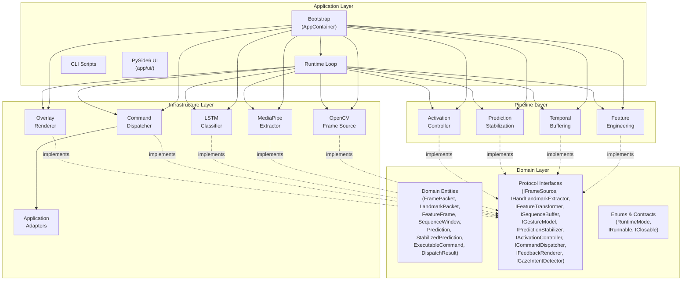

# Logical View

## 1. Overview

The logical view describes the conceptual organization of the system in terms of its major components, their responsibilities, and their interactions. The system follows a layered architecture with dependency inversion: higher layers depend on abstractions defined in the domain layer, not on concrete implementations.

## 2. Component Diagram



## 3. Component Responsibilities

### 3.1 Domain Layer

The domain layer contains pure data structures and abstract contracts. It has no dependencies on external libraries.

| Component               | Responsibility                                                                                                                                                                                                                                        |
| ----------------------- | ----------------------------------------------------------------------------------------------------------------------------------------------------------------------------------------------------------------------------------------------------- |
| **Entities**            | Dataclasses (using `slots=True`) representing pipeline data at each processing stage: `FramePacket`, `LandmarkPacket`, `FeatureFrame`, `SequenceWindow`, `Prediction`, `StabilizedPrediction`, `ExecutableCommand`, `DispatchResult`, `RuntimeState`. |
| **Protocol Interfaces** | Ten `typing.Protocol` definitions that specify the behavioral contract for each pipeline stage. Implementations satisfy these contracts through structural subtyping.                                                                                 |
| **Enums**               | `RuntimeMode` (IDLE, ARMED, COOLDOWN) defines the activation state machine vocabulary.                                                                                                                                                                |
| **Contracts**           | `IRunnable` and `IClosable` protocols for lifecycle management.                                                                                                                                                                                       |

### 3.2 Infrastructure Layer

The infrastructure layer provides concrete implementations of domain interfaces using external libraries.

| Component                   | Interface                | Responsibility                                                                                                                                                                                                                                                                                                                                                                                                                                                                                                                                                                                   |
| --------------------------- | ------------------------ | ------------------------------------------------------------------------------------------------------------------------------------------------------------------------------------------------------------------------------------------------------------------------------------------------------------------------------------------------------------------------------------------------------------------------------------------------------------------------------------------------------------------------------------------------------------------------------------------------ |
| **OpenCVFrameSource**       | `IFrameSource`           | Opens the webcam via `cv2.VideoCapture`, enforces target frame rate, and produces `FramePacket` instances. Buffer size is set to 1 to minimize capture latency.                                                                                                                                                                                                                                                                                                                                                                                                                                  |
| **MediaPipeHandsExtractor** | `IHandLandmarkExtractor` | Wraps `mediapipe.solutions.hands.Hands` to extract 21 hand landmarks per frame. Applies configurable detection and tracking confidence thresholds. Returns `LandmarkPacket` with a validity flag.                                                                                                                                                                                                                                                                                                                                                                                                |
| **TwoStreamGestureLSTM**    | `IGestureModel`          | Loads a trained two-stream LSTM checkpoint (`two_stream_lstm_v1`, ~182 K params) and performs forward inference on sequence windows. The 147-dim input is partitioned into a pose stream (positions + joint_angles, 73 dims) and a motion stream (fingertip_spread + wrist_traj + velocity + wrist_vel_raw, 74 dims). Each stream is processed by an independent 2-layer LSTM with Bahdanau attention; the two 64-dim context vectors are concatenated and projected to an 8-class softmax output. `checkpoint_loader.py` validates `artifact_type == "two_stream_lstm_inference"` at load time. |
| **CommandDispatcher**       | `ICommandDispatcher`     | Enforces command allowlist and rate limiting. Delegates to application-specific adapters. Returns `DispatchResult` with diagnostic detail.                                                                                                                                                                                                                                                                                                                                                                                                                                                       |
| **Application Adapters**    | `IApplicationAdapter`    | `PresentationAdapter` translates command IDs to OS-level keyboard shortcuts for slide navigation, content scrolling, zoom, and presentation start/stop. It delegates to `KeyboardAdapter`, which validates key names against a safe allowlist before invoking `pyautogui.hotkey()`.                                                                                                                                                                                                                                                                                                              |
| **OverlayRenderer**         | `IFeedbackRenderer`      | Renders diagnostic information (mode, gesture label, confidence, FPS, latency) onto the video frame for real-time visual feedback.                                                                                                                                                                                                                                                                                                                                                                                                                                                               |
| **HeadPoseGazeDetector**    | `IGazeIntentDetector`    | Uses MediaPipe BlazeFace face detection and solvePnP to estimate head pose from 6 face keypoints. Implements a 4-state machine (ABSENT → ACQUIRING → ACTIVE → LOSING) gated by yaw/pitch thresholds, arm/grace timers, and a configurable sub-sampling interval.                                                                                                                                                                                                                                                                                                                                 |
| **NullGazeDetector**        | `IGazeIntentDetector`    | Null-object implementation that always grants gaze permission. Used when `gaze.enabled = false` to eliminate all gaze-logic overhead from the runtime path.                                                                                                                                                                                                                                                                                                                                                                                                                                      |

### 3.3 Pipeline Layer

The pipeline layer contains stateful processing components that sit between raw sensor input and command output.

| Component                       | Interface               | Responsibility                                                                                                                                                                                                                                                                                                                               |
| ------------------------------- | ----------------------- | -------------------------------------------------------------------------------------------------------------------------------------------------------------------------------------------------------------------------------------------------------------------------------------------------------------------------------------------- |
| **LandmarkFeatureTransformer**  | `IFeatureTransformer`   | Transforms raw 21×3 landmarks into a **147-dimensional feature vector** (feature-schema-v5) through wrist-relative centering, scale normalization, fingertip spread, wrist trajectory, velocity, joint angles, and wrist velocity in camera-normalized coordinates. Maintains per-frame state for velocity and wrist trajectory computation. |
| **SlidingWindowSequenceBuffer** | `ISequenceBuffer`       | Accumulates feature vectors in a fixed-length deque (default 24 frames). Emits a `SequenceWindow` when the buffer is full, the step interval has elapsed, and the valid-frame ratio exceeds the minimum threshold.                                                                                                                           |
| **PredictionStabilizer**        | `IPredictionStabilizer` | Applies three-stage filtering: (1) exponential moving average smoothing on class probabilities, (2) per-class confidence thresholding, and (3) temporal majority voting over a configurable window.                                                                                                                                          |
| **GestureActivationController** | `IActivationController` | Implements a three-state machine (IDLE → ARMED → COOLDOWN) that gates command dispatch. Requires activation gesture hold for entry, supports idle timeout for exit, and enforces edge-triggered dispatch with cooldown.                                                                                                                      |

### 3.4 Application Layer

| Component        | Responsibility                                                                                                                                                                          |
| ---------------- | --------------------------------------------------------------------------------------------------------------------------------------------------------------------------------------- |
| **AppContainer** | Composition root that instantiates all pipeline components from YAML configuration. Loads model artifacts, vocabulary, command map, and thresholds.                                     |
| **Runtime**      | Main event loop that orchestrates sequential frame processing through all pipeline stages. Manages the OpenCV display window and responds to keyboard interrupts for graceful shutdown. |
| **CLI Scripts**  | Command-line entry points for real-time inference, model training, dataset building, data collection, and benchmarking.                                                                 |

## 4. Interaction Patterns

### 4.1 Dependency Injection

All runtime dependencies are assembled by `AppContainer.build_container()` at startup. The runtime loop receives pre-constructed components and interacts with them only through Protocol interfaces. This enables complete mock-based testing without modifying production code.

### 4.2 Data Flow Contracts

Each pipeline stage consumes a specific entity type and produces the next entity in the chain:

```
IFrameSource.read()                → FramePacket
IHandLandmarkExtractor.extract()   → LandmarkPacket
IFeatureTransformer.transform()    → FeatureFrame
ISequenceBuffer.push() / .window() → SequenceWindow
IGestureModel.predict()            → Prediction
IPredictionStabilizer.update()     → StabilizedPrediction
IActivationController.route()      → ExecutableCommand | None
ICommandDispatcher.dispatch()      → DispatchResult
```

This chain defines a linear pipeline with no branching or feedback loops during normal operation. The overlay renderer operates as a side-channel that reads the current `RuntimeState` for visualization without affecting pipeline progression.

### 4.3 Gesture Recognition Subsystem

The gesture recognition subsystem spans three components:

1. **Feature Engineering**: Converts raw spatial landmarks into a normalized, velocity-augmented representation that is invariant to hand position and scale.
2. **Temporal Buffering**: Aggregates individual feature frames into fixed-length sequences suitable for recurrent network input.
3. **LSTM Classifier**: Processes the temporal sequence and produces a probability distribution over gesture classes.

These three components share a common feature schema that is validated at both training time (embedded in the NPZ dataset) and inference time (checked against the loaded model artifact).

### 4.4 Control Execution Subsystem

The control execution subsystem spans three components:

1. **Prediction Stabilization**: Reduces noise in raw model output through smoothing, thresholding, and temporal consensus.
2. **Activation Control**: Implements the high-level interaction protocol (activate → command → cooldown → ready).
3. **Command Dispatch**: Translates accepted gestures into validated keyboard commands and executes them against the target application.

The separation of stabilization from activation ensures that the state machine receives clean, high-confidence predictions, while the dispatch layer enforces independent safety constraints (allowlist, rate limit, key validation).

## 5. Subsystem Boundaries

```mermaid
graph LR
    subgraph Control ["Control Subsystem (GUI mode)"]
        RC[RuntimeController]
        MW[MainWindow]
    end

    subgraph Perception ["Perception Subsystem"]
        FS[Frame Source]
        LE[Landmark Extractor]
    end

    subgraph Recognition ["Recognition Subsystem"]
        FE[Feature Engineer]
        TB[Temporal Buffer]
        LSTM[LSTM Classifier]
    end

    subgraph Decision ["Decision Subsystem"]
        PS[Prediction Stabilizer]
        AC[Activation Controller]
    end

    subgraph Execution ["Execution Subsystem"]
        CD[Command Dispatcher]
        AA[App Adapters]
        KB[Keyboard Adapter]
    end

    Control -->|manages lifecycle| Perception
    Control -.->|observes RuntimeState| Decision
    Perception --> Recognition
    Recognition --> Decision
    Decision --> Execution
```



Each subsystem can be tested in isolation by providing synthetic inputs at its boundary. The perception subsystem requires hardware mocking; the recognition subsystem operates on numerical arrays; the decision subsystem processes `Prediction` objects; and the execution subsystem validates command routing.

The **Control subsystem** is present only when the system is launched via `scripts/run_ui.py`. It manages the inference lifecycle (start/stop/restart) and observes `RuntimeState` updates via Qt queued signals. In CLI mode (`scripts/run_realtime.py`) the Control subsystem is absent and the process exits on keyboard interrupt.

---

**Document**: Logical View  
**Suite**: Architecture Documentation (`docs/architecture/`)  
**Last Updated**: April 2026
