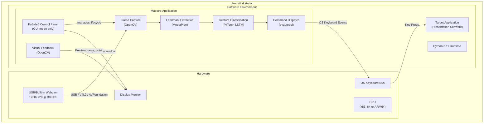

# Physical View

## 1. Overview

The physical view describes the system's deployment topology, hardware dependencies, runtime environment, and communication between physical components. The system is designed as a single-node desktop application that runs entirely on the user's local machine with no network dependencies.

## 2. Deployment Topology



## 3. Hardware Requirements

### 3.1 Minimum Hardware

| Component   | Requirement      | Notes                                                                                 |
| ----------- | ---------------- | ------------------------------------------------------------------------------------- |
| **Webcam**  | 720p @ 30 FPS    | Built-in laptop cameras are sufficient; USB webcams supported via OpenCV device index |
| **CPU**     | 4-core, 2.0+ GHz | MediaPipe and PyTorch inference are CPU-bound; no GPU required                        |
| **RAM**     | 4 GB available   | MediaPipe model (~50 MB), LSTM model (~1 MB), frame buffers (~10 MB)                  |
| **Display** | Any resolution   | Required for visual feedback overlay; optional with `--no-display` flag               |

### 3.2 Tested Configurations

The system has been developed and tested on macOS with Apple Silicon (ARM64). The architecture is platform-independent at the application level, with platform-specific behavior isolated to:

- **pyautogui**: Uses Quartz API on macOS, X11/Wayland on Linux, Win32 API on Windows.
- **OpenCV VideoCapture**: Uses AVFoundation on macOS, V4L2 on Linux, DirectShow on Windows.

### 3.3 GPU Support

GPU acceleration is **optional and not required**. If a CUDA-capable GPU or Apple MPS device is available, PyTorch will use it for LSTM inference and training when `--device auto` is specified. The default configuration targets CPU execution.

## 4. Runtime Environment

### 4.1 Python Environment

| Component       | Version      | Constraint                                                 |
| --------------- | ------------ | ---------------------------------------------------------- |
| Python          | 3.11         | `>=3.11,<3.12` (locked to match MediaPipe compatibility)   |
| Package Manager | pip          | Installed via `pip install -e .` from `pyproject.toml`     |
| Environment     | Conda / venv | Recommended: `conda create -n gesture-control python=3.11` |

### 4.2 Runtime Dependencies

| Library                | Version   | Role                                                                                                                                |
| ---------------------- | --------- | ----------------------------------------------------------------------------------------------------------------------------------- |
| mediapipe              | ==0.10.14 | Hand landmark extraction (pinned for reproducibility)                                                                               |
| torch                  | ≥2.7.0    | LSTM inference and training                                                                                                         |
| opencv-python-headless | ≥4.10.0   | Webcam capture and image rendering                                                                                                  |
| pyautogui              | ≥0.9.54   | OS keyboard event injection                                                                                                         |
| pydantic               | ≥2.6.0    | Configuration schema validation                                                                                                     |
| numpy                  | ≥1.26.0   | Array operations                                                                                                                    |
| PyYAML                 | ≥6.0.1    | Configuration file parsing                                                                                                          |
| PySide6                | ≥6.5.0    | Qt6 Python bindings for the graphical interface (`[dev]` optional extra; not required for CLI inference)                            |
| huggingface_hub        | ≥0.22.0   | Model download from HF Hub (`[huggingface]` optional extra; required for the default `backend: huggingface` in `model_source.yaml`) |
| scikit-learn           | ≥1.5.0    | Dataset splitting and training metrics (`[training]` optional extra; not required at inference runtime)                             |

### 4.3 OS Permissions

The system requires the following OS-level permissions:

| Permission                       | Platform              | Purpose                                   |
| -------------------------------- | --------------------- | ----------------------------------------- |
| Camera access                    | macOS, Linux, Windows | Webcam frame capture via OpenCV           |
| Accessibility / Input Monitoring | macOS                 | pyautogui keyboard event injection        |
| No special permissions           | Linux (X11)           | X11 allows keyboard simulation by default |

## 5. Communication Interfaces

### 5.1 Webcam → Application

- **Protocol**: OS-native video capture API (AVFoundation / V4L2 / DirectShow)
- **Mediated by**: OpenCV `VideoCapture`
- **Data**: BGR 8-bit frames at configured resolution and FPS
- **Buffering**: OpenCV buffer size set to 1 to minimize capture latency

### 5.2 Application → Target Software

- **Protocol**: OS keyboard event injection
- **Mediated by**: pyautogui → Quartz / X11 / Win32
- **Data**: Key press/release and pointer events (e.g., Right Arrow, Escape, Cmd/Ctrl+Scroll, mouse drag)
- **Safety**: Key names validated against hardcoded allowlist before injection

### 5.3 Application → Display

**GUI mode** (`scripts/run_ui.py`):

- **Protocol**: PySide6 Qt window rendered by the OS compositor
- **Data**: Form controls, telemetry labels, log entries, system tray icon
- **Tray colours**: Grey (stopped), green (running + gaze active), amber (command dispatched, 300 ms flash)

**CLI mode** / opt-in preview window:

- **Protocol**: OpenCV `imshow()` window
- **Data**: Annotated BGR frame with diagnostic overlay
- **Optional**: Enabled by the "Show preview window" checkbox in GUI mode, or always-on in CLI mode (`run_realtime.py`)

## 6. File System Layout

The system reads from and writes to the local file system:

| Path                        | Access     | Purpose                                                                  |
| --------------------------- | ---------- | ------------------------------------------------------------------------ |
| `configs/`                  | Read       | YAML configuration files loaded at startup                               |
| `models/checkpoints/`       | Write      | Training checkpoints saved during model training (.gitignored)           |
| `data/raw/`                 | Read/Write | JSONL landmark recordings from data collection                           |
| `data/processed/`           | Read/Write | NPZ sequence datasets built from raw data                                |
| `experiments/runs/`         | Write      | Training run logs and metrics                                            |
| `~/.cache/huggingface/hub/` | Read/Write | Hugging Face Hub download cache (first-use download of production model) |

Trained inference artifacts are **not tracked in VCS**. The runtime default model source points to an EnhancedTwoStreamLSTM artifact (`two_stream_attn_v1_2layer_ld_cong_finetune_20260515T134706Z_inference.pt`) on Hugging Face Hub (`ntsrigaud/maestro-lstm-hybrid`), downloaded on first use by `hf_hub_download()`. The backend is controlled by `configs/model_source.yaml`.

## 7. Deployment Procedure

### 7.1 Installation

```bash
# Clone repository
git clone <repository-url>
cd Maestro

# Create and activate environment
conda create -n maestro python=3.11
conda activate maestro

# Install package with dependencies
# Include [huggingface] extra for the default Hugging Face Hub model backend
pip install -e ".[huggingface]"
```

### 7.2 Inference Execution

```bash
# Launch graphical control panel (recommended)
python scripts/run_ui.py

# Run CLI-only inference (headless; no PySide6 required)
python scripts/run_realtime.py --config configs

# Override HF revision
python scripts/run_realtime.py --config configs --hf-revision main

# Use an explicit local artifact instead of HF backend
python scripts/run_realtime.py --config configs --model-artifact path/to/artifact.pt
```

### 7.3 Training Execution

```bash
# Train model (default: EnhancedTwoStreamLSTM)
python scripts/train_model.py \
    --dataset-path data/processed/ipn_dataset.npz \
    --config configs/model/two_stream_attn.yaml \
    --config-dir configs
```

## 8. Scalability Considerations

The current system is designed for single-user, single-camera operation. The architecture supports the following extension points without structural changes:

| Extension                      | Mechanism                                                                   |
| ------------------------------ | --------------------------------------------------------------------------- |
| Additional target applications | Implement `IApplicationAdapter` with application-specific shortcut mappings |
| Alternative cameras            | Change `camera_index` in `app.yaml` or implement a custom `IFrameSource`    |
| GPU inference                  | Runtime selects CUDA when available, else CPU (current bootstrap behavior). |
| Headless deployment            | Use `--no-display` flag to skip OpenCV window rendering                     |
| Alternative models             | Implement `IGestureModel` with a different classifier (Transformer, TCN)    |

---

**Document**: Physical View  
**Suite**: Architecture Documentation (`docs/architecture/`)  
**Last Updated**: May 2026
