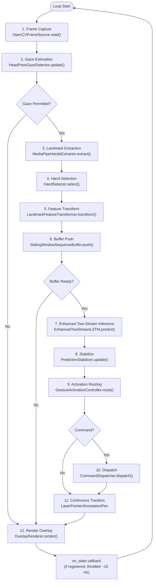
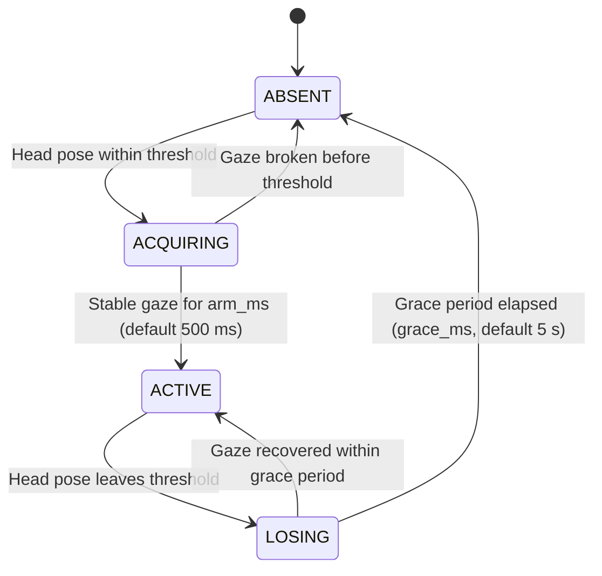
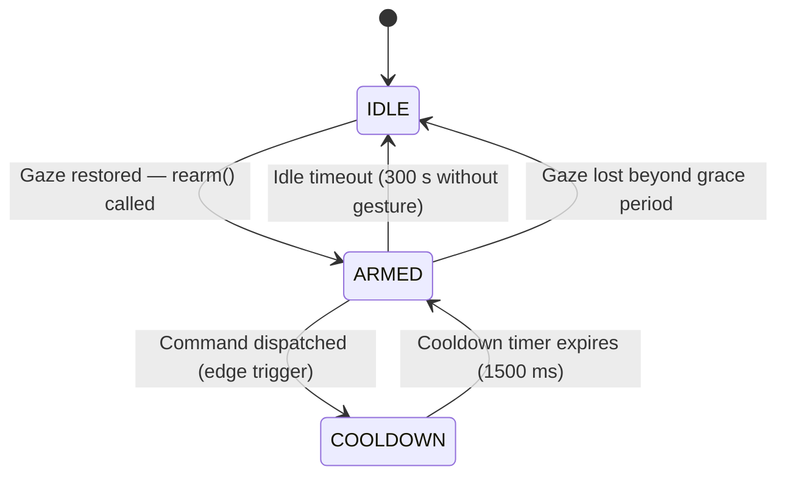
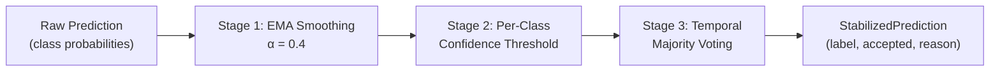
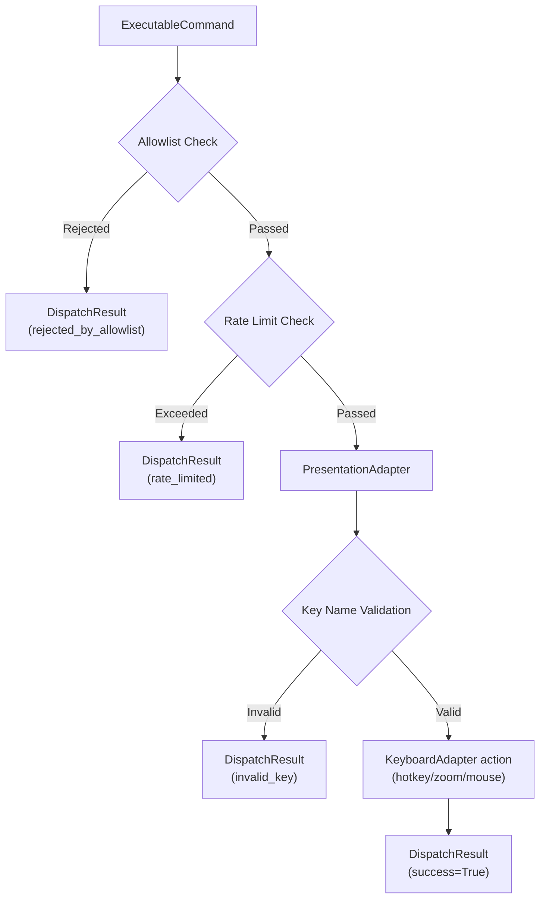
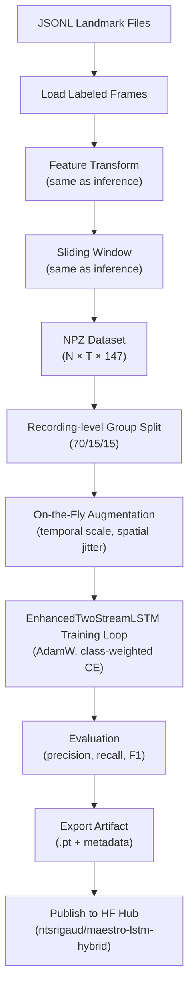

# Process View

## 1. Overview

The process view describes the runtime behavior of the system, including the real-time frame processing pipeline, concurrency model, state management, and timing characteristics. The system supports two execution modes: a **single-threaded CLI mode** (`scripts/run_realtime.py`) and a **dual-thread GUI mode** (`scripts/run_ui.py`). In both modes the core inference pipeline is identical; the only difference is lifecycle management and state observation.

## 2. Threading Model

### 2.1 CLI Mode — Single-Threaded Execution

When launched via `scripts/run_realtime.py`, the system uses a **single-threaded execution model**. All pipeline stages execute sequentially within the main thread of the `Runtime.run()` event loop. This design choice is deliberate:

- **Determinism**: Sequential execution eliminates race conditions in stateful components (feature transformer velocity history, sliding window buffer, prediction stabilizer EMA state, activation controller state machine).
- **Simplicity**: No synchronization primitives, thread pools, or message queues are required.
- **Sufficient throughput**: The combined pipeline latency (~60–80 ms) sustains interactive frame rates (12–16 inferences per second) on consumer CPUs, which exceeds the temporal resolution required for gesture recognition.

OpenCV's `VideoCapture.read()` blocks until a frame is available. The frame source enforces target FPS timing through sleep-based throttling, preventing CPU spinning.

### 2.2 GUI Mode — Dual-Thread Execution

When launched via `scripts/run_ui.py`, the system uses a **dual-thread execution model**:

| Thread            | Runs                                         | Responsibility                            |
| ----------------- | -------------------------------------------- | ----------------------------------------- |
| **Main thread**   | `QApplication.exec()` (Qt event loop)        | UI rendering, signal dispatch, user input |
| **Worker thread** | `_RuntimeThread` (QThread) → `Runtime.run()` | Full inference pipeline, unmodified       |

Cross-thread communication uses Qt **queued signal connections** — the safe mechanism for passing data across thread boundaries in Qt. `_RuntimeThread._handle_state()` is called by `Runtime` every frame via the `on_state` callback. The worker increments a frame counter and emits the `state_ready` Qt signal every `emit_every` frames (default 3), capping UI traffic at approximately 10 Hz at 30 FPS. The queued connection delivers each `RuntimeState` (`dataclass(slots=True)`) to the main thread via Qt's event queue. No mutex, explicit lock, or shared mutable state is used.

The inference pipeline is **unmodified between modes**: `on_state` is the only addition to `runtime.py`. When `on_state is None` (CLI mode), there is zero overhead.

## 3. Main Event Loop

The runtime event loop processes one frame per iteration:

### Iteration Timing

At 30 FPS target, each loop iteration has a ~33 ms budget. The pipeline stages consume approximately:

| Stage               | Typical Latency | Notes                                                |
| ------------------- | --------------- | ---------------------------------------------------- |
| Frame Capture       | 1–2 ms          | Blocks until frame available; buffer size = 1        |
| Gaze Estimation     | 1–2 ms          | MediaPipe BlazeFace amortized; runs at ⅓ frame rate  |
| Landmark Extraction | 15–25 ms        | MediaPipe CPU inference; skipped if gaze absent      |
| Hand Selection      | < 0.1 ms        | In-memory preference filtering over 0–2 hand entries |
| Feature Transform   | < 1 ms          | NumPy array operations                               |
| Buffer Push         | < 0.1 ms        | Deque append                                         |
| Enhanced Inference  | 20–30 ms        | PyTorch CPU forward pass (when buffer ready)         |
| Stabilization       | < 0.1 ms        | EMA + deque lookup                                   |
| Activation Routing  | < 0.1 ms        | State machine transition                             |
| Command Dispatch    | < 1 ms          | pyautogui call (when command emitted)                |
| Continuous Trackers | < 1 ms          | Pointer/pen update, mouse drag while gesture active  |
| Overlay Render      | 1–2 ms          | OpenCV text/rectangle drawing                        |

**Total end-to-end (gaze active)**: ~40–60 ms per frame (without model inference), ~60–80 ms when inference triggers. Gaze estimation adds ~1–2 ms amortized per frame because BlazeFace is sampled at 10 Hz (every 3rd frame) and the result is cached. When gaze is absent, the per-frame cost drops to ~3–5 ms (capture + gaze check + render).

## 4. Gaze-Aware Activation Design

### 4.1 Gaze Intent Detector State Machine

`HeadPoseGazeDetector` maintains an independent four-state machine that acts as the outermost pipeline gate:

**ABSENT**: No face detected or head pose exceeds angular thresholds. All hand landmark extraction, LSTM inference, and activation routing are bypassed. Any ongoing gesture activation hold timer is reset.

**ACQUIRING**: A qualifying head pose has been detected. An internal stability timer starts. The gesture pipeline remains inactive until the state advances to ACTIVE, preventing instantaneous arming when the user glances briefly toward the camera.

**ACTIVE**: Head pose has been within thresholds continuously for `arm_ms` (default 500 ms). The downstream gesture pipeline is fully operational.

**LOSING**: Head pose has left the acceptance window. A grace timer starts. If the user looks back before the grace period elapses (`grace_ms`, default 5000 ms), no state change in the gesture controller occurs. This prevents disarming during natural head movements mid-presentation.

### 4.2 Gesture Activation State Machine

The `GestureActivationController` implements a three-state finite state machine that governs command emission. It operates whenever `gaze_permitted=True` (detector in ACTIVE or LOSING grace state):

### State Descriptions

**IDLE**:

- The system is suspended — no commands are dispatched and gesture predictions are ignored.
- The system enters IDLE when gaze is lost beyond the configured grace period, or when no non-no_gesture gesture is detected for `idle_timeout_ms`.
- The system exits IDLE only via an explicit `rearm()` call, which is issued by the runtime when gaze is restored.
- No commands are dispatched in this state.

**ARMED**:

- The system accepts command gestures and dispatches them to the target application.
- **Edge-trigger logic**: A command is emitted only when:
  1. The stabilized prediction is `accepted` (temporal voting passed).
  2. The label differs from the last dispatched label (rising-edge detection).
  3. The label exists in the command map.
- The `_last_dispatched_label` resets to `"no_gesture"` whenever the prediction returns to the no_gesture class (hand in neutral position), enabling the same gesture to be dispatched again after a neutral interval.
- Any non-no_gesture prediction refreshes the idle timeout timer, keeping the system armed during active use.
- If no non-no_gesture gesture is detected for `idle_timeout_ms` (default 100,000 ms in current config), the system returns to IDLE.

**COOLDOWN**:

- Entered immediately after a command is dispatched.
- All dispatch is blocked for `command_cooldown_ms` (default 1500 ms in current config).
- Provides a secondary guard against rapid re-dispatch (the primary guard is edge-triggering).
- After the cooldown timer expires, the system returns to ARMED.

## 5. Prediction Stabilization Pipeline

The prediction stabilizer applies three sequential filtering stages to reduce noise in raw model output:

**Stage 1 — EMA Smoothing**: Each class probability is smoothed over time using exponential moving average: `p'[c] = α · p_current[c] + (1 - α) · p_previous[c]`. This dampens frame-to-frame fluctuations.

**Stage 2 — Confidence Thresholding**: The smoothed top-class probability is compared against the class-specific threshold from `production_hybrid.yaml`. If below threshold, the candidate is demoted to `no_gesture` with reason `"below_threshold_or_no_gesture"`.

**Stage 3 — Temporal Majority Voting**: The last N predictions (where N = `class_vote_windows[label]`) must all agree on the same class. Dynamic gestures (swiping_right, swiping_left) use N=1 for immediate response. Static holds (stop_sign) use N=3 for stability. Disagreement results in rejection with reason `"temporal_inconsistency"`.

## 6. Command Dispatch Pipeline

When the activation controller emits an `ExecutableCommand`, it passes through three validation stages:

**Allowlist check**: The command ID must exist in the `allowed_commands` frozenset configured at startup.

**Rate limit check**: A sliding-window deque tracks recent dispatch timestamps. If `rate_limit_per_window` commands have occurred within `rate_limit_window_ms`, the command is rejected.

**Key name validation**: The `KeyboardAdapter` validates every key in the shortcut tuple against `_SAFE_KEY_NAMES`, a hardcoded frozenset of known-safe pyautogui key names. No user-supplied strings reach the OS keyboard layer.

## 7. Training Pipeline Process

The offline training pipeline is a batch process separate from the real-time inference loop:

The training pipeline reuses `LandmarkFeatureTransformer` and `SlidingWindowSequenceBuffer` from the inference pipeline to guarantee feature parity. The `GestureDataModule` manages dataset loading, group-aware recording-level splits, and on-the-fly augmentation for the training partition. Trained artifacts are published to the Hugging Face Hub (`ntsrigaud/maestro-lstm-hybrid`) via `training/hf_publish.py` and are not tracked in VCS. At runtime, the artifact is downloaded on first use via `hf_hub_download()` and served from the local HF cache.

## 8. Graceful Shutdown

The runtime loop supports three shutdown triggers:

1. **Keyboard interrupt**: Interrupting the process from terminal (headless CLI path).
2. **Frame limit**: Reaching `--max-frames` count (used in testing and benchmarking).
3. **UI Stop button**: Clicking Stop in the PySide6 control panel calls `RuntimeController.stop()`, which sets the runtime stop flag. `MainWindow` then waits for worker completion during shutdown.

On shutdown, the runtime:

1. Releases the camera resource (`IFrameSource.close()`).
2. Closes the MediaPipe model (`IHandLandmarkExtractor.close()`).
3. Deactivates continuous trackers (laser pointer / annotation pen) to restore safe input state.
4. Optionally writes a latency benchmark report to the specified JSON path.

---

**Document**: Process View  
**Suite**: Architecture Documentation (`docs/architecture/`)  
**Last Updated**: May 2026
