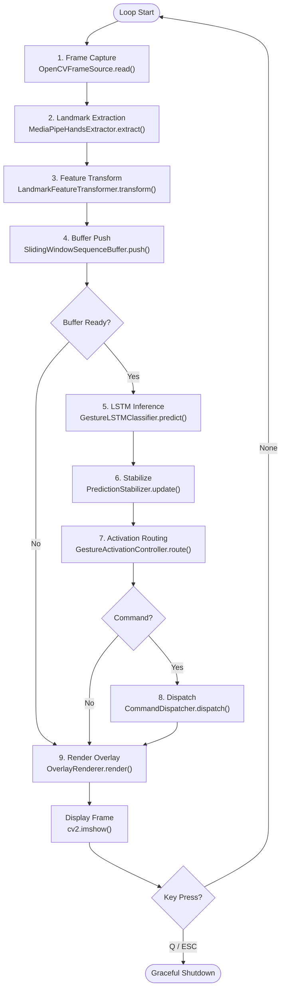
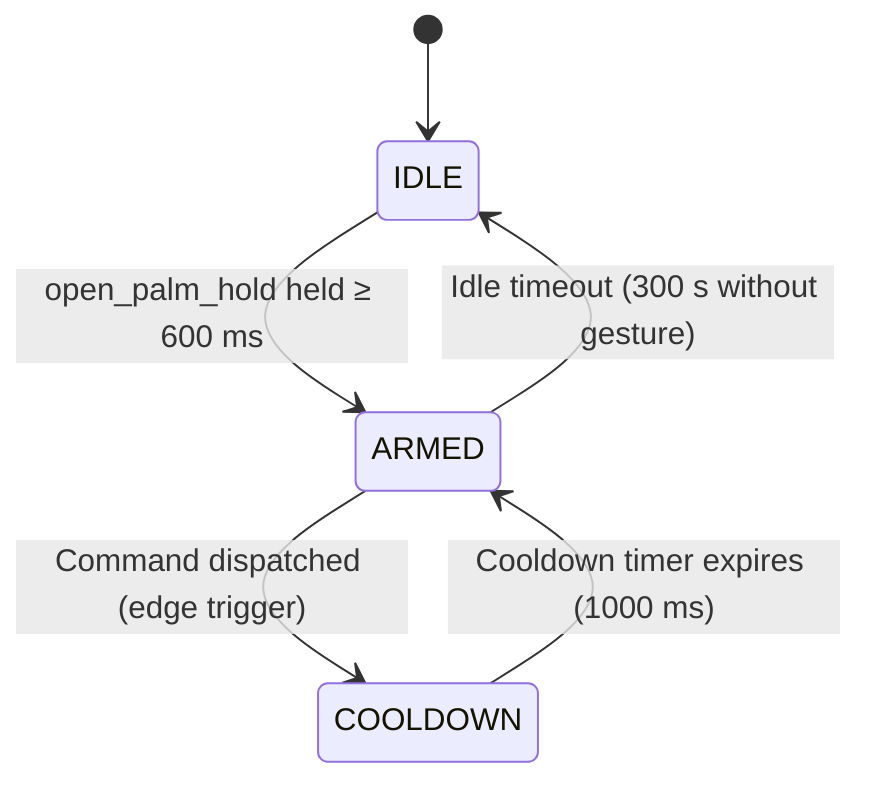
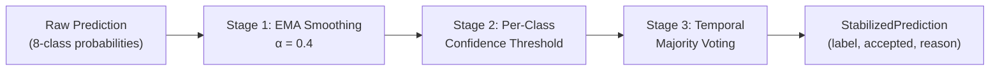
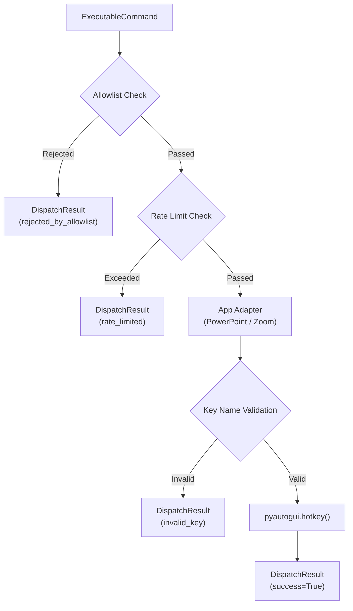
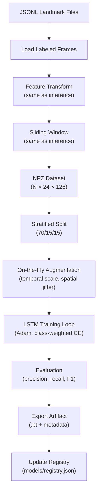

# Process View

## 1. Overview

The process view describes the runtime behavior of the system, including the real-time frame processing pipeline, concurrency model, state management, and timing characteristics. The system operates as a single-threaded sequential pipeline optimized for deterministic latency on CPU hardware.

## 2. Threading Model

The system uses a **single-threaded execution model**. All pipeline stages execute sequentially within the main thread of the `Runtime.run()` event loop. This design choice is deliberate:

- **Determinism**: Sequential execution eliminates race conditions in stateful components (feature transformer velocity history, sliding window buffer, prediction stabilizer EMA state, activation controller state machine).
- **Simplicity**: No synchronization primitives, thread pools, or message queues are required.
- **Sufficient throughput**: The combined pipeline latency (~60–80 ms) sustains interactive frame rates (12–16 inferences per second) on consumer CPUs, which exceeds the temporal resolution required for gesture recognition.

OpenCV's `VideoCapture.read()` blocks until a frame is available. The frame source enforces target FPS timing through sleep-based throttling, preventing CPU spinning.

## 3. Main Event Loop

The runtime event loop processes one frame per iteration:

### Iteration Timing

At 30 FPS target, each loop iteration has a ~33 ms budget. The pipeline stages consume approximately:

| Stage               | Typical Latency | Notes                                         |
| ------------------- | --------------- | --------------------------------------------- |
| Frame Capture       | 1–2 ms          | Blocks until frame available; buffer size = 1 |
| Landmark Extraction | 15–25 ms        | MediaPipe CPU inference; primary bottleneck   |
| Feature Transform   | < 1 ms          | NumPy array operations                        |
| Buffer Push         | < 0.1 ms        | Deque append                                  |
| LSTM Inference      | 20–30 ms        | PyTorch CPU forward pass (when buffer ready)  |
| Stabilization       | < 0.1 ms        | EMA + deque lookup                            |
| Activation Routing  | < 0.1 ms        | State machine transition                      |
| Command Dispatch    | < 1 ms          | pyautogui call (when command emitted)         |
| Overlay Render      | 1–2 ms          | OpenCV text/rectangle drawing                 |

**Total end-to-end**: ~40–60 ms per frame (without inference), ~60–80 ms when inference triggers. LSTM inference does not execute every frame—it triggers approximately every 3 frames (100 ms at 30 FPS) due to the sliding window step size.

## 4. Activation State Machine

The `GestureActivationController` implements a three-state finite state machine that governs the system's interaction protocol:

### State Descriptions

**IDLE**:

- The system passively monitors for the activation gesture (`open_palm_hold`).
- An internal timer starts on the first frame where the stabilized label matches the activation gesture.
- If the activation gesture is held continuously for `activation_hold_ms` (default 600 ms), the system transitions to ARMED.
- If the label changes before the timer expires, the timer resets.
- No commands are dispatched in this state.

**ARMED**:

- The system accepts command gestures and dispatches them to the target application.
- **Edge-trigger logic**: A command is emitted only when:
  1. The stabilized prediction is `accepted` (temporal voting passed).
  2. The label differs from the last dispatched label (rising-edge detection).
  3. The label exists in the command map.
- The `_last_dispatched_label` resets to `"unknown"` whenever the prediction returns to the unknown class (hand in neutral position), enabling the same gesture to be dispatched again after a neutral interval.
- Any non-unknown prediction refreshes the idle timeout timer, keeping the system armed during active use.
- If no non-unknown gesture is detected for `idle_timeout_ms` (default 300,000 ms = 5 minutes), the system returns to IDLE.

**COOLDOWN**:

- Entered immediately after a command is dispatched.
- All dispatch is blocked for `command_cooldown_ms` (default 1000 ms).
- Provides a secondary guard against rapid re-dispatch (the primary guard is edge-triggering).
- After the cooldown timer expires, the system returns to ARMED.

## 5. Prediction Stabilization Pipeline

The prediction stabilizer applies three sequential filtering stages to reduce noise in raw LSTM output:

**Stage 1 — EMA Smoothing**: Each class probability is smoothed over time using exponential moving average: `p'[c] = α · p_current[c] + (1 - α) · p_previous[c]`. This dampens frame-to-frame fluctuations.

**Stage 2 — Confidence Thresholding**: The smoothed top-class probability is compared against the class-specific threshold from `production_ipn.yaml`. If below threshold, the candidate is demoted to `unknown` with reason `"below_threshold_or_unknown"`.

**Stage 3 — Temporal Majority Voting**: The last N predictions (where N = `class_vote_windows[label]`) must all agree on the same class. Dynamic gestures (swipe_right, swipe_left) use N=1 for immediate response. Static holds (open_palm_hold) use N=3 for stability. Disagreement results in rejection with reason `"temporal_inconsistency"`.

## 6. Command Dispatch Pipeline

When the activation controller emits an `ExecutableCommand`, it passes through three validation stages:

**Allowlist check**: The command ID must exist in the `allowed_commands` frozenset configured at startup.

**Rate limit check**: A sliding-window deque tracks recent dispatch timestamps. If `rate_limit_per_window` commands have occurred within `rate_limit_window_ms`, the command is rejected.

**Key name validation**: The `KeyboardAdapter` validates every key in the shortcut tuple against `_SAFE_KEY_NAMES`, a hardcoded frozenset of known-safe pyautogui key names. No user-supplied strings reach the OS keyboard layer.

## 7. Training Pipeline Process

The offline training pipeline is a batch process separate from the real-time inference loop:

The training pipeline reuses `LandmarkFeatureTransformer` and `SlidingWindowSequenceBuffer` from the inference pipeline to guarantee feature parity. The `GestureDataModule` manages dataset loading, stratified splitting (with optional group-aware splits by recording ID), and on-the-fly augmentation for the training partition.

## 8. Graceful Shutdown

The runtime loop supports two shutdown triggers:

1. **Keyboard interrupt**: Pressing Q or ESC in the display window.
2. **Frame limit**: Reaching `--max-frames` count (used in testing and benchmarking).

On shutdown, the runtime:

1. Releases the camera resource (`IFrameSource.close()`).
2. Closes the MediaPipe model (`IHandLandmarkExtractor.close()`).
3. Destroys the OpenCV display window.
4. Optionally writes a latency benchmark report to the specified JSON path.

---

**Document**: Process View  
**Suite**: Architecture Documentation (`docs/architecture/`)  
**Last Updated**: March 2026
