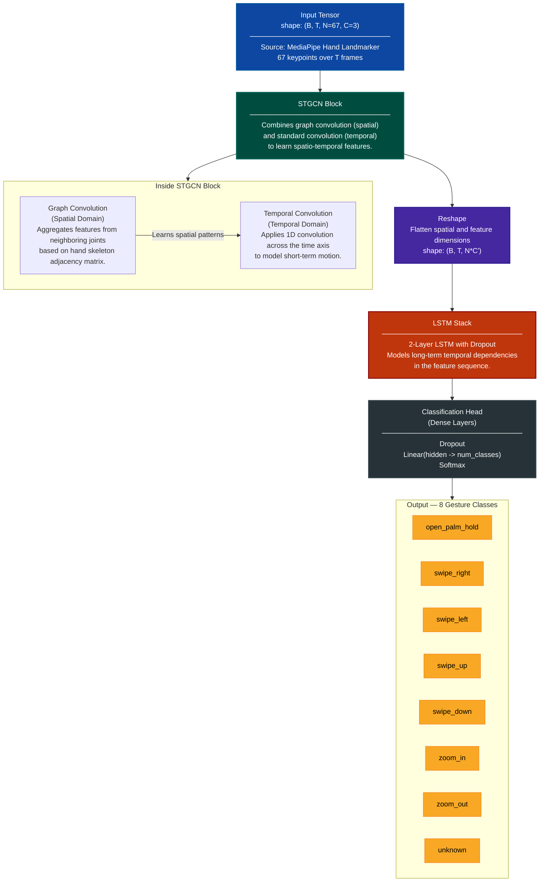

# Spatio-Temporal Graph Convolutional Network (STGCN-LSTM) Architecture

## 1. Overview & Rationale for Migration

This document outlines the proposed **Spatio-Temporal Graph Convolutional Network with Long Short-Term Memory (STGCN-LSTM)** architecture, intended to replace the existing `TwoStreamGestureLSTM` model. The current two-stream model, while parameter-efficient, has demonstrated limitations in capturing the complex spatio-temporal dynamics of hand gestures, leading to suboptimal accuracy and performance.

The STGCN-LSTM architecture is designed to overcome these limitations by explicitly modeling the hand's skeletal structure as a graph. This allows the model to learn not only the temporal evolution of each joint but also the spatial relationships between them. By combining Graph Convolutional Networks (GCNs) for spatial feature extraction and Long Short-Term Memory (LSTM) networks for temporal sequence modeling, we anticipate a significant improvement in gesture recognition performance.

This migration is motivated by recent advancements in action recognition demonstrating the superiority of graph-based models for skeletal data. The STGCN component will capture the intricate spatial dependencies of hand keypoints, while the LSTM component will model the temporal dynamics of gesture sequences.

---

## 2. Proposed Architecture: STGCN-LSTM

The proposed model integrates STGCN and LSTM modules to process sequences of hand-pose data. The key idea is to first apply STGCN layers to extract high-level spatial and temporal features from the raw keypoint data, and then feed these features into an LSTM network to model the long-range temporal dependencies of the gesture.

### 2.1. Data Input and Preprocessing

-   **Input Source**: Live 3D hand keypoints are extracted using the **MediaPipe Hands** pipeline.
-   **Keypoint Extraction**: MediaPipe provides **21 keypoints** per hand. For sign language recognition tasks that often involve facial expressions and body posture, a more holistic set of **75 keypoints** (including hands, face, and pose) is typically used.
-   **Feature Selection for Hand Gestures**: For our specific use case of hand gesture recognition, we will adapt this by using a subset of **67 keypoints** that focus primarily on the hands and arms, discarding irrelevant facial or body keypoints. The input tensor will have the shape `(B, T, N, C)`, where:
    -   `B`: Batch size
    -   `T`: Number of frames in the sequence (e.g., 24 frames)
    -   `N`: Number of keypoints (67)
    -   `C`: Number of coordinates per keypoint (e.g., 3 for x, y, z)

### 2.2. Architecture Diagram

### 2.3. STGCN Module

The core of the architecture is the STGCN layer. It performs two key operations:

1.  **Graph Convolution (Spatial Domain)**: At each time step, we treat the 67 keypoints as nodes in a graph. An adjacency matrix, `A`, defines the natural connections in the human hand skeleton. The graph convolution operation updates the feature vector of each node by aggregating information from its neighbors. This allows the model to learn features like "finger extension" or "fist shape" directly from the skeletal structure.

2.  **Temporal Convolution (Temporal Domain)**: Standard 1D convolutions are applied across the time axis for each node. This enables the model to capture short-term motion patterns, such as the velocity and acceleration of individual joints.

Multiple STGCN layers can be stacked to build a powerful feature extractor that learns progressively more abstract and complex spatio-temporal features.

### 2.4. LSTM Module

The output of the final STGCN layer is a feature sequence that encodes rich spatio-temporal information. This sequence is then fed into a multi-layer LSTM network. The role of the LSTM is to model the long-range temporal dependencies and sequential patterns that define a complete gesture. For example, the LSTM can learn the distinct phases of a "swipe" gesture, from initiation to completion.

---

## 3. Adaptation for Hand Gesture Recognition

The proposed STGCN-LSTM architecture is highly adaptable. While originally designed for full-body action recognition or sign language (using 75+ keypoints), it can be effectively tailored for hand-centric gesture recognition using the **IPN Hands dataset**.

-   **Dataset**: The model will be trained on the IPN Hands dataset, which contains a vocabulary of gestures relevant to our application.
-   **Input Features**: We will utilize the 21 keypoints per hand (42 for two hands if necessary) provided by MediaPipe, which are also the basis for the IPN dataset. The graph structure (adjacency matrix) will be defined based on this 21-keypoint hand skeleton.
-   **Transfer Learning**: If a pre-trained STGCN model on a larger sign-language dataset is available, we can leverage transfer learning. We would fine-tune the model on the IPN Hands dataset, which is expected to accelerate convergence and improve performance, especially given a smaller dataset.

By focusing the model on hand-specific keypoints and training it on the IPN dataset, we can create a highly accurate and robust classifier for our target gesture vocabulary.

---

## 4. Expected Improvements

By migrating to the STGCN-LSTM architecture, we anticipate the following benefits:

-   **Improved Accuracy**: Superior modeling of the underlying hand structure and dynamics will lead to better discrimination between subtle gestures.
-   **Enhanced Robustness**: The graph-based approach is inherently more robust to variations in viewpoint, scale, and translation.
-   **Better Generalization**: The model is expected to generalize better to unseen variations of gestures.

This migration represents a strategic shift towards a state-of-the-art architecture that is better suited for the complexities of dynamic hand gesture recognition.

---

_See also: [data-flow.md](data-flow.md) for the full inference pipeline and [logical-view.md](logical-view.md) for the component architecture._
