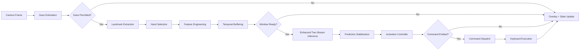

# System Overview

## 1. Introduction

Maestro is a real-time gesture recognition system that enables hands-free presentation control. The system captures webcam video, extracts hand landmarks using MediaPipe Hands, classifies temporal gesture sequences with the `EnhancedTwoStreamLSTM` neural network, and dispatches operating-system-level keyboard commands for slide navigation, scrolling, zoom, and presentation start/stop.

The architecture follows a modular, protocol-driven design with strict separation between domain logic, infrastructure adapters, and pipeline orchestration. All runtime parameters are externalized to YAML configuration files. The system is CPU-first and operates at interactive frame rates on consumer hardware.

## 2. System Objective

Provide reliable, low-latency gesture-based desktop control using a small, highly separable gesture vocabulary. The system prioritizes safety (low false-trigger rate) over recognition speed through multi-stage prediction stabilization and an explicit activation state machine.

## 3. Gesture Vocabulary

Runtime recognition uses a 10-class vocabulary (9 active gestures + `unknown`). Discrete command dispatch uses the subset configured in `gesture_commands`, while `point_one` and `point_two` are continuous tracker gestures configured in `gesture_modes`.

The production runtime vocabulary (discrete command path) is:

| Gesture                 | Type            | Mapped Command     |
| ----------------------- | --------------- | ------------------ |
| `fist`                  | Static          | Erase annotations  |
| `swiping_right`         | Dynamic         | Next slide         |
| `swiping_left`          | Dynamic         | Previous slide     |
| `swiping_up`            | Dynamic         | Start presentation |
| `swiping_down`          | Dynamic         | Stop presentation  |
| `zooming_in_full_hand`  | Dynamic         | Zoom in view       |
| `zooming_out_full_hand` | Dynamic         | Zoom out view      |
| `unknown`               | Rejection class | No action          |

`command_map_presentation.yaml` also applies `label_remap` for directional swipes (`swiping_left` ↔ `swiping_right`) before dispatch/display so user-facing direction matches mirrored-camera ergonomics.

The activation gate is controlled by the activation controller state machine: the controller starts in ARMED at session startup and remains ready to dispatch throughout the session. Command semantics are configured in `configs/gestures/command_map_presentation.yaml`.

Continuous gestures are configured separately in `gesture_modes`: `point_one` drives the laser pointer tracker and `point_two` drives the annotation pen tracker. These continuous paths bypass command dispatch so cursor/pen updates can run at frame rate.

| Gesture     | Type       | Runtime Path                                  |
| ----------- | ---------- | --------------------------------------------- |
| `point_one` | Continuous | `LaserPointerTracker` (per-frame cursor path) |
| `point_two` | Continuous | `AnnotationPenTracker` (per-frame pen path)   |

## 4. High-Level Architecture

The system is organized into four layers:

```
┌─────────────────────────────────────────────────────────┐
│                    Application Layer                    │
│  (Bootstrap, Runtime Loop, CLI Scripts, PySide6 UI)     │
├─────────────────────────────────────────────────────────┤
│                    Pipeline Layer                       │
│  (Hand Selection, Feature Engineering, Buffering,       │
│   Stabilization, Activation Control)                    │
├─────────────────────────────────────────────────────────┤
│                 Infrastructure Layer                    │
│  (OpenCV Camera, MediaPipe Extractor, LSTM Model,       │
│   Command Dispatcher, Keyboard Adapters, Overlay)       │
├─────────────────────────────────────────────────────────┤
│                    Domain Layer                         │
│  (Entities, Enums, Contracts, Events)                   │
└─────────────────────────────────────────────────────────┘
```

**Domain Layer**: Pure data structures and interface contracts with minimal dependencies. Pipeline data types (`FramePacket`, `HandLandmarks`, `MultiHandPacket`, `LandmarkPacket`, `FeatureFrame`, `SequenceWindow`, `Prediction`, `StabilizedPrediction`, `ExecutableCommand`, `DispatchResult`) are `dataclass(slots=True)` entities.

**Infrastructure Layer**: Concrete implementations of domain interfaces using external libraries (OpenCV, MediaPipe, PyTorch, pyautogui). Each implementation is isolated behind a Protocol interface.

**Pipeline Layer**: Stateful processing components that transform data between pipeline stages. Includes feature normalization, temporal windowing, prediction smoothing, and the activation state machine.

**Application Layer**: Composition root (`bootstrap.py`) wires all dependencies from configuration. The runtime loop (`runtime.py`) orchestrates the sequential frame processing pipeline. The **PySide6 graphical interface** (`app/ui/`) provides start/stop control, live telemetry monitoring, configuration editing, and model selection without modifying the inference pipeline. The system is launched via `scripts/run_ui.py`.

## 5. End-to-End Pipeline Summary

The real-time inference pipeline processes each camera frame through eleven sequential stages:



1. **Frame Capture**: OpenCV reads a BGR frame from the webcam at 30 FPS (1280×720).
2. **Gaze Estimation**: MediaPipe BlazeFace face detection estimates head pose from 6 face keypoints. If the user's gaze is not directed toward the camera, all downstream gesture processing is bypassed for that frame.
3. **Landmark Extraction**: MediaPipe Hands detects all visible hands (up to 2) and returns a `MultiHandPacket` containing each hand's 21 landmarks, handedness label, detection confidence, and tracking confidence.
4. **Hand Selection**: `HandSelector` applies the user's `hand_preference` configuration to pick one hand from the `MultiHandPacket`, producing a `LandmarkPacket`. Encodes the selfie-view inversion (`"right"` → MP `"Left"`, `"left"` → MP `"Right"`); marks the packet `valid=False` if the preferred hand is absent or below confidence thresholds.
5. **Feature Engineering**: Landmarks are wrist-centered, scale-normalized, and augmented with velocity, joint angles, fingertip spread, and wrist trajectory features to produce a 147-dimensional feature vector (feature-schema-v5).
6. **Temporal Buffering**: A sliding window buffer accumulates 16 consecutive feature vectors with a step size of 3 frames (runtime-configurable; validated against artifact metadata at load time).
7. **Enhanced Two-Stream Inference**: The buffered sequence (16×147 in production runtime) is partitioned into a pose stream (73 dims: positions + joint angles) and a motion stream (74 dims: velocity + spread + wrist trajectory). `EnhancedTwoStreamLSTM` applies per-stream projection, bidirectional LSTM encoding, multi-head self-attention, cross-stream gating, and an MLP head to produce the final class probabilities.
8. **Prediction Stabilization**: EMA smoothing, per-class confidence thresholding, and temporal majority voting filter transient predictions.
9. **Activation Control**: A two-state machine (ARMED / COOLDOWN) gates command emission. The system starts in ARMED; commands are only dispatched when ARMED; after dispatch, a brief COOLDOWN period prevents re-triggering. Edge-triggered dispatch is enforced throughout.
10. **Command Dispatch**: The discrete gesture-to-command mapping is resolved, validated against an allowlist, rate-limited, and routed to the appropriate application adapter.
11. **Keyboard/Pointer Execution**: Discrete commands are translated into validated keyboard/zoom actions; continuous `point_one`/`point_two` gestures are executed by runtime trackers as cursor movement and drag-based annotation strokes.

## 6. Key Architectural Characteristics

### 6.1 Safety-First Command Dispatch

Multiple independent safety mechanisms prevent accidental command execution:

- **Gaze gating**: The entire gesture pipeline is bypassed unless the user's head pose indicates attention toward the camera. This is the outermost safety layer and eliminates unintentional activations when the user is not facing the display.
- **Activation gating**: Commands are only accepted while the system is in ARMED mode.
- **Edge-triggered dispatch**: A gesture triggers a command only on its first accepted occurrence; holding the same gesture does not re-fire.
- **Temporal voting**: 1–3 consecutive frames must agree on the same class before acceptance.
- **Per-class confidence thresholds**: Each gesture class has an independent acceptance threshold.
- **Command allowlist**: Only pre-approved command IDs reach the OS keyboard layer.
- **Rate limiting**: A sliding-window rate limiter caps dispatch frequency.
- **Key-name allowlist**: The keyboard adapter validates every key name against a safe set before invoking pyautogui.

### 6.2 Training–Inference Parity

The same `LandmarkFeatureTransformer` and `SlidingWindowSequenceBuffer` classes are used in both the training dataset builder and the real-time inference pipeline. Feature schema metadata embedded in the NPZ dataset and model checkpoint enables automated compatibility validation at runtime.

### 6.3 Configuration-Driven Operation

All operational parameters—camera settings, inference window geometry, confidence thresholds, gesture vocabulary, command mappings, model hyperparameters—are externalized to YAML files under `configs/`. No thresholds or behavioral constants are hardcoded in source.

### 6.4 Protocol-Based Modularity

Nine `Protocol` interfaces define service contracts. Implementations can be swapped without modifying consuming code. This enables isolated unit testing with mock implementations and supports future extension (additional application adapters, alternative model backends).

## 7. Technology Stack

| Component               | Technology                      | Version                                                                |
| ----------------------- | ------------------------------- | ---------------------------------------------------------------------- |
| Language                | Python                          | 3.11                                                                   |
| Hand Pose Estimation    | MediaPipe Hands                 | 0.10.14 (pinned)                                                       |
| Sequence Classification | PyTorch (EnhancedTwoStreamLSTM) | ≥2.7.0                                                                 |
| Frame Capture           | OpenCV (headless)               | ≥4.10.0                                                                |
| OS Keyboard Control     | pyautogui                       | ≥0.9.54                                                                |
| Config Validation       | Pydantic                        | ≥2.6.0                                                                 |
| Array Operations        | NumPy                           | ≥1.26.0                                                                |
| Graphical Interface     | PySide6 (Qt6)                   | ≥6.5.0 (`[dev]` optional extra; not required for CLI inference)        |
| Model Hosting           | Hugging Face Hub                | ≥0.22.0 (optional `[huggingface]` extra; required for default backend) |
| ML Metrics (training)   | scikit-learn                    | ≥1.5.0 (optional `[training]` extra)                                   |

## 8. Training Infrastructure

The offline training pipeline converts labeled video data into a trained LSTM checkpoint:

1. **Data Collection**: The IPN Hand dataset is the canonical training corpus. `scripts/build_ipn_dataset.py` extracts landmarks and emits NPZ sequence datasets (default graph format; flat `feature-schema-v5` output via `--format flat` for two-stream LSTM training).
2. **Model Training**: `scripts/train_model.py` defaults to `configs/model/two_stream_attn.yaml`, training `EnhancedTwoStreamLSTM` with AdamW, learning-rate scheduling, and early stopping (plus optional balancing controls such as class capping/weighting). Legacy model configs are retained for experimental reference only.
3. **Model Export**: Trained checkpoints are exported as inference artifacts containing state dictionary, class labels, and feature schema metadata, then published to the Hugging Face Hub (`ntsrigaud/maestro-lstm-hybrid`). Runtime loading is pinned to the enhanced artifact type (`two_stream_attn_inference`).

For detailed model internals, see `enhanced-two-stream-lstm-architecture.md`.

---

**Document**: System Overview  
**Suite**: Architecture Documentation (`docs/architecture/`)  
**Last Updated**: May 2026
