# Training Pipeline: Dataset Preparation → Model Training → Hugging Face Deployment

This document describes the offline ML pipeline that produces the production
`two_stream_lstm_v1` artefact — from raw IPN Hand video files through to the
published model on Hugging Face Hub. This pipeline is entirely separate from the
real-time inference path: **no webcam or live camera is involved at any stage.**

---

## Pipeline Diagram

```mermaid
flowchart TD
    classDef rawNode    fill:#1a237e,color:#fff,stroke:#283593,stroke-width:2px
    classDef procNode   fill:#004d40,color:#fff,stroke:#00695c,stroke-width:2px
    classDef buildNode  fill:#1b5e20,color:#fff,stroke:#2e7d32,stroke-width:2px
    classDef trainNode  fill:#4a148c,color:#fff,stroke:#6a1b9a,stroke-width:2px
    classDef evalNode   fill:#bf360c,color:#fff,stroke:#870000,stroke-width:2px
    classDef exportNode fill:#880e4f,color:#fff,stroke:#560027,stroke-width:2px
    classDef hfNode     fill:#e65100,color:#fff,stroke:#bf360c,stroke-width:3px
    classDef fileNode   fill:#37474f,color:#fff,stroke:#546e7a,stroke-width:1px,stroke-dasharray:4 2
    classDef configNode fill:#f9a825,color:#000,stroke:#f57f17,stroke-width:1px,stroke-dasharray:4 2

    %% ════════════════════════════════════════════════════════════════════════
    %% PHASE 1 — RAW DATA SOURCES
    %% ════════════════════════════════════════════════════════════════════════

    subgraph PH1["Phase 1 — Raw Data Sources  (IPN Hand Database)"]
        direction TB
        VIDEOS["IPN Hand Videos<br/>200 MP4 files · 640×480 · 30 FPS<br/>50 subjects · lab environment"]
        ANNOT["Annotation Files<br/>Annot_TrainList.txt · Annot_TestList.txt<br/>Columns: video, label, t_start, t_end<br/>14 IPN gesture labels total"]
        VOCAB["Vocabulary Config<br/>configs/gestures/vocabulary_ipn.yaml<br/>8 production classes<br/>G03–G11 + D0X + B0A + B0B"]
    end

    class VIDEOS rawNode
    class ANNOT rawNode
    class VOCAB configNode

    %% ════════════════════════════════════════════════════════════════════════
    %% PHASE 2 — LANDMARK EXTRACTION  (build_ipn_dataset.py — Phase 1)
    %% ════════════════════════════════════════════════════════════════════════

    subgraph PH2["Phase 2 — Per-Video Landmark Extraction  (parallelised)"]
        direction TB
        DECODE["Video Decoding<br/>cv2.VideoCapture · every frame in source order<br/>Temporal tracker requires sequential processing"]
        MP["MediaPipe Hands Extractor<br/>MediaPipeHandsExtractor<br/>static_image_mode = False<br/>21 × 3 landmarks per frame · detect_conf · track_conf"]
        HS["Hand Selection<br/>HandSelector  (preference = 'both')<br/>Selects highest-confidence hand<br/>Emits: landmarks · detect_conf · track_conf · valid"]
        CACHE["Per-Video Cache<br/>cache/&lt;video_stem&gt;.npz<br/>Arrays: frame_ids · valid · landmarks (N,21,3)<br/>detect_conf · track_conf · handedness<br/>Skipped on subsequent runs if cache exists"]
    end

    class DECODE procNode
    class MP procNode
    class HS procNode
    class CACHE fileNode

    VIDEOS --> DECODE --> MP --> HS --> CACHE

    %% ════════════════════════════════════════════════════════════════════════
    %% PHASE 3 — LABEL MAPPING  (build_ipn_dataset.py — Phase 2 preamble)
    %% ════════════════════════════════════════════════════════════════════════

    subgraph PH3["Phase 3 — Label Mapping and Segment Filtering"]
        direction TB
        LMAP["IPN → Vocabulary Mapping<br/>G03 → swipe_up    G04 → swipe_down<br/>G05 → swipe_left  G06 → swipe_right<br/>G07 → open_palm_hold<br/>G10 → zoom_in     G11 → zoom_out<br/>D0X + B0A + B0B → unknown<br/>G01 G02 G08 G09 → SKIPPED (no control semantic)"]
        SUBSAMP["Unknown Class Subsampling<br/>unknown sequences subsampled to prevent domination<br/>Inverse-frequency class weights computed for training loss"]
    end

    class LMAP buildNode
    class SUBSAMP buildNode

    ANNOT --> LMAP --> SUBSAMP
    VOCAB --> LMAP

    %% ════════════════════════════════════════════════════════════════════════
    %% PHASE 4 — FEATURE ENGINEERING + WINDOWING
    %% ════════════════════════════════════════════════════════════════════════

    subgraph PH4["Phase 4 — Feature Engineering and Sliding Window Assembly"]
        direction TB
        FT["LandmarkFeatureTransformer<br/>per frame · feature-schema-v5<br/>────────────────────────────────────<br/>1. Wrist centering    l_i = l_i - l_0<br/>2. Scale norm         l_i = l_i / dist(l_0, l_9)<br/>3. Orientation norm   DISABLED<br/>4. Velocity           v_i = Δpos / Δt<br/>Output: 147-dim vector per frame"]
        WIN["SlidingWindowSequenceBuffer<br/>window_size = 24 frames<br/>step = 1  (dense during dataset build)<br/>min_valid_ratio = 0.8<br/>Output: (24, 147) numpy array per window"]
        LABEL["Window Labelling<br/>Strategy: majority label in window<br/>Windows with &lt; 80% valid frames → discarded"]
    end

    class FT buildNode
    class WIN buildNode
    class LABEL buildNode

    CACHE --> FT
    SUBSAMP --> WIN
    FT --> WIN --> LABEL

    %% ════════════════════════════════════════════════════════════════════════
    %% PHASE 5 — MIRROR AUGMENTATION + NPZ SERIALISATION
    %% ════════════════════════════════════════════════════════════════════════

    subgraph PH5["Phase 5 — Mirror Augmentation and Dataset Serialisation"]
        direction TB
        MIRR["Mirror Augmentation (optional)<br/>Label-aware horizontal flip<br/>swipe_left ↔ swipe_right are swapped<br/>Doubles training set size<br/>Produces: ipn_dataset_v5_mirrored.npz"]
        NPZ["Output NPZ Dataset<br/>data/processed/ipn_dataset_v5_mirrored.npz<br/>────────────────────────────────────<br/>sequences   (N, 24, 147)  float32<br/>labels      (N,)          str<br/>label_ids   (N,)          int64<br/>recording_ids (N,)        str<br/>valid_ratio (N,)          float32<br/>metadata_json             JSON blob"]
    end

    class MIRR buildNode
    class NPZ fileNode

    LABEL --> MIRR --> NPZ

    %% ════════════════════════════════════════════════════════════════════════
    %% PHASE 6 — DATA LOADING AND SPLIT
    %% ════════════════════════════════════════════════════════════════════════

    subgraph PH6["Phase 6 — Dataset Loading and Stratified Splits"]
        direction TB
        DM["GestureDataModule<br/>Stratified split by class + recording<br/>────────────────────────────────────<br/>Train : 70%  of sequences<br/>Val   : 15%  of sequences<br/>Test  : 15%  of sequences<br/>No subject leakage across splits"]
        CW["Class Weight Computation<br/>w_c = N_total / (N_c × num_classes)<br/>Applied to CrossEntropyLoss<br/>Counteracts unknown class imbalance"]
    end

    class DM trainNode
    class CW trainNode

    NPZ --> DM --> CW

    %% ════════════════════════════════════════════════════════════════════════
    %% PHASE 7 — MODEL CONFIGURATION
    %% ════════════════════════════════════════════════════════════════════════

    subgraph PH7["Phase 7 — Training Configuration"]
        direction LR
        CFG_MODEL["Model Hyperparameters<br/>two_stream_lstm.yaml<br/>────────────────────────────<br/>input_size    : 147<br/>hidden_size   : 64 (per stream)<br/>num_layers    : 2<br/>dropout       : 0.3<br/>num_classes   : 8"]
        CFG_TRAIN["Training Hyperparameters<br/>────────────────────────────<br/>epochs        : 30 (max)<br/>batch_size    : 64<br/>learning_rate : 0.001<br/>weight_decay  : 0.0001<br/>grad_clip_norm: 1.0<br/>seed          : 42"]
        CFG_STOP["Early Stopping<br/>────────────────────────────<br/>patience      : 7 epochs<br/>min_delta     : 0.0001<br/>Monitor       : val_loss"]
        CFG_SCHED["LR Scheduler<br/>ReduceLROnPlateau<br/>────────────────────────────<br/>factor        : 0.5<br/>patience      : 3 epochs<br/>min_lr        : 1e-6"]
        CFG_AUG["Augmentation (online)<br/>────────────────────────────<br/>temporal_scale: 0.8 – 1.2×<br/>spatial_jitter: σ = 0.005<br/>apply_prob    : 0.5<br/>mirror_flip   : 0.0  (done offline)"]
    end

    class CFG_MODEL configNode
    class CFG_TRAIN configNode
    class CFG_STOP configNode
    class CFG_SCHED configNode
    class CFG_AUG configNode

    %% ════════════════════════════════════════════════════════════════════════
    %% PHASE 8 — TRAINING LOOP
    %% ════════════════════════════════════════════════════════════════════════

    subgraph PH8["Phase 8 — Training Loop"]
        direction TB
        INIT["Model Initialisation<br/>TwoStreamGestureLSTM<br/>~182 K parameters · device: CPU / MPS / CUDA<br/>Optimizer: AdamW (lr=0.001, wd=0.0001)"]
        EPOCH["Epoch Loop  (max 30 epochs)<br/>For each mini-batch (size 64):<br/>  → online augmentation applied to training batches<br/>  → forward pass through both LSTM streams<br/>  → CrossEntropyLoss with class weights<br/>  → gradient clip at norm = 1.0<br/>  → AdamW parameter update"]
        VAL["Validation Pass<br/>After each epoch — no augmentation<br/>Metrics: val_loss · val_accuracy · val_macro_f1<br/>ReduceLROnPlateau checks val_loss<br/>Best-epoch checkpoint saved on val_loss improvement"]
        ES["Early Stopping Check<br/>Stop if val_loss has not improved by<br/>min_delta = 0.0001 for 7 consecutive epochs<br/>Production run: stopped at epoch 11"]
    end

    class INIT trainNode
    class EPOCH trainNode
    class VAL trainNode
    class ES trainNode

    CW --> INIT
    CFG_MODEL --> INIT
    CFG_TRAIN --> EPOCH
    CFG_STOP --> ES
    CFG_SCHED --> VAL
    CFG_AUG --> EPOCH
    INIT --> EPOCH --> VAL --> ES
    ES -->|"continue"| EPOCH

    %% ════════════════════════════════════════════════════════════════════════
    %% PHASE 9 — EVALUATION
    %% ════════════════════════════════════════════════════════════════════════

    subgraph PH9["Phase 9 — Test Set Evaluation"]
        direction TB
        CKPT["Best Checkpoint Restore<br/>Epoch with lowest val_loss reloaded<br/>Production: epoch 11<br/>Val accuracy: 78.99%   Val Macro-F1: 77.95%"]
        EVAL["Test Set Inference (no augmentation)<br/>Full forward pass on held-out 15% split<br/>Metrics computed:<br/>  accuracy · macro F1 · per-class precision/recall<br/>  calibration ECE · confusion matrix"]
        REPORT["Evaluation Report<br/>Per-class F1 · confusion matrix<br/>Swipe directional parity analysis<br/>Overfitting gap (train vs val accuracy)"]
    end

    class CKPT evalNode
    class EVAL evalNode
    class REPORT evalNode

    ES -->|"stopped"| CKPT
    CKPT --> EVAL --> REPORT

    %% ════════════════════════════════════════════════════════════════════════
    %% PHASE 10 — ARTEFACT EXPORT
    %% ════════════════════════════════════════════════════════════════════════

    subgraph PH10["Phase 10 — Inference Artefact Export"]
        direction TB
        EXPORT["export_inference_artifact()<br/>Strips training state (optimizer, scheduler)<br/>Bundles into a single .pt dict:<br/>  model_state_dict<br/>  hyperparameters  (input_size, hidden_size, …)<br/>  class_labels     (8 gesture names)<br/>  feature_schema_version  (feature-schema-v5)<br/>  model_name       (two_stream_lstm_v1)<br/>  artifact_type    (two_stream_lstm_inference)"]
        PTFILE["Inference Artefact<br/>models/exported/<br/>two_stream_lstm_v1_20260420T091839Z_inference.pt<br/>Loadable with load_inference_artifact()<br/>No training dependencies required"]
        REG["Model Registry Update (optional)<br/>configs/model_source.yaml<br/>Points to new artefact name<br/>Used by runtime to locate the checkpoint"]
    end

    class EXPORT exportNode
    class PTFILE fileNode
    class REG fileNode

    REPORT --> EXPORT --> PTFILE --> REG

    %% ════════════════════════════════════════════════════════════════════════
    %% PHASE 11 — HUGGING FACE HUB PUBLISH
    %% ════════════════════════════════════════════════════════════════════════

    subgraph PH11["Phase 11 — Hugging Face Hub Publishing"]
        direction TB
        HF_UP["publish_to_huggingface()<br/>Uploads .pt inference artefact<br/>Generates model card with:<br/>  architecture description<br/>  test accuracy · macro F1 · per-class metrics<br/>  feature schema version<br/>  dataset provenance (IPN Hand)<br/>  class label list"]
        HF_REPO["Hugging Face Hub<br/>ntsrigaud/maestro-lstm<br/>────────────────────────────<br/>Artefact: …091839Z_inference.pt<br/>Access: public<br/>Cached locally on first load by runtime"]
        HF_CFG["model_source.yaml updated<br/>Runtime HFModelSource reads this<br/>to locate + download the published artefact<br/>Falls back to local cache if offline"]
    end

    class HF_UP hfNode
    class HF_REPO hfNode
    class HF_CFG fileNode

    REG --> HF_UP --> HF_REPO --> HF_CFG
```

---

## Phase Summary

| Phase                                   | Script / Notebook                                                                     | Key Output                                         |
| --------------------------------------- | ------------------------------------------------------------------------------------- | -------------------------------------------------- |
| 1 — Raw data                            | External (IPN Hand download)                                                          | 200 MP4 videos + annotation TXT files              |
| 2 — Landmark extraction                 | `scripts/build_ipn_dataset.py` Phase 1                                                | `cache/<stem>.npz` per video (parallelised)        |
| 3 — Label mapping                       | `scripts/build_ipn_dataset.py` Phase 2                                                | 8-class vocabulary mapping; 4 labels skipped       |
| 4 — Feature engineering + windowing     | `build_ipn_dataset.py` → `LandmarkFeatureTransformer` + `SlidingWindowSequenceBuffer` | Sequence windows (N, 24, 147) with majority labels |
| 5 — Mirror augmentation + serialisation | `build_ipn_dataset.py`                                                                | `data/processed/ipn_dataset_v5_mirrored.npz`       |
| 6 — Data splits                         | `notebooks/02_model_training.ipynb` → `GestureDataModule`                             | Stratified 70/15/15 train/val/test split           |
| 7 — Configuration                       | `configs/model/two_stream_lstm.yaml`                                                  | All hyperparameters                                |
| 8 — Training loop                       | `notebooks/02_model_training.ipynb` → `train_lstm()`                                  | Per-epoch checkpoints; best saved by `val_loss`    |
| 9 — Evaluation                          | `notebooks/02_model_training.ipynb`                                                   | Test metrics, confusion matrix, per-class report   |
| 10 — Export                             | `training/export_checkpoint.py`                                                       | `…091839Z_inference.pt` (no training state)        |
| 11 — Publish                            | `training/hf_publish.py`                                                              | `ntsrigaud/maestro-lstm` on Hugging Face Hub       |

---

## Key Design Decisions in the Data Pipeline

### Orientation Normalisation: Disabled

Rotating the landmark frame to a canonical hand orientation before computing velocity
destroys swipe-direction coherence: a leftward and rightward swipe would produce
identical velocity vectors after rotation. This is deliberately disabled at the
`LandmarkFeatureTransformer` level.

### Mirror Augmentation: Offline, Label-Aware

Mirror augmentation (horizontal flip) doubles the dataset size and balances
left-vs-right representation. It is applied **offline** at dataset build time rather
than online during training, because a naive horizontal flip must also swap
`swipe_left` ↔ `swipe_right` labels — a label-aware operation that the standard
augmentation transforms do not support.

### Unknown Class Subsampling

The IPN Hand `D0X` (non-gesture background) class is substantially more frequent than
the active gesture classes. It is subsampled at dataset build time, and residual
imbalance is corrected by inverse-frequency class weights applied to
`CrossEntropyLoss` during training.

### Sliding Window Step During Build vs. Inference

During **dataset build**, the sliding window advances with `step = 1` (dense) to
maximise the number of training sequences extracted from each gesture segment.
During **inference**, the window advances with `step = 3` (every third frame, ≈10 Hz)
to reduce CPU load. These are independent parameters.

---

_See also: [two-stream-lstm-architecture.md](two-stream-lstm-architecture.md) for the
model architecture diagram, and [data-flow.md](data-flow.md) for the real-time
inference pipeline._
