# Two-Stream LSTM Model Architecture

## Overview

`TwoStreamGestureLSTM` (`two_stream_lstm_v1`) is the production gesture classifier
deployed in Maestro. It receives a 24-frame sliding window of 147-dimensional hand
features and produces a softmax probability distribution over 8 gesture classes.

The central design decision is the **explicit partitioning** of the 147-dim
feature-schema-v5 vector into two semantically coherent groups before any recurrent
processing occurs. This gives motion-critical features (velocity, wrist trajectory)
a dedicated LSTM pathway with their own gradient signal, avoiding the signal-dilution
that occurred when those 74 dims competed with 73 pose dims inside a single-stream LSTM.

The architecture achieves parity with the single-stream baseline at approximately
50 % of its parameter budget (~182 K vs ~284 K).

---

## Architecture Diagram

```mermaid
flowchart TD
    classDef inputNode  fill:#0d47a1,color:#fff,stroke:#01579b,stroke-width:2px
    classDef prepNode   fill:#4527a0,color:#fff,stroke:#311b92,stroke-width:2px
    classDef splitNode  fill:#4a148c,color:#fff,stroke:#6a1b9a,stroke-width:2px
    classDef featureNode fill:#1b5e20,color:#fff,stroke:#2e7d32,stroke-width:2px
    classDef lstmNode   fill:#004d40,color:#fff,stroke:#00695c,stroke-width:2px
    classDef attnNode   fill:#bf360c,color:#fff,stroke:#870000,stroke-width:2px
    classDef fuseNode   fill:#880e4f,color:#fff,stroke:#560027,stroke-width:3px
    classDef headNode   fill:#263238,color:#fff,stroke:#37474f,stroke-width:2px
    classDef outputNode fill:#e65100,color:#fff,stroke:#bf360c,stroke-width:2px
    classDef classNode  fill:#f9a825,color:#000,stroke:#f57f17,stroke-width:1px

    %% ── Input ────────────────────────────────────────────────────────────────
    INPUT["Input Tensor<br/>shape: (B, T=24, F=147)<br/>────────────────────────────<br/>Sliding window — 24 frames per sequence<br/>Source (training): pre-built NPZ batch from IPN Hand<br/>Source (inference): SlidingWindowSequenceBuffer over live landmarks"]
    class INPUT inputNode

    %% ── Upstream preprocessing (applied in LandmarkFeatureTransformer) ───────
    PREP["Upstream Preprocessing<br/>LandmarkFeatureTransformer<br/>────────────────────────────<br/>1. Wrist-centering   l_i = l_i - l_0<br/>2. Scale norm        l_i = l_i / dist(l_0, l_9)<br/>3. Orientation norm  DISABLED<br/>   (preserves velocity coherence for swipe direction)"]
    class PREP prepNode

    %% ── Feature partitioning ─────────────────────────────────────────────────
    PART["Feature Partitioning — feature-schema-v5<br/>Pure index slicing · no learned parameters<br/>────────────────────────────<br/>147 dims split into two non-overlapping subsets<br/>Pose / Shape → Stream A      73 dims<br/>Motion / Dynamics → Stream B  74 dims"]
    class PART splitNode

    INPUT --> PREP --> PART

    %% ── Feature blocks ───────────────────────────────────────────────────────
    FA["Stream A Input — Pose / Shape<br/>────────────────────────────<br/>positions    [0  : 63 ]  63 dims<br/>  21 wrist-relative landmarks × 3 (x,y,z)<br/>  wrist-centred, scale-normalised<br/>────────────────────────────<br/>joint_angles [134:144]  10 dims<br/>  MCP joint angles: fingers 1-5<br/>  PIP joint angles: fingers 1-5 (radians)<br/>────────────────────────────<br/>Total: 73 dims"]
    class FA featureNode

    FB["Stream B Input — Motion / Dynamics<br/>────────────────────────────<br/>fingertip_spread [63 : 68 ]  5 dims<br/>  Euclidean dist between fingertip pairs<br/>wrist_trajectory [68 : 71 ]  3 dims<br/>  Net wrist displacement over the window<br/>velocity         [71 :134 ] 63 dims<br/>  Per-landmark velocity: Δpos / Δt × 3<br/>wrist_vel_raw    [144:147 ]  3 dims<br/>  Camera-normalised wrist velocity<br/>────────────────────────────<br/>Total: 74 dims"]
    class FB featureNode

    PART -->|"73 dims"| FA
    PART -->|"74 dims"| FB

    %% ── LSTM streams ─────────────────────────────────────────────────────────
    subgraph SA["Stream A — 2-Layer LSTM"]
        direction TB
        LA1["LSTM Layer 1<br/>input_size = 73<br/>hidden_size = 64<br/>inter-layer dropout = 0.3"]
        LA2["LSTM Layer 2<br/>hidden_size = 64"]
        OA["Hidden-state sequence<br/>shape: (B, T=24, H=64)"]
        LA1 --> LA2 --> OA
    end

    subgraph SB["Stream B — 2-Layer LSTM"]
        direction TB
        LB1["LSTM Layer 1<br/>input_size = 74<br/>hidden_size = 64<br/>inter-layer dropout = 0.3"]
        LB2["LSTM Layer 2<br/>hidden_size = 64"]
        OB["Hidden-state sequence<br/>shape: (B, T=24, H=64)"]
        LB1 --> LB2 --> OB
    end

    FA --> SA
    FB --> SB

    %% ── Attention ────────────────────────────────────────────────────────────
    subgraph AA["Bahdanau Temporal Attention — Stream A"]
        direction TB
        SCA["Score function<br/>e_t = Linear_A(h_t)<br/>Linear(in=64, out=1) applied per timestep<br/>scores: (B, T=24, 1)"]
        SWA["Normalisation<br/>alpha_t = exp(e_t) / sum_t(exp(e_t))<br/>weights: (B, T=24, 1)"]
        CTA["Context vector<br/>ctx_A = sum_t(alpha_t * h_t)<br/>shape: (B, 64)"]
        SCA --> SWA --> CTA
    end

    subgraph AB["Bahdanau Temporal Attention — Stream B"]
        direction TB
        SCB["Score function<br/>e_t = Linear_B(h_t)<br/>Linear(in=64, out=1) applied per timestep<br/>scores: (B, T=24, 1)"]
        SWB["Normalisation<br/>alpha_t = exp(e_t) / sum_t(exp(e_t))<br/>weights: (B, T=24, 1)"]
        CTB["Context vector<br/>ctx_B = sum_t(alpha_t * h_t)<br/>shape: (B, 64)"]
        SCB --> SWB --> CTB
    end

    OA --> AA
    OB --> AB

    %% ── Late fusion ──────────────────────────────────────────────────────────
    FUSE["Late Fusion<br/>torch.cat([ctx_A, ctx_B], dim=-1)<br/>fused vector: (B, 128)<br/>────────────────────────────<br/>No intermediate projection —<br/>both streams contribute equally to the head"]
    class FUSE fuseNode

    CTA -->|"ctx_A : (B, 64)"| FUSE
    CTB -->|"ctx_B : (B, 64)"| FUSE

    %% ── Classification head ──────────────────────────────────────────────────
    DROP["Dropout<br/>p = 0.3"]
    class DROP headNode

    LIN["Linear(128 -> 8)<br/>logits: (B, 8)"]
    class LIN headNode

    SM["Softmax<br/>class probabilities: (B, 8)"]
    class SM headNode

    FUSE --> DROP --> LIN --> SM

    %% ── Output classes ───────────────────────────────────────────────────────
    subgraph OUT["Output — 8 Gesture Classes"]
        direction LR
        G1["open_palm_hold"]
        G2["swipe_right"]
        G3["swipe_left"]
        G4["swipe_up"]
        G5["swipe_down"]
        G6["zoom_in"]
        G7["zoom_out"]
        G8["unknown"]
    end

    class G1 classNode
    class G2 classNode
    class G3 classNode
    class G4 classNode
    class G5 classNode
    class G6 classNode
    class G7 classNode
    class G8 classNode

    SM --> OUT
```

---

## Parameter Budget

| Component                              | Formula                    | Parameters  |
| -------------------------------------- | -------------------------- | ----------- |
| LSTM-A (2 layers, input=73, hidden=64) | 4 × 64 × (73 + 64 + 1) × 2 | ≈ 90 K      |
| LSTM-B (2 layers, input=74, hidden=64) | 4 × 64 × (74 + 64 + 1) × 2 | ≈ 91 K      |
| Attention-A                            | Linear(64 → 1): 65         | ≈ 0.1 K     |
| Attention-B                            | Linear(64 → 1): 65         | ≈ 0.1 K     |
| Classification head                    | Linear(128 → 8): 1032      | ≈ 1 K       |
| **Total**                              |                            | **≈ 182 K** |

The single-stream baseline (`lstm_v1`, hidden=128) required ≈ 284 K parameters. The
two-stream model matches its test accuracy while using **~50 % fewer parameters**,
because each stream operates over a smaller input dimension (73 or 74 vs. 147) with a
smaller hidden size (64 vs. 128), yet each stream's hidden space is entirely dedicated
to its semantic role.

---

## Feature Partition Reference — feature-schema-v5

| Block              | Slice       | Dims | Stream | Semantic Role                                                            |
| ------------------ | ----------- | ---- | ------ | ------------------------------------------------------------------------ |
| `position`         | `[0:63]`    | 63   | A      | 21 wrist-relative, scale-normalised landmark coordinates (x, y, z)       |
| `fingertip_spread` | `[63:68]`   | 5    | B      | Euclidean distances between pairs of fingertip landmarks                 |
| `wrist_trajectory` | `[68:71]`   | 3    | B      | Net wrist displacement from the first frame in the window                |
| `velocity`         | `[71:134]`  | 63   | B      | Per-landmark velocity: Δpos / Δt for each of the 21 landmarks            |
| `joint_angles`     | `[134:144]` | 10   | A      | MCP and PIP joint angles for all five fingers (radians, via cosine rule) |
| `wrist_vel_raw`    | `[144:147]` | 3    | B      | Camera-normalised wrist velocity; **critical swipe discriminator**       |

> **Design note — orientation normalisation disabled**: Rotating landmarks to a
> canonical axis before computing velocity destroys swipe-direction coherence. The
> `wrist_vel_raw` and `velocity` blocks carry the directional signal that separates
> `swipe_left` from `swipe_right`; rotating them to a canonical frame makes left and
> right swipes produce identical velocity vectors. Orientation normalisation is
> therefore disabled in the production feature pipeline.

---

## Attention Mechanism

Both streams apply **Bahdanau-style (additive) temporal attention** over the LSTM's
full output sequence before pooling to a context vector. This allows the model to
selectively weight the most informative timesteps within the 24-frame window rather
than relying solely on the final hidden state.

For stream $s \in \{A, B\}$, given LSTM output sequence $\mathbf{H}_s \in \mathbb{R}^{T \times H}$:

$$e_t^{(s)} = \mathbf{w}_s^\top \mathbf{h}_t^{(s)} + b_s \qquad \text{(scoring)}$$

$$\alpha_t^{(s)} = \frac{\exp(e_t^{(s)})}{\sum_{t'=1}^{T} \exp(e_{t'}^{(s)})} \qquad \text{(normalisation)}$$

$$\mathbf{c}^{(s)} = \sum_{t=1}^{T} \alpha_t^{(s)} \cdot \mathbf{h}_t^{(s)} \qquad \text{(aggregation)}$$

where $\mathbf{w}_s \in \mathbb{R}^{H}$ and $b_s \in \mathbb{R}$ are the learnable parameters of
`attn_a` / `attn_b` (`nn.Linear(hidden_size, 1)`).

Concretely, for a swipe gesture, the attention weights in Stream B are expected to peak
at the frames corresponding to peak wrist velocity, while Stream A weights may be more
diffuse across the window (hand shape is relatively stable during a swipe).

---

## Gesture Vocabulary

| Class            | Source (IPN)    | Bound Action                |
| ---------------- | --------------- | --------------------------- |
| `open_palm_hold` | G07             | Start / stop presentation   |
| `swipe_right`    | G06             | Scroll forward              |
| `swipe_left`     | G05             | Scroll back                 |
| `swipe_up`       | G03             | Previous slide              |
| `swipe_down`     | G04             | Next slide                  |
| `zoom_in`        | G10             | Zoom in                     |
| `zoom_out`       | G11             | Zoom out                    |
| `unknown`        | D0X + B0A + B0B | No action (rejection class) |

---

## Production Artefact

| Property                     | Value                                      |
| ---------------------------- | ------------------------------------------ |
| Artefact name                | `two_stream_lstm_v1_20260420T091839Z`      |
| Hosted                       | Hugging Face Hub: `ntsrigaud/maestro-lstm` |
| Val accuracy (best epoch 11) | 78.99 %                                    |
| Val Macro-F1 (best epoch 11) | 77.95 %                                    |
| Training dataset             | IPN Hand v5 (mirrored augmentation)        |
| Inference hardware           | CPU only                                   |
| Inference latency            | < 5 ms per window on laptop-class CPU      |

---

_See also: [data-flow.md](data-flow.md) for the full 11-stage inference pipeline,
[logical-view.md](logical-view.md) for the component architecture, and
[`docs/ml-system/feature-schema-v5.md`](../ml-system/feature-schema-v5.md) for the
complete feature block specification._
