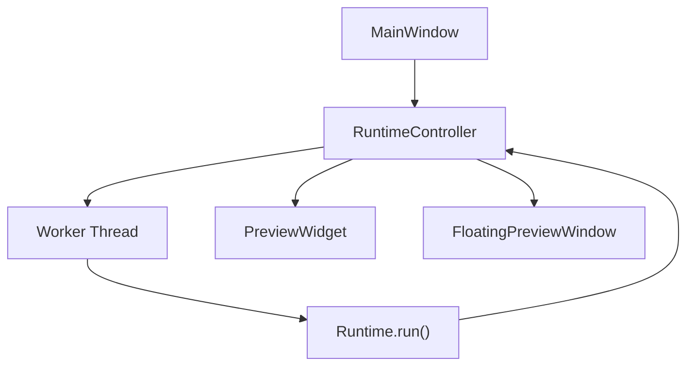

# UI View

## 1. Overview

The UI layer is a PySide6 desktop surface for controlling runtime lifecycle and viewing
live inference output. It is intentionally separated from pipeline internals.

Primary responsibilities:
- start/stop runtime execution
- surface status and runtime errors
- render preview frames in-window or detached floating mode

## 2. Current Module Inventory

```text
src/maestro/app/ui/
├── app_ui.py            # QApplication bootstrap + top-level launch
├── controller.py        # RuntimeController + worker-thread runtime bridge
├── main_window.py       # MainWindow controls, status, and layout wiring
├── preview_widget.py    # Widget that renders runtime preview frames
├── floating_preview.py  # Detached preview window management
└── cli_preview.py       # Lightweight preview window used by CLI preview mode
```

This is the authoritative UI module set. Legacy panel modules are not part of the codebase.

## 3. Runtime Integration

- `RuntimeController` owns a worker thread for runtime execution.
- UI widgets receive state updates through Qt signals.
- Runtime stays UI-agnostic; UI integration is callback/signal based.



## 4. Threading Model

- Main thread: Qt event loop + all widgets/windows.
- Worker thread: runtime loop and frame processing.
- Communication: queued Qt signals to avoid shared mutable UI state.

## 5. Entry Points

- `scripts/run_ui.py`: full UI workflow.
- `scripts/run_realtime.py`: runtime-first flow; can use preview helper path when configured.

## 6. Constraints

- No PySide6 imports in core runtime pipeline modules.
- UI modules should not embed gesture classification logic.
- All model and pipeline construction is delegated to app bootstrap/runtime layers.
