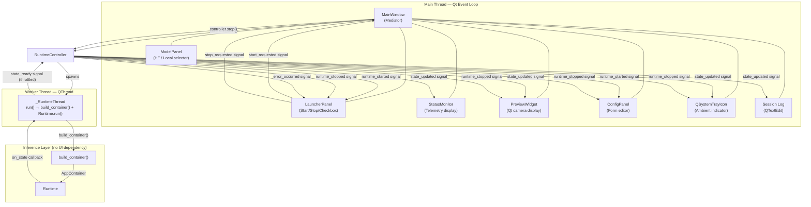
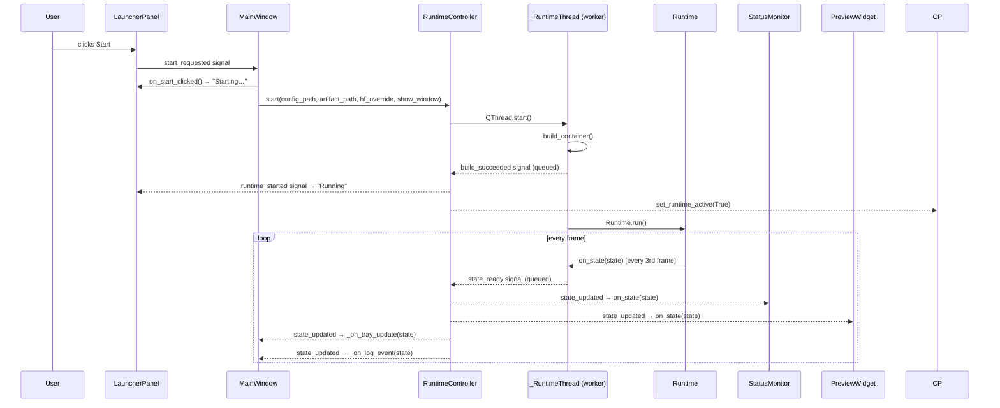
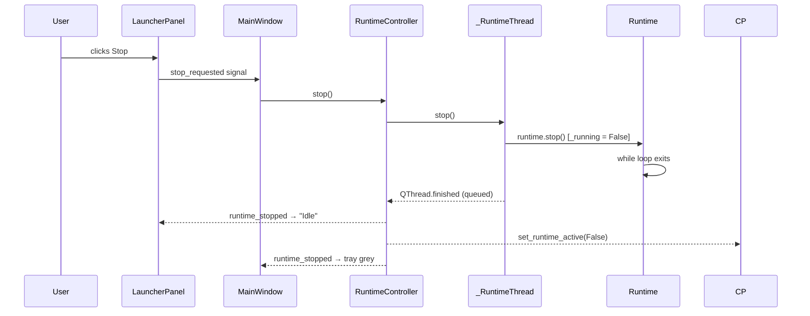
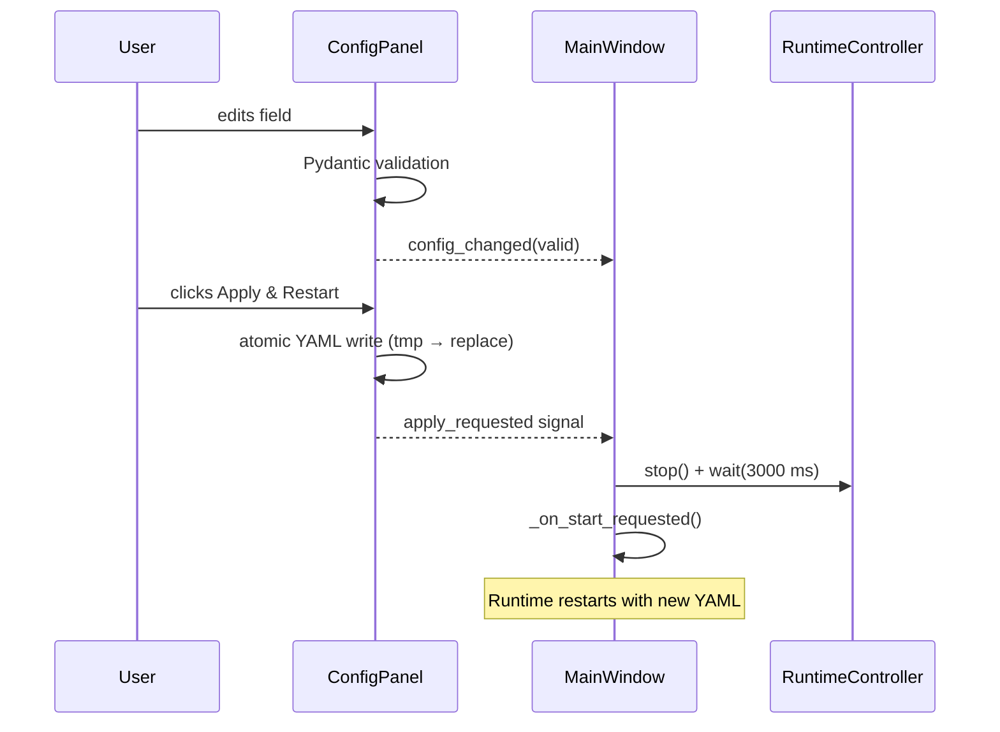

# UI View

## 1. Overview

### 1.1 Purpose

The UI layer provides a graphical control surface for Maestro. Its
responsibilities are confined to three concerns:

- **Lifecycle management**: starting and stopping the inference runtime.
- **Configuration editing**: presenting `AppConfig` and `InferenceConfig` fields as an editable
  form with live Pydantic validation, and writing validated YAML only after the runtime stops.
- **State observation**: displaying per-frame telemetry (`RuntimeState`) and dispatched gesture
  events via signal-driven widgets and a system tray icon.

The UI is explicitly not part of the inference pipeline. It never reads from or writes to any
pipeline component during a running session. All interaction with the runtime is mediated through
a single controller object.

### 1.2 Design Goals

| Goal                        | Mechanism                                                                |
| --------------------------- | ------------------------------------------------------------------------ |
| Non-blocking inference loop | `Runtime.run()` executes in a `QThread` worker; Qt event loop in main    |
| Thread-safe state delivery  | Qt queued signal connections; no shared mutable state in the hot path    |
| Configuration safety        | YAML written only when runtime is stopped; Pydantic validates all drafts |
| Minimal inference coupling  | One optional `on_state` callback parameter added to `Runtime.__init__`   |
| Ambient feedback            | `QSystemTrayIcon` with colour-coded icons; visible when window minimised |
| Single deployment unit      | PySide6 native; no web server, port, or browser dependency               |

### 1.3 Entry Points

| Script                    | Purpose                                              |
| ------------------------- | ---------------------------------------------------- |
| `scripts/run_ui.py`       | Qt GUI entry point — launches `run_ui()` from app_ui |
| `scripts/run_realtime.py` | CLI-only entry point — no PySide6 import; unchanged  |

The inference CLI path (`run_realtime.py` → `app/main.py`) never imports PySide6. The two
entry points are completely isolated at the import boundary.

### 1.4 Layout Overview

The application uses a two-pane splitter layout: a fixed-width sidebar (Control + Runtime
telemetry) and an expanding content pane (Camera Preview + Settings tabs + Session Log).


*Figure 1 — Idle state. The sidebar contains the runtime control and live telemetry. The content
pane holds the camera preview area (collapsed when no preview is active), the tabbed settings
editor, and the session log.*

---

## 2. Architectural Design

### 2.1 Pattern

The UI layer follows an **event-driven, signal-slot architecture** on top of Qt's queued
connection mechanism. The pattern maps cleanly to the system's existing structure:

- `Runtime` is a pure computation object with no UI dependency.
- `RuntimeController` acts as the **presenter**: it owns the worker thread, translates lifecycle
  events into Qt signals, and throttles state delivery.
- Panels are **passive views**: they receive signals and emit user-intent signals; they never
  call into the runtime or controller directly.
- `MainWindow` acts as the **mediator**: it wires signals between panels and the controller
  without exposing either side to the other.

### 2.2 Layer Diagram



### 2.3 Package Structure

```
src/maestro/app/
├── bootstrap.py          # Composition root — wires all dependencies
├── runtime.py            # Inference loop — on_state callback, no cv2.imshow
├── main.py               # CLI entry point — Qt preview or headless path
└── ui/
    ├── __init__.py
    ├── app_ui.py          # run_ui() — QApplication bootstrap
    ├── controller.py      # RuntimeController + _RuntimeThread
    ├── main_window.py     # MainWindow — QSplitter layout, mediator, signal router
    ├── launcher_panel.py  # Start/Stop button + status chip + preview checkbox
    ├── status_monitor.py  # Per-frame telemetry — Runtime + Performance groups
    ├── preview_widget.py  # Qt-native camera display — converts RuntimeState.preview_frame
    ├── cli_preview.py     # Minimal Qt window for CLI preview mode
    ├── config_panel.py    # Pydantic-driven config form
    └── model_panel.py     # HF / Local model source selector
```

**Dependency rule enforced by implementation**: No file outside `app/ui/` imports from
`app/ui/`. `app/runtime.py` and `app/main.py` contain no PySide6 imports.

---

## 3. Thread-Safety and Concurrency Model

### 3.1 Threading Architecture

```
┌─────────────────────────────────────────────────────────────┐
│  Main Thread                                                │
│  QApplication.exec() — Qt event loop                        │
│  Owns: MainWindow, all panels, RuntimeController            │
└────────────────────┬────────────────────────────────────────┘
                     │ QThread.start()
                     ▼
┌─────────────────────────────────────────────────────────────┐
│  Worker Thread (_RuntimeThread)                             │
│  Executes: build_container() → Runtime.run()                │
│  Owns: Runtime instance, frame counter                      │
│  Emits: state_ready, build_succeeded, error_emitted         │
└────────────────────┬────────────────────────────────────────┘
                     │ on_state callback (in worker thread)
                     ▼
┌─────────────────────────────────────────────────────────────┐
│  Runtime.run() inference loop                               │
│  Calls self._on_state(state) every frame                    │
│  on_state → _RuntimeThread._handle_state() → emit signal    │
└─────────────────────────────────────────────────────────────┘
```

The two threads share **no mutable state** except:

- `Runtime._running` — a single `bool` set by `Runtime.stop()`. Under the Python GIL, a
  single boolean write is atomic. No lock is required.
- `_RuntimeThread._runtime` — written once in `run()` before `stop()` is ever called;
  the reference is published to the main thread only via the Qt signal-slot mechanism.

### 3.2 Signal Delivery

Qt's queued connection delivers every emitted signal through the receiving thread's event queue.
When the worker thread emits `state_ready.emit(state)`, the `RuntimeState` object is placed in
the main thread's event queue and processed during the next event-loop iteration. No locking,
no polling, no `Queue.get()`.

All cross-thread signal connections in `RuntimeController.start()` use the default auto
connection, which Qt automatically promotes to a queued connection when source and destination
are in different threads.

### 3.3 State Throttling

`Runtime.run()` calls `on_state` on every frame (30 Hz). The `_RuntimeThread._handle_state`
method maintains a private frame counter and emits `state_ready` only every `emit_every` frames
(default 3). This caps UI update traffic at approximately 10 Hz, preventing signal flooding
while preserving interactive responsiveness.

The frame counter is private to the worker thread; no synchronization is needed to read or
increment it.

### 3.4 Shutdown Sequence

```
User clicks Stop (or closeEvent fires)
    │
    ▼
RuntimeController.stop()
    │
    └─→ _RuntimeThread.stop()
            │
            └─→ Runtime.stop()          ← sets _running = False (GIL-safe)
                        │
                        ▼
                Runtime.run() while loop exits on next iteration
                        │
                        ▼
                _RuntimeThread.run() returns
                        │
                        ▼
                QThread.finished emitted (worker thread)
                        │
                        ▼ queued connection
                RuntimeController.runtime_stopped emitted (main thread)
                        │
                        ▼
                LauncherPanel, ConfigPanel, tray icon updated
```

`RuntimeController.wait(timeout_ms)` is available for deterministic teardown in `closeEvent`
and test fixtures. It blocks the main thread until the worker exits or the timeout elapses.

---

## 4. Integration with the Inference Pipeline

### 4.1 Change Surface

The only modification to pre-existing inference code is a single optional constructor parameter
in `Runtime`:

```python
class Runtime:
    def __init__(
        self,
        container: RuntimeDependencies,
        on_state: Callable[[RuntimeState], None] | None = None,
    ) -> None:
```

When `on_state` is `None` (the CLI path), `Runtime` behaves identically to its pre-UI
implementation. No inference-path code was changed to support the UI.

### 4.2 RuntimeState as the UI Data Contract

`RuntimeState` is produced per-frame by `Runtime.run()` and is the sole data type crossing the
thread boundary. It is a frozen dataclass defined in `domain/entities.py` and carries all
information the UI requires:

| Field                      | Type          | Consumer               |
| -------------------------- | ------------- | ---------------------- |
| `mode`                     | `str`         | StatusMonitor, tray    |
| `gaze_permitted`           | `bool`        | StatusMonitor, tray    |
| `last_label`               | `str \| None` | StatusMonitor, log     |
| `last_confidence`          | `float`       | StatusMonitor          |
| `info["fps"]`              | `float`       | StatusMonitor          |
| `info["latency_e2e_ms"]`   | `float`       | StatusMonitor          |
| `info["latency_infer_ms"]` | `float`       | StatusMonitor          |
| `info["valid_ratio"]`      | `float`       | StatusMonitor          |
| `info["accepted"]`         | `bool`        | Tray notification, log |

The UI never queries any pipeline object directly. All telemetry arrives through `state_updated`.

### 4.3 Container Construction

`build_container()` is invoked once per session start, inside the worker thread. It reads YAML
configs, validates them via Pydantic, downloads or loads the model artifact, and opens the
webcam. This operation takes approximately 2–5 seconds and is intentionally not called from the
main thread. The `build_succeeded` signal notifies the UI when construction completes, at which
point the launcher transitions from "Starting…" to "Running".

### 4.4 Camera Preview Delivery

Camera preview is delivered entirely through the Qt signal-slot mechanism; `cv2.imshow` is not
used anywhere in the codebase.

When the user enables "Show camera preview", `bootstrap.py` instantiates `OverlayRenderer`
with `output_rgb=True`. The rendered frame is attached to `RuntimeState.preview_frame` (an RGB
`numpy` array) inside `Runtime.run()`, immediately after overlay drawing, on every frame where
`container.show_window` is `True`.

`RuntimeController` delivers the state to the main thread via the `state_updated` queued
signal. `PreviewWidget.on_state()` — running on the main thread — reads `preview_frame`,
constructs a `QImage(Format_RGB888)`, scales it to at most 480 px wide, and sets it as a
`QPixmap` on the label. No copy of the frame is made; no locking is required because the worker
thread never mutates the frame after attaching it to the state object.

`PreviewWidget` starts hidden and becomes visible on the first non-`None` frame; it collapses
again when `runtime_stopped` fires. The "Show camera preview" checkbox in `LauncherPanel`
defaults to unchecked; preview is opt-in.

---

## 5. Component Breakdown

### 5.1 `app_ui.py` — Application Bootstrap

```
run_ui(config_path: str = "configs") → int
```

Creates or reuses the `QApplication` singleton, instantiates `MainWindow`, calls `window.show()`,
and enters the Qt event loop with `app.exec()`. Returns the exit code. This is the only
function called from `scripts/run_ui.py`.

### 5.2 `controller.py` — RuntimeController and \_RuntimeThread

**`_RuntimeThread(QThread)`** — private worker:

| Signal            | Emitted When                                     |
| ----------------- | ------------------------------------------------ |
| `state_ready`     | Every `emit_every` frames during `Runtime.run()` |
| `build_succeeded` | `build_container()` returned successfully        |
| `error_emitted`   | Unhandled exception in `run()`                   |

The thread owns the `Runtime` reference. It is constructed with all session parameters
(`config_path`, `artifact_path`, `hf_revision_override`, `show_window`, `emit_every`) and
does not accept changes after `start()`.

**`RuntimeController(QObject)`** — public bridge:

| Signal            | Emitted When                                         |
| ----------------- | ---------------------------------------------------- |
| `state_updated`   | Forwarded from `_RuntimeThread.state_ready`          |
| `runtime_started` | Forwarded from `_RuntimeThread.build_succeeded`      |
| `runtime_stopped` | `_RuntimeThread.finished` (QThread lifecycle signal) |
| `error_occurred`  | Forwarded from `_RuntimeThread.error_emitted`        |

Public methods: `start()`, `stop()`, `wait()`, `is_running`.

`start()` is a no-op if a thread is already running. `stop()` is a no-op if no thread is live.
Both are safe to call from the main thread at any time.

### 5.3 `main_window.py` — MainWindow

`MainWindow(QMainWindow)` is the composition root of the UI layer. It:

- Instantiates all panels and `RuntimeController`.
- Pre-populates `ModelPanel` from `model_source.yaml` if available.
- Wires all signals between panels and the controller.
- Owns the `QSystemTrayIcon` and session log `QTextEdit`.
- Implements minimize-to-tray via `changeEvent` override.
- Implements graceful shutdown via `closeEvent` override (stops runtime before closing).

`MainWindow` does not contain any domain or pipeline logic. All business decisions are
delegated to `RuntimeController` and the panel signals.

**Layout**: a `QSplitter(Horizontal)` divides the window into two non-collapsible panes:

- *Sidebar* (fixed, 240 px) — app identity header, `LauncherPanel` inside a Control `QGroupBox`,
  `StatusMonitor`.
- *Content pane* (expanding) — Camera Preview `QGroupBox` containing `PreviewWidget`, a
  `QTabWidget` holding `ConfigPanel` ("Configuration" tab) and `ModelPanel` ("Model Source"
  tab), and the session log.

**Tray icon colour convention**:

| Colour | Hex       | Meaning                               |
| ------ | --------- | ------------------------------------- |
| Grey   | `#6B7280` | Runtime stopped or gaze absent        |
| Green  | `#059669` | Runtime running, gaze active          |
| Amber  | `#D97706` | Gesture accepted / command dispatched |

A brief amber flash (300 ms) followed by a return to green accompanies each dispatched command.
Tray notifications display the dispatched gesture label for 800 ms.

**Session log**: A read-only `QTextEdit` (fixed height 110 px, monospace font) appends
timestamped entries on mode transitions and dispatched commands. It never receives raw telemetry
values — only state-change events derived from `RuntimeState`.

### 5.4 `launcher_panel.py` — LauncherPanel

`LauncherPanel(QWidget)` presents a vertical layout: a status chip (10 px coloured dot +
bold coloured text label), a full-width primary action button, and an opt-in
"Show camera preview" checkbox.

| System State | Button Label    | Chip Colour |
| ------------ | --------------- | ----------- |
| `idle`       | Start Session   | Grey        |
| `building`   | Starting…       | Amber       |
| `running`    | Stop Session    | Green       |
| `error`      | Retry           | Red         |

State transitions are driven by slots (`on_runtime_started`, `on_runtime_stopped`, `on_error`,
`on_start_clicked`) connected from `MainWindow`. The panel emits `start_requested` and
`stop_requested` signals; it never calls `RuntimeController` directly.

The `show_window` property reads the checkbox state and is consumed by `MainWindow._on_start_requested()`.

### 5.5 `status_monitor.py` — StatusMonitor

`StatusMonitor(QWidget)` subscribes to `RuntimeController.state_updated` via its
`on_state(RuntimeState)` slot. Fields are grouped into two `QGroupBox` sections:

**Runtime group**:

| Row        | Widget         | Source                        |
| ---------- | -------------- | ----------------------------- |
| Mode       | `QLabel`       | `state.mode.upper()`          |
| Gaze       | `QLabel`       | `state.gaze_permitted`        |
| Gesture    | `QLabel`       | `state.last_label`            |
| Confidence | `QProgressBar` | `state.last_confidence × 100` |

The Gaze label switches `objectName` between `gazeActive` and `gazeAbsent` on each update;
the application stylesheet maps these names to green and grey text respectively.

**Performance group**:

| Row        | Widget   | Source                                            |
| ---------- | -------- | ------------------------------------------------- |
| FPS        | `QLabel` | `state.info["fps"]`                               |
| Latency    | `QLabel` | `state.info["latency_e2e_ms"] / latency_infer_ms` |
| Valid ratio | `QLabel` | `state.info["valid_ratio"]`                      |

Latency is displayed as a single combined value (`e2e ms / infer ms`).

The widget contains no state beyond what Qt widget internals require. It never calls into the
runtime or stores `RuntimeState` objects.

### 5.6 `config_panel.py` — ConfigPanel

`ConfigPanel(QWidget)` generates a form from `AppConfig` and `InferenceConfig` Pydantic model
fields. Widget type is selected by field annotation:

| Annotation     | Widget           | Notes                                    |
| -------------- | ---------------- | ---------------------------------------- |
| `bool`         | `QCheckBox`      | Checked if default is `True`             |
| `int`          | `QSpinBox`       | `ge`/`le` constraints applied as min/max |
| `float`        | `QDoubleSpinBox` | `ge`/`le` constraints applied as min/max |
| `str`          | `QLineEdit`      |                                          |
| `Literal[...]` | `QComboBox`      | All literal values as selectable options |
| Nested/complex | Skipped          | `command_map`, `app_name`, `GazeConfig`  |

On every field-change event, the panel builds a draft dict from all widget values and attempts
`RuntimeConfig(**draft)` construction. If Pydantic raises `ValidationError`, the draft is
marked invalid and the Apply button is disabled. If valid and the runtime is stopped, Apply
is enabled.

The "Apply & Restart" button triggers `apply_requested`, which:

1. Writes the validated config to `configs/app.yaml` and `configs/inference.yaml` using atomic
   `.yaml.tmp` → `.replace(path)` writes (safe against partial-write corruption).
2. Signals `MainWindow._on_apply_requested()`, which stops the runtime, waits for the worker
   to exit, and calls `_on_start_requested()` to restart with the new config.

YAML files are **never** written while `_runtime_active` is `True`.

Signals emitted: `config_changed(bool)` on every validation cycle, `apply_requested` on click.

### 5.7 `model_panel.py` — ModelPanel

`ModelPanel(QWidget)` presents two tabs backed by a `QTabWidget`:

**Tab 0 — Hugging Face**: `repo_id`, `revision`, and `filename` `QLineEdit` fields, pre-populated
from `model_source.yaml` via `ModelSourceConfig`. Revision is passed as `hf_revision_override`
to `RuntimeController.start()`; an empty string is treated as `None` (use the default revision).

**Tab 1 — Local Artifact**: A file label and "Browse…" button open a `QFileDialog` filtered to
`.pt` / `.pth` files. The selected path is passed as `artifact_path` to `RuntimeController.start()`.

When the Hugging Face tab is active, `artifact_path()` returns `None` (HF download path used by
bootstrap). When the Local tab is active, `hf_revision_override()` returns `None`.

### 5.8 `preview_widget.py` — PreviewWidget

`PreviewWidget(QLabel)` is the Qt-native camera display, used by both `MainWindow` and
`CLIPreviewWindow`.

On each `on_state(RuntimeState)` call:

1. Reads `state.preview_frame` — an RGB `numpy` array produced by `OverlayRenderer` with
   `output_rgb=True`. Returns immediately if the field is `None`.
2. Wraps the array bytes in a `QImage(Format_RGB888)` with no channel copy.
3. Scales the resulting `QPixmap` to at most 480 px wide (aspect ratio preserved).
4. Sets the pixmap on the label and calls `show()` on the first non-`None` frame.

The widget starts hidden; it collapses when `runtime_stopped` calls `hide()`.

Thread safety is guaranteed by the Qt queued connection: `on_state` always executes on the
main thread regardless of which thread emits `state_updated`.

### 5.9 `cli_preview.py` — CLIPreviewWindow

`CLIPreviewWindow(QMainWindow)` provides a minimal Qt window for the CLI preview path
(`scripts/run_realtime.py` with the display enabled). It owns a `RuntimeController` and a
`PreviewWidget`, wired with the same signal connections used in `MainWindow`.

Entry from `app/main.py` (display path):

```python
app = QApplication.instance() or QApplication(sys.argv)
window = CLIPreviewWindow()
window.show()
window.start(args.config, artifact_path=..., hf_revision_override=...)
sys.exit(app.exec())
```

Key bindings: **Q** or **Escape** stops the session and closes the window.
`closeEvent` stops the runtime and waits up to 5 000 ms for the worker thread to exit.

---

## 6. Data Flow

### 6.1 Start Session Data Flow



### 6.2 Stop Session Data Flow



### 6.3 Config Apply Data Flow



---

## 7. Design Decisions and Trade-offs

### 7.1 PySide6 over Alternatives

| Option                     | Reason Rejected                                          |
| -------------------------- | -------------------------------------------------------- |
| FastAPI + browser frontend | HTTP stack, port conflicts, Node dependency, IPC latency |
| Tkinter                    | Poor widget quality, no system tray support              |
| Electron / Tauri           | Heavy runtime, complex deployment                        |
| **PySide6 (selected)**     | Native, zero-IPC, cross-platform, system tray support    |

### 7.2 `QThread` over `threading.Thread`

Qt's `QThread` integrates directly with the signal-slot system. Signals emitted from a `QThread`
are automatically delivered to the main thread via Qt's event queue, without any explicit locking
or `Queue`. `threading.Thread` would require a manual thread-safe queue and a polling timer.

### 7.3 Worker Thread owns `Runtime`, not `RuntimeController`

`RuntimeController` lives in the main thread. If it owned `Runtime`, calling `run()` would
block the event loop. Moving `Runtime` into `_RuntimeThread.run()` is the only correct placement.

### 7.4 Throttled State Emission

`Runtime.run()` runs at 30 Hz; emitting a Qt signal every frame would post 30 cross-thread
deliveries per second, each incurring event-queue overhead. The 3-frame throttle caps UI signal
traffic at ~10 Hz with negligible impact on perceived responsiveness.

### 7.5 No In-Session Config Mutation

The config form is locked (`set_runtime_active(True)`) while the runtime is active. YAML files
are written only after the runtime stops. This eliminates the risk of `build_container()` reading
a partially-written config and avoids the need for a live config hot-reload mechanism.

### 7.6 Minimize-to-Tray

`changeEvent` intercepts `WindowStateChange` when `isMinimized()` is true, hides the window
(`self.hide()`), and ignores the event. Left-clicking the tray icon calls `show()`, `raise_()`,
and `activateWindow()`. This keeps the runtime alive with no open windows, providing ambient
gesture feedback via the tray icon without requiring the user to keep the control panel in focus.

### 7.7 Atomic YAML Writes

The `ConfigPanel._safe_write()` method writes to a `.yaml.tmp` sibling file and atomically
renames it over the target. On POSIX systems, `Path.replace()` is guaranteed atomic at the
filesystem level. This prevents config file corruption if the process is killed mid-write.

---

## 8. Configuration and Deployment

### 8.1 Dependencies

PySide6 is declared in the `dev` optional extra of `pyproject.toml` (alongside `pytest-qt`).
To run the UI:

```bash
pip install -e ".[dev,training,huggingface]"
python scripts/run_ui.py
```

### 8.2 CI Guard

`tests/conftest.py` includes a collection guard that skips all `test_ui_*` files when PySide6
is not importable. This allows the standard CI pipeline (which runs without a display server) to
collect and execute all non-UI tests without modification.

### 8.3 Test Coverage

| Test file                       | Scope                                               | Count |
| ------------------------------- | --------------------------------------------------- | ----- |
| `test_ui_runtime_on_state.py`   | `on_state` callback integration in `Runtime`        | 5     |
| `test_ui_runtime_controller.py` | `RuntimeController` signal contract and lifecycle   | 6     |
| `test_ui_launcher_panel.py`     | `LauncherPanel` state machine and signals           | 8     |
| `test_ui_status_monitor.py`     | `StatusMonitor` field rendering from `RuntimeState` | 6     |
| `test_ui_config_panel.py`       | Form validation, apply-button gating, atomic write  | 6     |
| `test_ui_model_panel.py`        | HF / Local tab switching and path accessors         | 6     |
| `test_ui_tray.py`               | System tray creation and `show_window` checkbox     | 4     |

---

**Document**: UI View  
**Suite**: Architecture Documentation (`docs/architecture/`)  
**Last Updated**: April 2026
