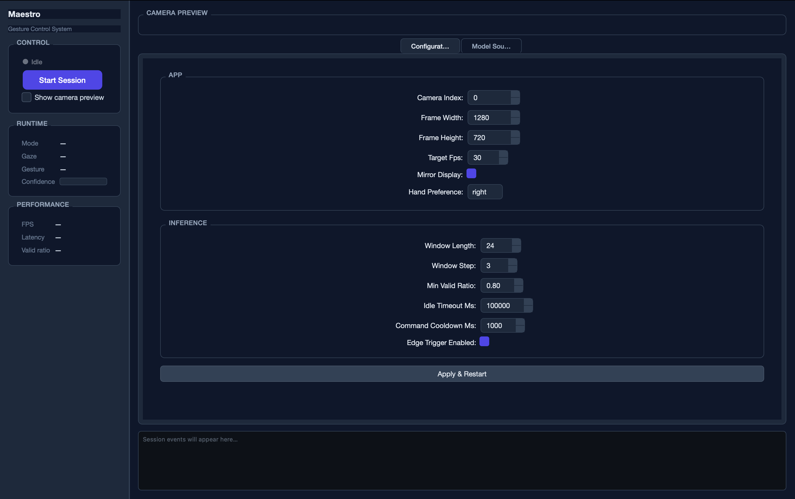

# Documentation Assets

This directory contains static assets referenced by project documentation.

## Directory Structure

```
docs/assets/
└── screenshots/       # Captured UI states for README and architecture docs
    ├── ui-idle.png              # Application in idle state (no session running)
    ├── ui-running-preview.png   # Active session with camera preview enabled
    └── ui-running-monitor.png   # Active session showing telemetry and session log
```

## Screenshot Conventions

### Naming

Screenshots follow the pattern `<scope>-<state>[--<variant>].png`:

| Segment   | Purpose                                            | Examples                                 |
| --------- | -------------------------------------------------- | ---------------------------------------- |
| `scope`   | The surface or component being captured            | `ui`, `cli`, `config`, `tray`            |
| `state`   | The application or component state at capture time | `idle`, `running`, `error`, `building`   |
| `variant` | Optional disambiguator when multiple shots exist   | `--preview`, `--monitor`, `--detail`     |

Examples: `ui-running--preview.png`, `config-validation-error.png`.

### Capture Guidelines

- **Resolution**: capture at 1× pixel density (no Retina scaling). Target a window width of
  approximately 1 400 px so text is legible without zooming.
- **Content**: use realistic but non-personal data. Blur or mask any identifiable faces or
  screen content visible through the camera preview before committing.
- **State**: ensure the application is in a stable, representative state — avoid capturing
  transient animations or partial loads.
- **Format**: PNG only. Do not commit JPEGs or WebP; lossless compression preserves UI text
  legibility.
- **File size**: compress with `pngcrush` or `oxipng` before committing. Target ≤ 500 KB per
  screenshot.

### Referencing Assets in Markdown

Use paths relative to the Markdown file that contains the reference:

```markdown
<!-- From docs/architecture/ui-view.md (two levels up from docs/assets/) -->


<!-- From README.md (repo root, one level up from docs/) -->

```

Always supply descriptive alt text. Alt text should describe what the screenshot conveys, not
just its filename: `"Idle state — sidebar showing Start Session button"`, not `"screenshot"`.

### Updating Screenshots

Replace a screenshot when:

- A visible UI element (label text, layout, colour) has changed in code.
- A new panel or feature has been added to the surface captured.

Do **not** update a screenshot for purely cosmetic OS-level differences (window chrome,
cursor position, font rendering). Keep the asset stable unless the UI change is substantive.

When replacing, overwrite the existing file with the same name so existing Markdown references
remain valid without edits.
